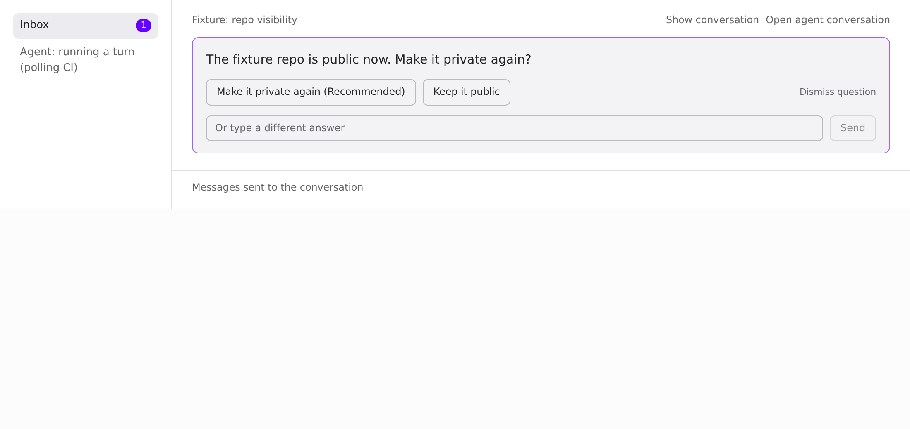
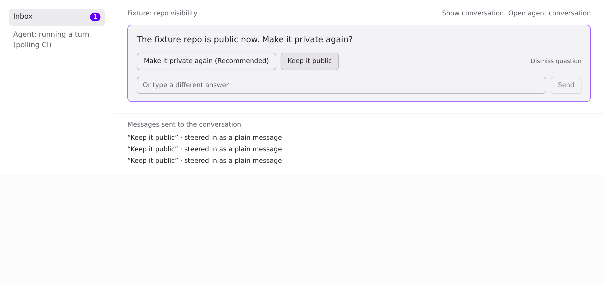
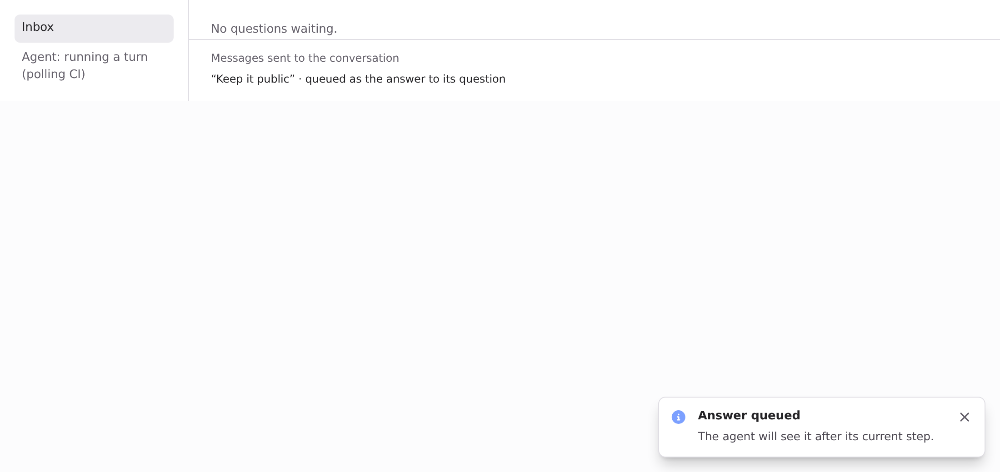

## Summary

Answering an Inbox question while its agent was busy sent the choice as a steer and dropped the question id. Each click became a plain user message ("Keep it public" ×3), the question stayed open, the card stayed clickable, and the Inbox badge stayed at 1.

**Root cause.** The Inbox reader card (`views/inbox/DecisionCards.tsx`) answers through the hidden panel composer. While a turn runs, `routeSend` turns any send into a steer and drops `decisionReplyTo`. That skipped `answeringInbox` (#1218), so the card never left. Nothing on the backend stopped a second answer either.

## Changes

- **Desktop routing.** A reply from a surface that only answers questions (the Inbox and the input queue, i.e. any panel without the main chat's "Replying to" chip) waits behind the running turn with its question and never steers. The main chat chip steers as before (`sendRouting.test.ts` keeps that).
- **Desktop feedback.** The card leaves the Inbox and the badge clears at once, as in #1218. An answer queued behind a running turn shows a toast: "Answer queued. The agent will see it after its current step." If the send fails, the card comes back with "Could not send your answer". A repeated click before the send goes out sends nothing.
- **Backend: one answer per question** (@yuaanlin, this is A3, please check). `admitQueueableChat` holds the question for the accepted message (`inputRequests.$.answerQueued = messageId`, an atomic conditional update). A second answer from another message gets **409 `decision_already_answered`**, and so does an answer to a question that is already answered or dismissed. Resending the same message id still works. A question the conversation doesn't list (older cards) is left to the turn, as before.
- **Backend: a queued answer clears the Inbox on every device.** The listing filter and `openInputRequests` skip held requests, so the badge stays at 0 while the answer waits in the queue. Taking the queued message back (`DELETE …/queue/:id`) releases the question. Steering it in resolves it. The question resolves when the turn runs, same as before.
- Locale keys are insert-only, 3 per locale, placed next to "Could not send your message".

The hold is server-side, on the decision record, so another device's badge agrees as well.

## Not changed

- iOS and Android don't have this gap. They show `request_user_decision` as a plain "Question" row with no option buttons and never send `decisionReplyTo`.
- In the main chat, the in-transcript `ChoiceCard` is already disabled while a turn runs.
- Known residual: if the hold is set and the session is reset (`clearPendingUserMessages`), the question stays hidden until the agent asks again.

## Tests

- `session-queue-turn.test.ts`: a repeated click or a second option after the first is refused with 409, and only one message is queued. Answering a resolved question is refused. An unlisted question is left alone.
- `pending-decision.test.ts`: a held request is not listed as open. Hold and release make the right conditional updates. The Inbox filter expectations are updated.
- `dispatchTurn.test.ts`: an answer to a busy agent clears the badge at once, says it is queued, and stays cleared under a listing that holds it.
- `sendRouting.test.ts`: an Inbox answer to a running turn is not steered and keeps its question.
- Run locally: desktop `src/**/*.test.ts` 1934/1934 and `tsc` clean. Backend `src/routes/agent` + `src/lib/agent`: 2137 pass, 2 fail. Both failures (`nuphos-plan semantic scripts`, `nuphos-api helper origin binding`) also fail on clean main in this sandbox. Import-cycle check ok.

## Visuals for 18745cd2

Captured at 18745cd2 (base 4b75f4cb), light theme, fixture data. The page is a fixture harness that mounts the real `DecisionCards`, `routeSend`, `answeringInbox`/badge count and toasts, with a busy agent. Before is upstream main, after is this branch. The script clicks "Keep it public" up to 3 times.

| | Before (main) | After (this PR) |
|---|---|---|
| Asked |  |  |
| After clicking "Keep it public" |  |  |

Before: 3 clicks, 3 plain messages, the card stays open and the badge stays at 1. After: the first click queues one answer with its question, the card leaves, the badge clears and the "Answer queued" toast shows. There was no card left for a second click.

🤖 Generated with [Claude Code](https://claude.com/claude-code)
