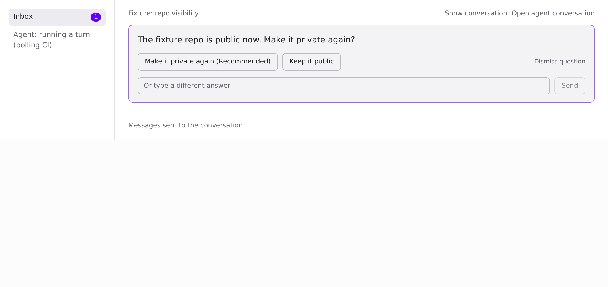
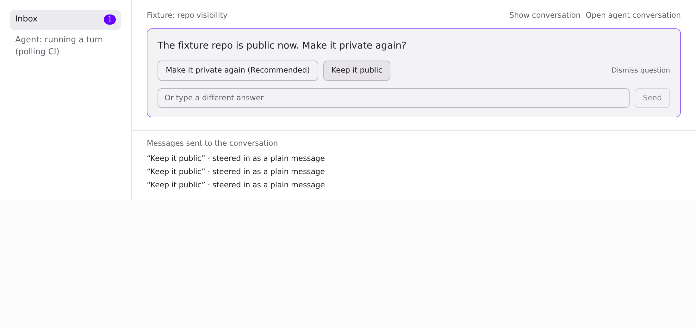
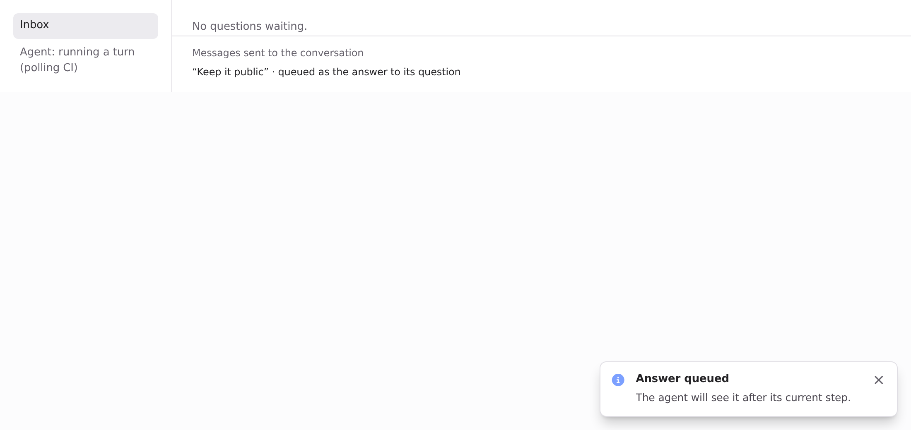

## Visuals for 18745cd2: the full set

Captured at 18745cd2 (base 4b75f4cb), light theme, fixture data. The page is a fixture harness that mounts the real `DecisionCards`, `routeSend`, `answeringInbox`/badge count and toasts, with a busy agent. Before is upstream main, after is this branch. The script clicks "Keep it public" up to 3 times.

| | Before (main) | After (this PR) |
|---|---|---|
| Asked |  |  |
| After clicking "Keep it public" |  |  |

Before: 3 clicks, 3 plain messages, the card stays open and the badge stays at 1. After: the first click queues one answer with its question, the card leaves, the badge clears and the "Answer queued" toast shows. There was no card left for a second click.

Range-diff: none. This is the first head.