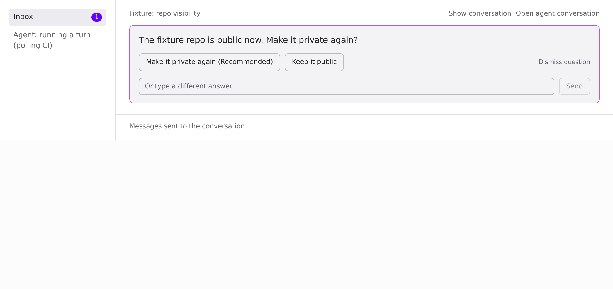
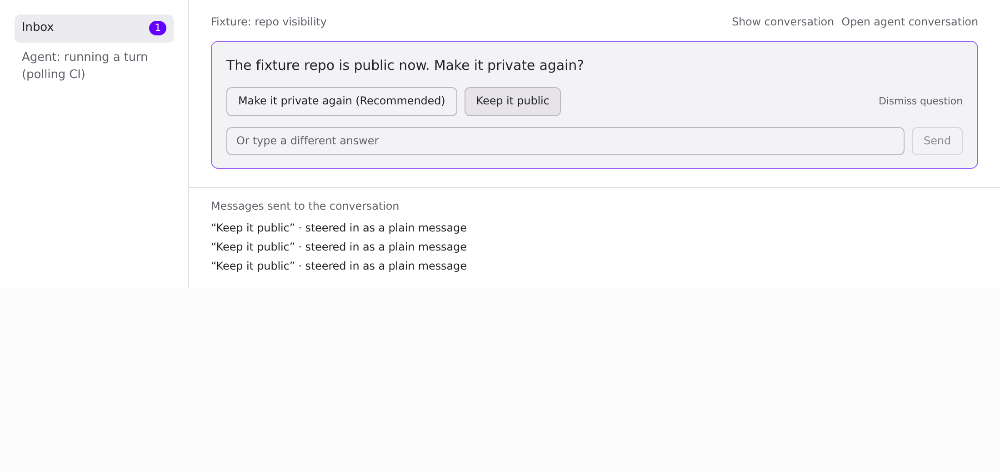
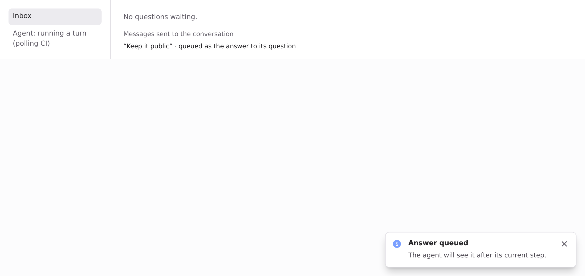

## Visuals for 521ad68f: the full set

Captured at 521ad68f (base 4b75f4cb), light theme, fixture data. The page is a fixture harness that mounts the real `DecisionCards`, `routeSend`, `answeringInbox`/badge count and toasts, with a busy agent. Before is main, after is this branch. The script clicks "Keep it public" up to 3 times.

| | Before (main) | After (this PR) |
|---|---|---|
| Asked |  |  |
| After clicking "Keep it public" |  |  |

Before: 3 clicks, 3 plain messages, the card stays open and the badge stays at 1. After: the first click queues one answer with its question, the card leaves, the badge clears and the "Answer queued" toast shows. There was no card left for a second click.

**Range-diff 18745cd2 → 521ad68f** (`git range-diff 4b75f4cb..18745cd2 4b75f4cb..521ad68f`): backend only. The stored `answerQueued` hold, `holdInputRequestAnswer`/`releaseInputRequestAnswer` and the Inbox filter change are gone, as asked in review and by @yuaanlin. A question now counts as answered while the session queue holds a message whose `chat.decisionReplyTo` is its id (`answeringIds`, applied by the list and detail serializers), and the 409 check reads the same queue. A failed enqueue, a take-back or a session reset now leaves the question answerable. That is tested in "an answer taken back, or never queued, leaves its question answerable". The desktop code is unchanged, so nothing visible changed. The images were re-captured at this head anyway.
