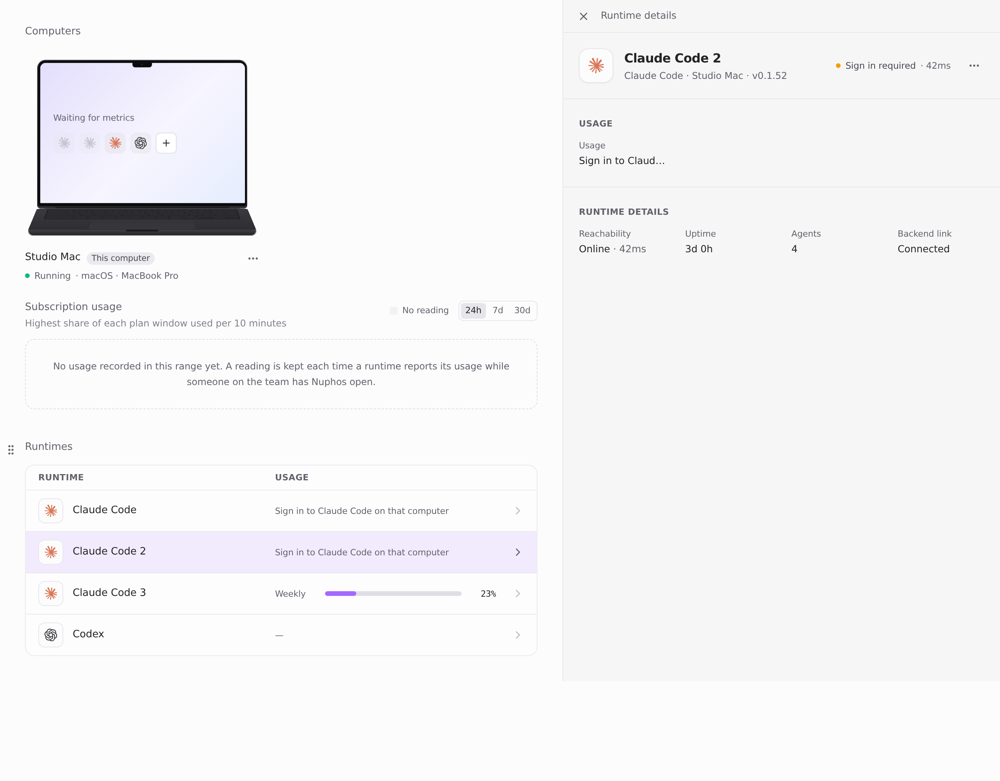
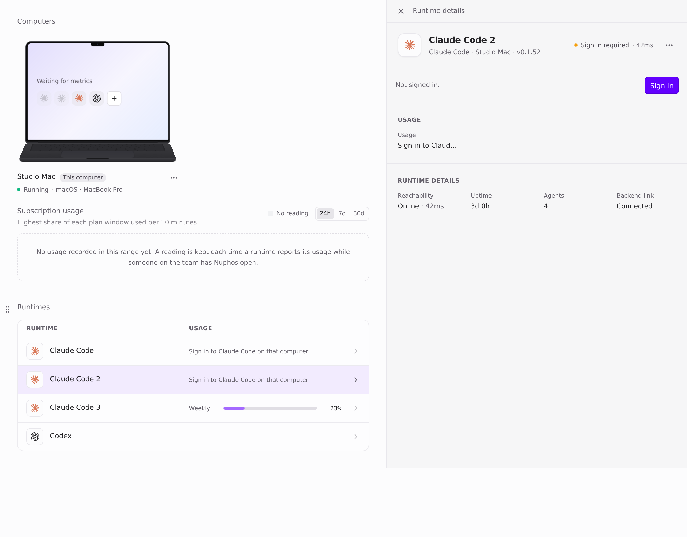
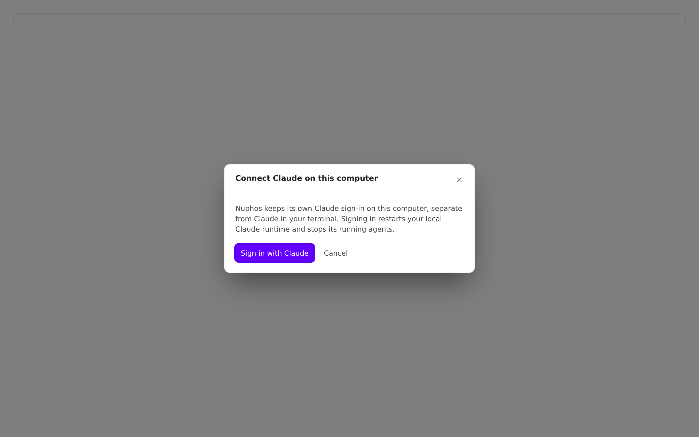
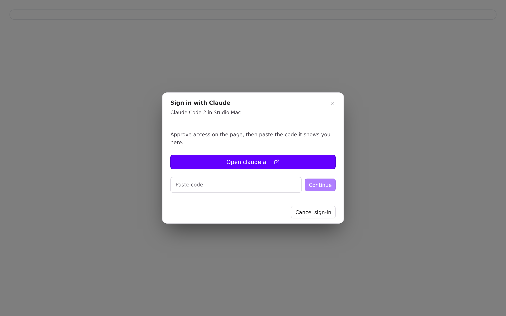
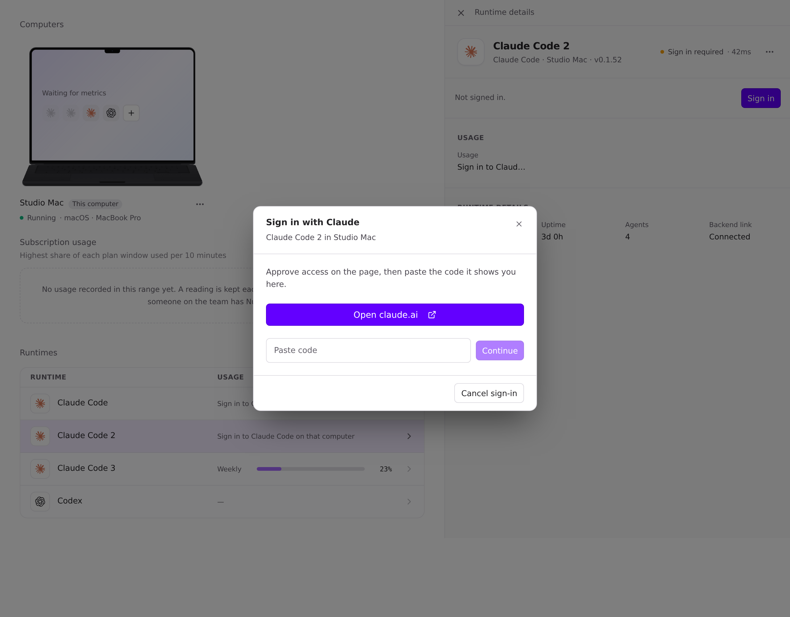

Part 1 of #1570. This is a plain bug fix with no schema change.

## Problem

An added runtime ("Claude Code 2", one with `local.instanceId`) keeps its own Claude login in its own config directory. When it is signed out on this computer:

- **Runtimes card:** no sign-in button at all. `thisComputerSignIn` returns nothing for `instanceId` runtimes, so adding yet another runtime looked like the only fix.
- **Composer picker and conversation card:** the "Sign in" chip opens the CLI login ("Connect Claude on this computer"). That signs in the computer's **default** runtime, not this one. `signInRoute` sends every runtime on this computer to the CLI.

## Fix

One rule in both places: on this computer, the **default** runtime signs in through its CLI, and an **added** runtime signs in through the runtime sign-in for that exact runtime (`RuntimeLoginDialog` → `POST /agent-runtimes/:runtimeId/login`). That is the same path Box runtimes already use.

- `thisComputerSignIn` returns `'runtime'` for a signed-out added runtime on this computer, and the card shows a primary **Sign in** button that opens `RuntimeLoginDialog` for it.
- `signInRoute` keeps the CLI route for the default runtime only, so the picker and conversation card open the dialog for an added runtime.

There are no new strings and no locale changes. It reuses `Sign in` and `Not signed in.`

## Before / after

Captured from the real components in a page-only harness at `main` (b2e72322) and this branch, with fixture data ("Studio Mac", user Alex) and the light theme. The fixture records which login each click starts.

| | Before | After |
| --- | --- | --- |
| Runtimes card, "Claude Code 2" selected |  No sign-in button |  **Sign in** (primary) |
| Picker: "Sign in" on "Claude Code 2" |  Default runtime's CLI login: started `cli:claude-code` |  This runtime's sign-in: started `runtime:local_user-alex_device-studio_claude-code_i2` |

The card's Sign in opens the same dialog for "Claude Code 2":

## Tests

- `agentPresentation.test.ts`: a signed-out added runtime on this computer returns `'runtime'` (any provider). Signed in, or on another computer, returns nothing.
- `agentSignInModel.test.ts`: an added runtime on this computer routes to the dialog, not the CLI.
- Both new assertions fail on `main` (2 failures) and pass here.
- `npm test` in `apps/desktop`: 2678/2682 pass. The one failing file is `electron/local-terminal.test.ts`, which fails the same way on `main` in my sandbox because `node-pty`'s native module isn't built there.
- `tsc -b --noEmit` passes, and eslint on the changed files reports no errors and no new warnings (21 before, 21 after).

🤖 Generated with [Claude Code](https://claude.com/claude-code)
