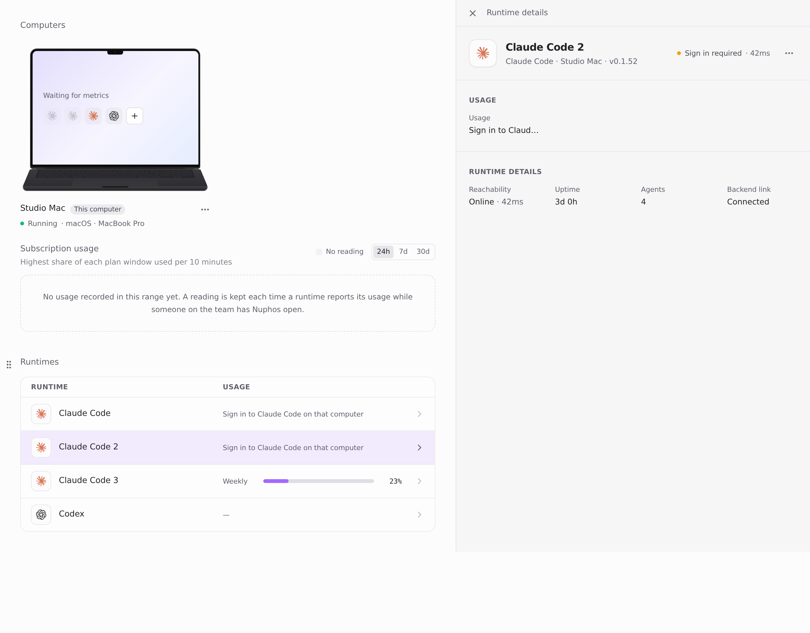
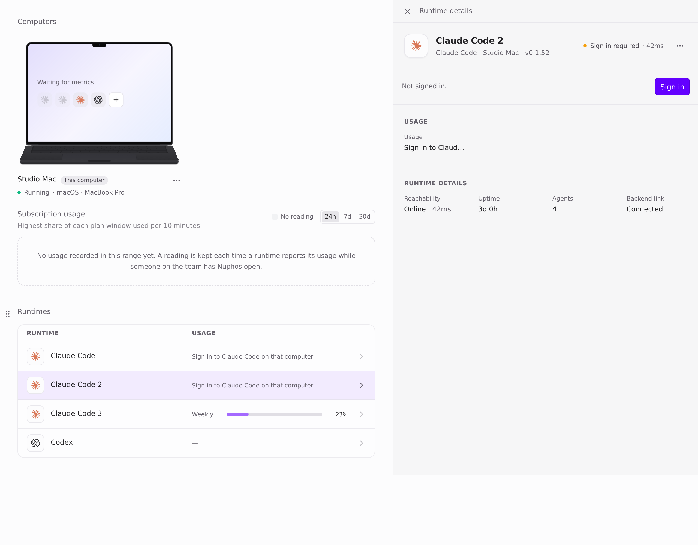
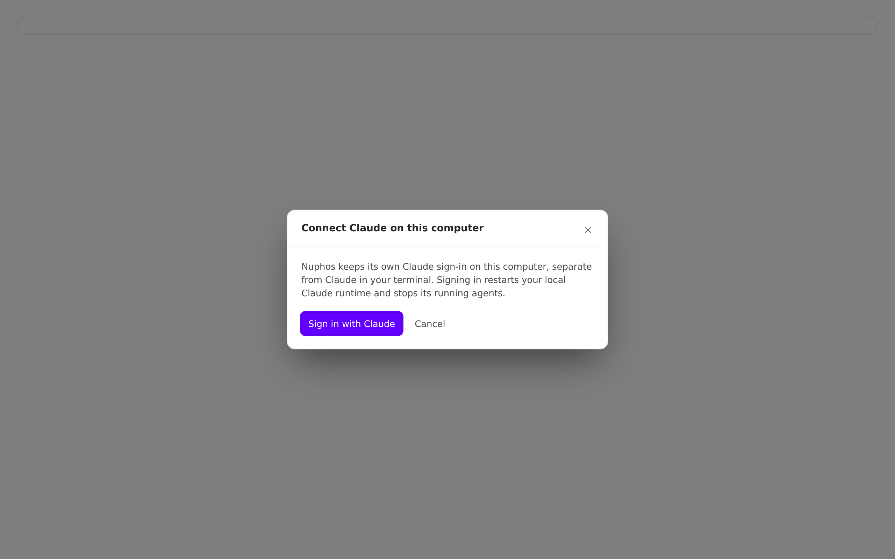
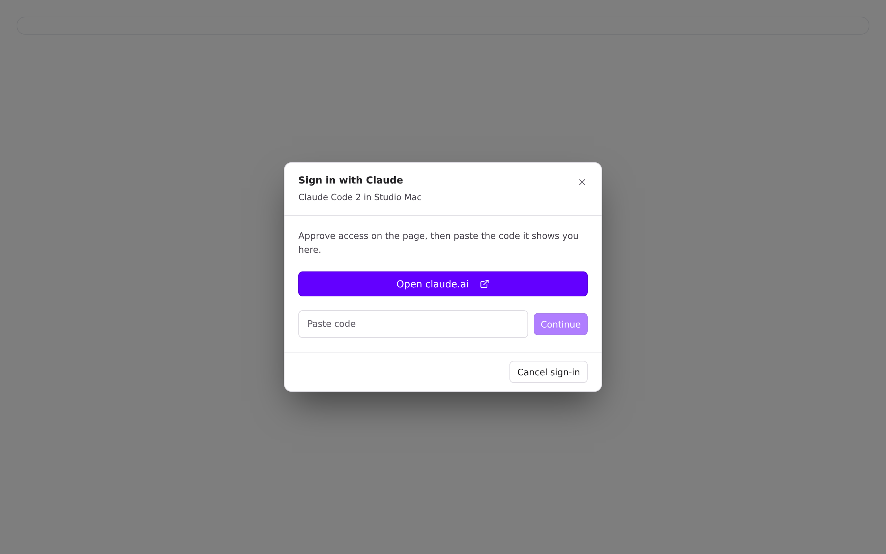
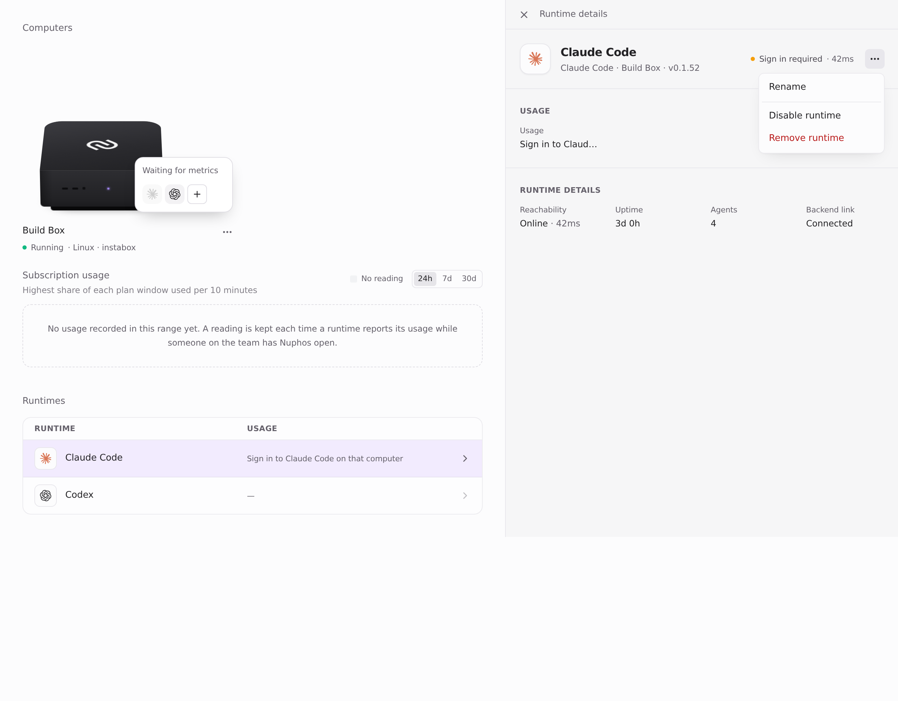
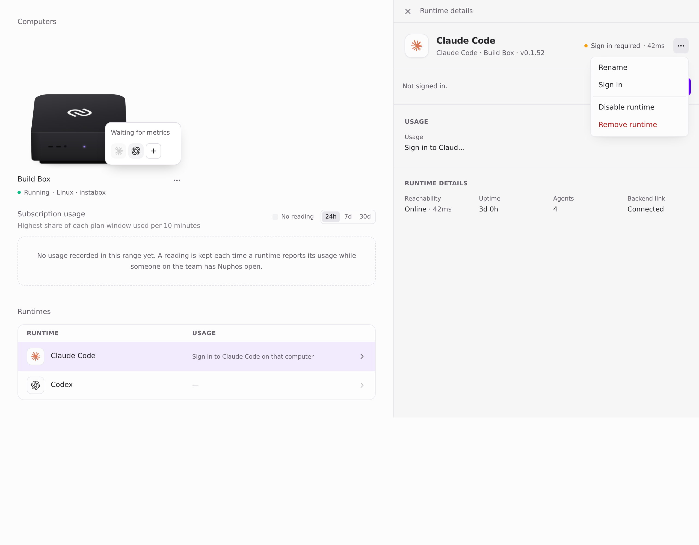
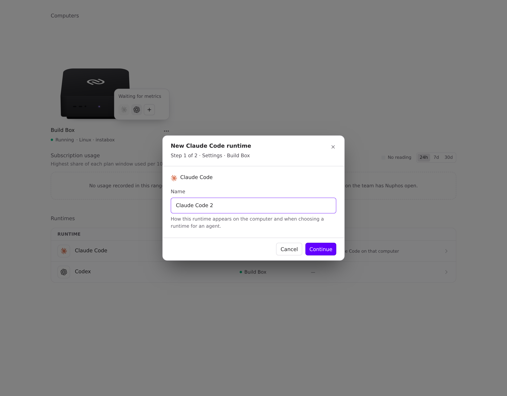
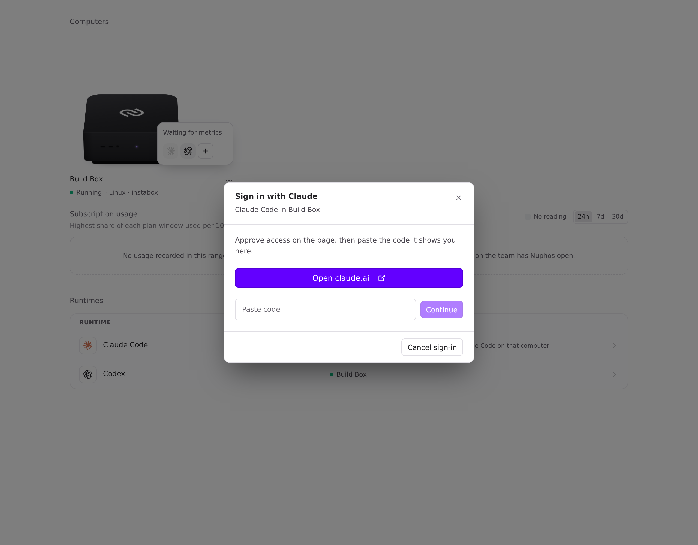
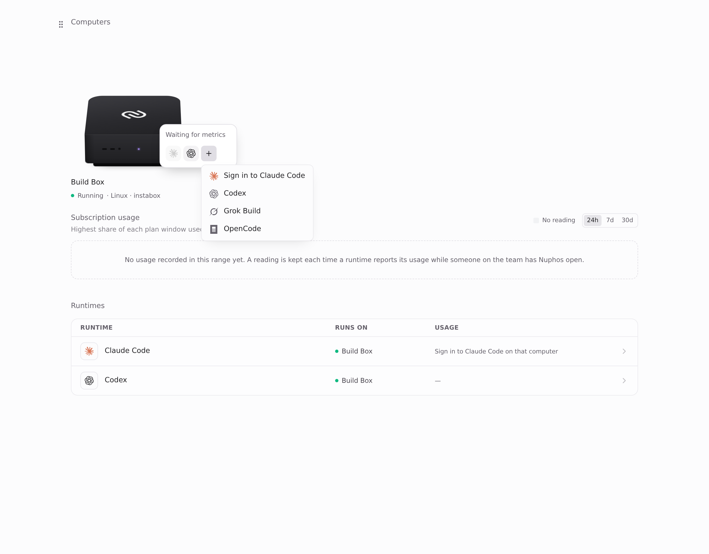

Part 1 of #1570. Frontend only, no schema change. It also covers the audit's F5.

## Problem

A signed-out runtime often had no working way to sign in again, so people added another one ("Claude Code 2", "Claude Code 3"):

1. **Added runtime on this computer:** the Runtimes card had no Sign in at all (`thisComputerSignIn` skipped `instanceId` runtimes). Its picker and conversation-card "Sign in" opened the CLI login, which signs in the computer's **default** runtime, not this one (`signInRoute` sent every runtime on this computer to the CLI).
2. **Default runtime on a Box or another computer:** its card shows "Sign in", but its page and ⋯ menu had none. The menu offered Sign in only for managed and self-hosted runtimes.
3. **"+" (New runtime) on a capable host:** it always created a new runtime, even when a signed-out one of that provider was sitting right there, pre-named "Claude Code 2".

## Fix

There is one rule for a signed-out runtime on one of your own computers (`localSignIn` in `agentPresentation.ts`):

- **This computer's default Claude Code or Codex** signs in through its CLI, unchanged.
- **Anything else** (added, or on a Box or another computer) signs in through the runtime sign-in for exactly that runtime: `RuntimeLoginDialog` → `POST /agent-runtimes/:id/login`. The backend already allows this for anyone with `use` on the computer.

Applied everywhere:

- **Card:** `LocalAgentSignInRow` shows the primary **Sign in**.
- **⋯ menu:** **Sign in** for the same runtimes. For a CLI runtime it opens the CLI sign-in.
- **Picker and conversation card:** `signInRoute` keeps the CLI route for the default runtime only.
- **"+":** `newAgentAction` signs in a signed-out runtime of that provider **before** it adds one. The menu item then reads "Sign in to Claude Code". A second runtime is still added when every runtime of that provider is signed in, for a different account.

`newAgentAction` moved to `agentPresentation.ts`, next to the other sign-in rules, because `boxPresentation.ts` is at its 300-line limit. It adds no new strings. It reuses `Sign in`, `Not signed in.` and `Sign in to {provider}`.

## Before / after

Captured from the real components in a page-only harness at `main` (b2e72322) and this branch (ab1af221), with fixture data ("Studio Mac" and "Build Box", user Alex) and the light theme. The fixture records which login each click starts.

**Added runtime "Claude Code 2" on this computer**

| | Before | After |
| --- | --- | --- |
| Card |  No Sign in |  **Sign in** (primary) |
| Picker "Sign in" |  Started `cli:claude-code` (the default runtime) |  Started `runtime:…_claude-code_i2` |

**Default Claude Code on "Build Box", signed out**

| | Before | After |
| --- | --- | --- |
| ⋯ menu |  No Sign in |  **Sign in**: started `runtime:local_user-alex_device-buildbox` |
| "+" → Claude Code |  Creates "Claude Code 2" |  Signs in the existing one |

 The "+" menu says what it will do.

## Tests

- `agentPresentation.test.ts`: `localSignIn` returns the CLI for this computer's default, `'runtime'` for added runtimes, other computers and other providers, and nothing when signed in or someone else's. `newAgentAction` signs in a lapsed runtime instead of adding, and adds when all are signed in.
- `agentSignInModel.test.ts`: an added runtime on this computer routes to the dialog.
- The new assertions fail on `main` and pass here.
- `npm test` in `apps/desktop`: 2678/2682 pass. The one failing file is `electron/local-terminal.test.ts`, which fails the same way on `main` in my sandbox because `node-pty`'s native module isn't built there.
- `tsc -b --noEmit` passes. Prettier is clean, and eslint reports no errors and no new warnings.

🤖 Generated with [Claude Code](https://claude.com/claude-code)
