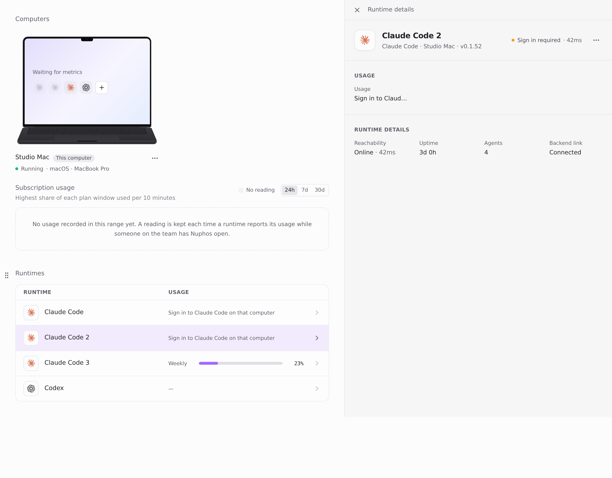
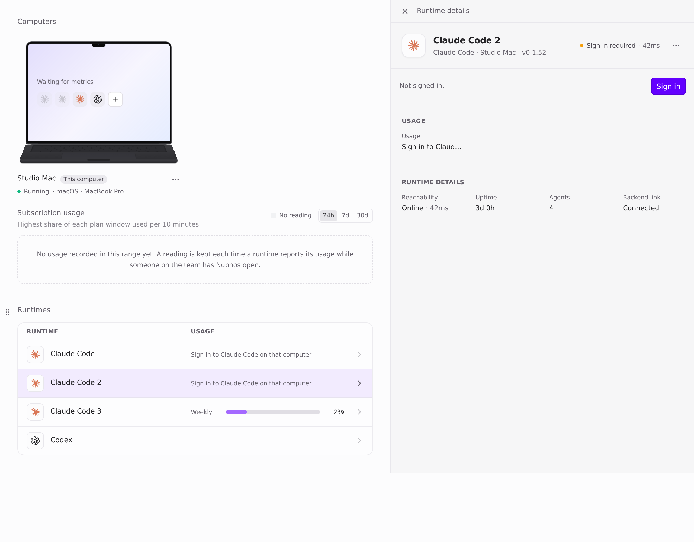
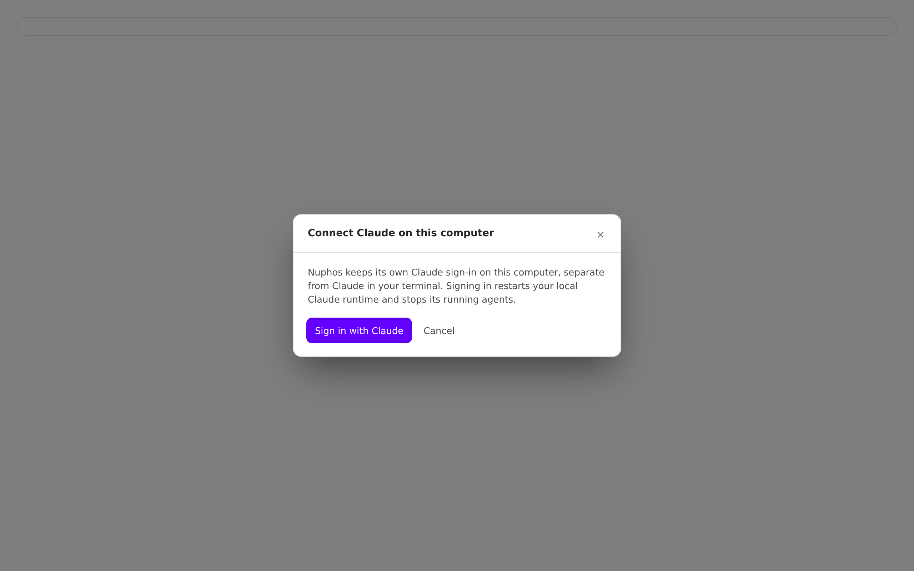
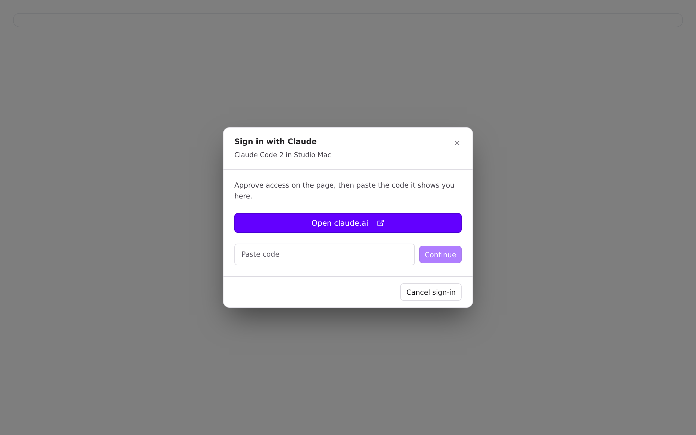
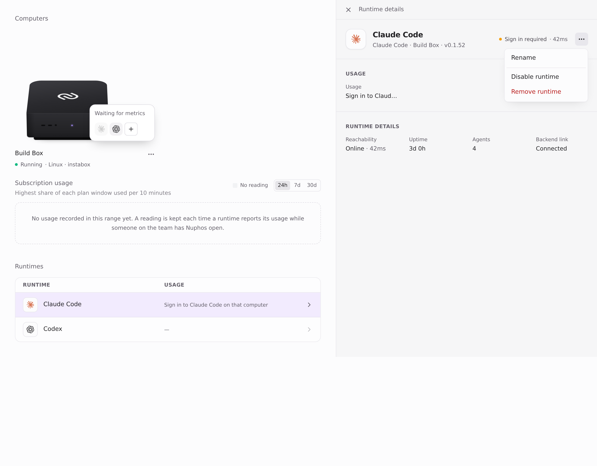
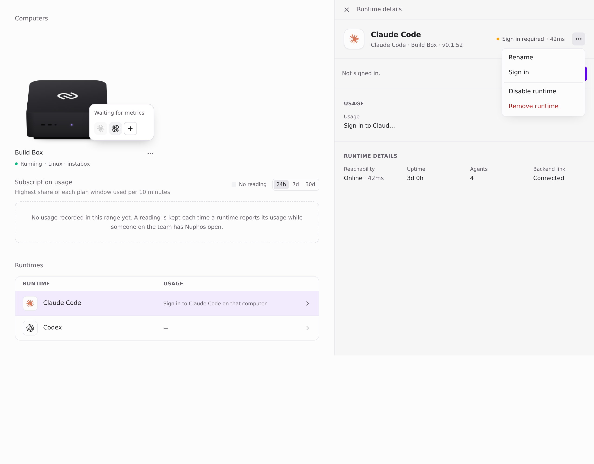
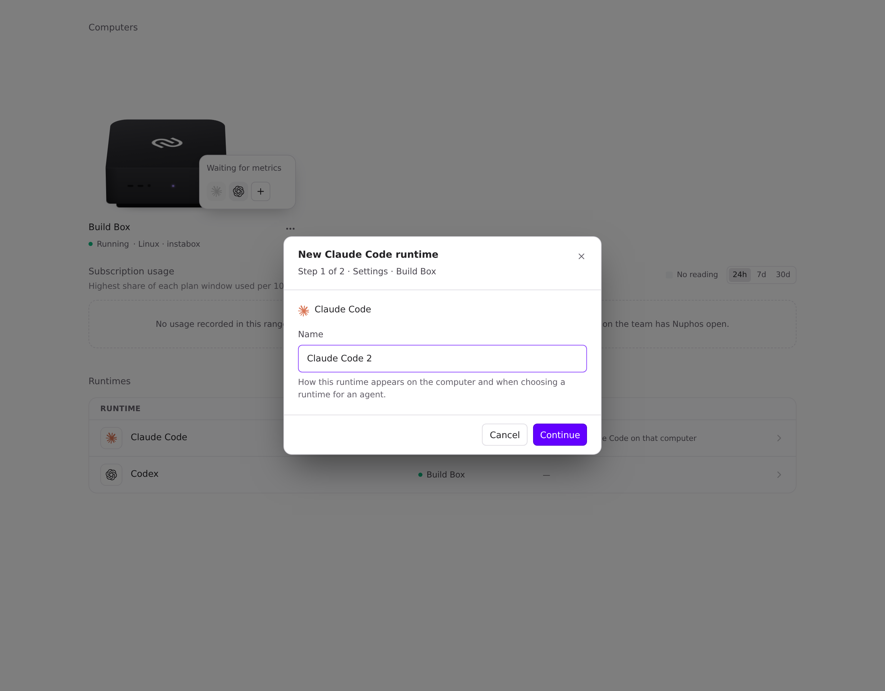
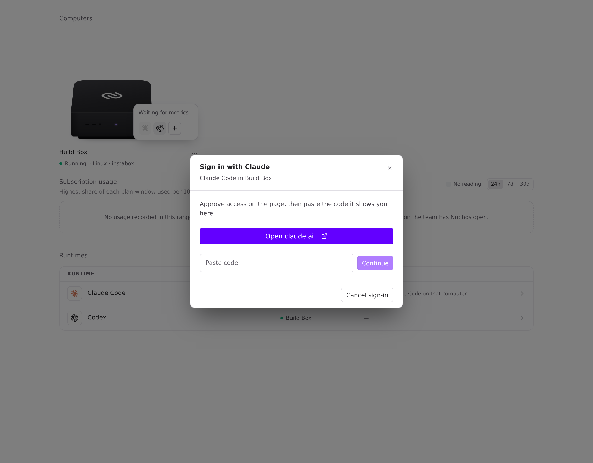
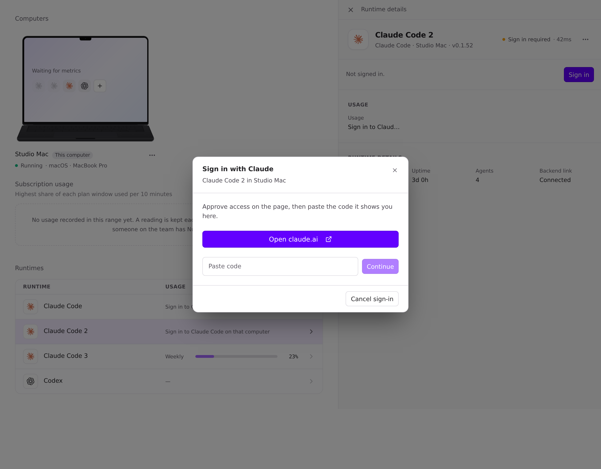
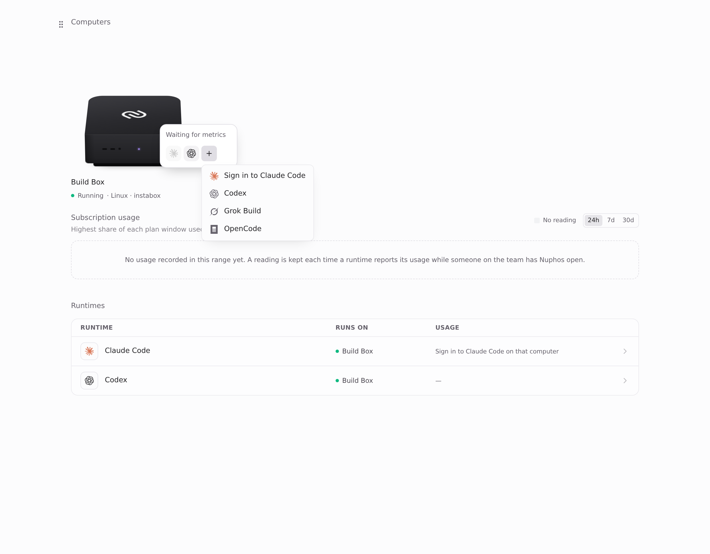

## Visuals for ab1af221

Captured at head `ab1af221` on base `main` b2e72322, with fixture data and the light theme.

Range-diff since 3e3f7e25: commit 1 is unchanged. Commit 2 (ab1af221) is new: it adds Sign in for signed-out default runtimes on a Box or another computer (card and ⋯ menu), makes "+" sign in a signed-out runtime before adding one, and moves `newAgentAction` to `agentPresentation.ts`.

| | Before | After |
| --- | --- | --- |
| Added runtime, card |  |  |
| Added runtime, picker Sign in |  |  |
| Box default, ⋯ menu |  |  |
| Box, "+" → Claude Code |  |  |

After, the card's Sign in dialog and the "+" menu:

 
