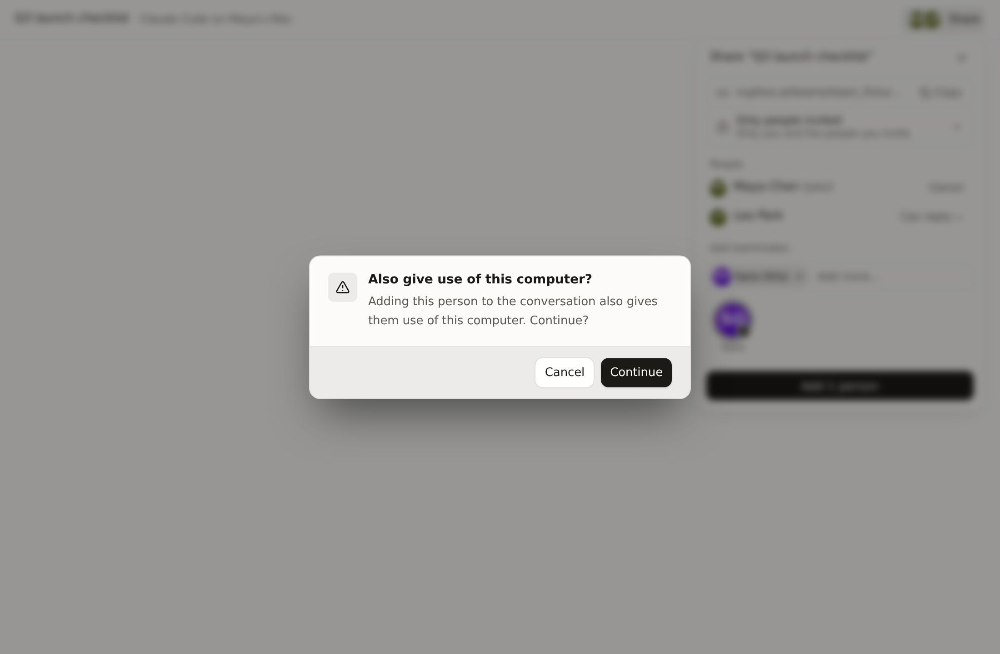
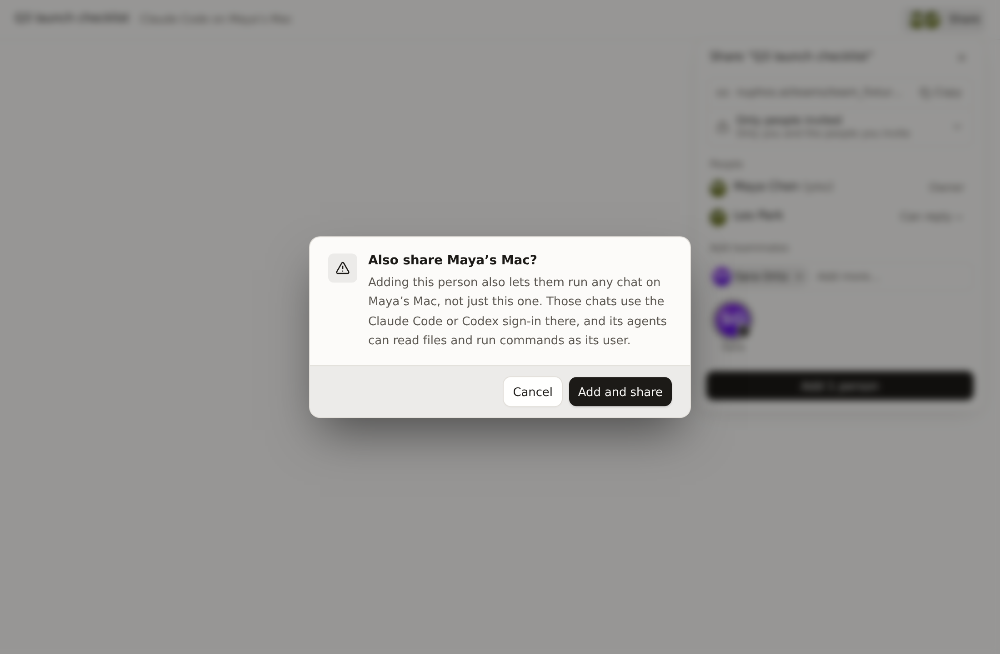
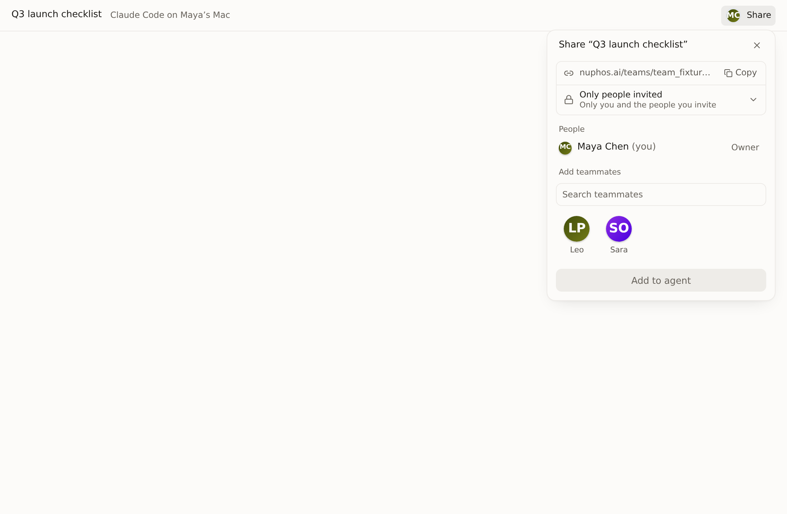
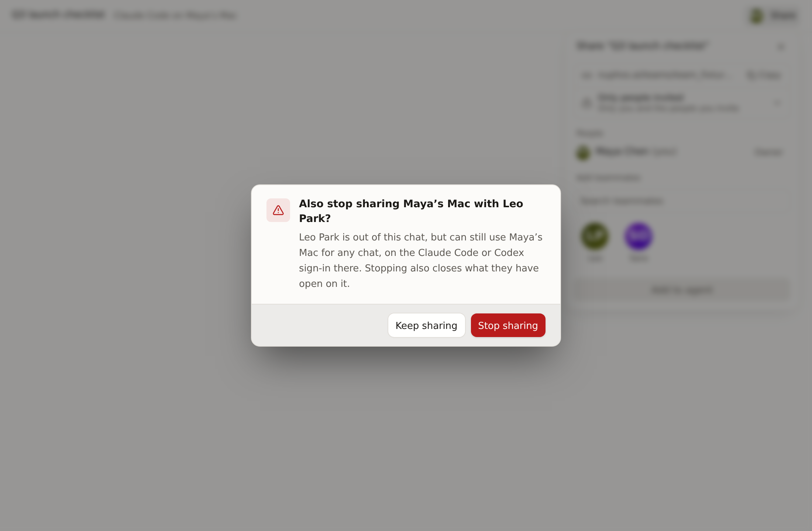

## Summary

Part of #3197 (piece 6 of the split: chat participants and `stop-computer-use`). Fixes #ISSUE.

Taking part in a chat means using the computer it runs on. So when a chat owner who manages that computer invites someone who can't use it, the backend answers `409 computer_use_required`, and confirming gives the invitee `use` of the computer (`addTeamUse`, audited as `conversation_invite`). That `use` covers the whole computer, not this chat. The invitee can run any chat on it, on the Claude Code or Codex sign-in there. Removing them from the chat, or undoing the invite, doesn't take it back, and nothing tells the owner they still have it.

This PR changes three things.

- **The invite confirm says what it gives.** `ComputerUseConfirm` was "Also give use of this computer? ... Continue". It now names the computer from the refusal's `details.computer.label` (`computerUseNeeded` in `computerUse.ts`): "Also share Maya's Mac?". It says the person can run any chat on it, not just this one, on the sign-in there, with its agents reading files and running commands as its user. The button is "Add and share". The Share card and the @mention invite (`useComposerMentions.tsx`) both use it.
- **Removing someone offers to stop their computer use.**
  - Backend: `DELETE /agent/conversations/:sessionId/participants/:userId` adds `computerStillShared: { deviceId, label }` to its answer. It appears when the remover manages the chat's computer and the removed person is on its grant by name, not as a manager or the owner, and the grant isn't "everyone". It doesn't appear when someone leaves on their own. That check is `computerStillShared` in the new `lib/agent/devices/conversation-computer-use.ts`. It runs after the removal and is wrapped in `.catch(() => null)`, so a failed check never turns a finished removal into an error.
  - New route `POST /agent/conversations/:sessionId/participants/:userId/stop-computer-use` (`routes/agent/routes-conversation-computer-use.ts`, mounted in `routes/agent.ts`, `"user"` in `route-access.json`). Only the chat's owner can call it (`assertConversationWritable`). It answers `409 still_participant` while the target is still in the chat, and `409 nothing_to_stop` when the same check finds nothing to take. `dropTeamUse` takes the person off with one guarded positional `$pull` (`access.$[grant].userIds`), so a Share dialog saved at the same moment isn't overwritten. Then it closes their streams on the computer and drops their share approvals and trusts, the same clean-up as losing use in the Share dialog.
  - The change goes through `auditEach` (now exported, and returning how many computers it changed) with a new `via: 'conversation_remove'`.
  - Desktop: `SessionParticipants` opens "Also stop sharing Maya's Mac with Leo Park?" (Keep sharing / Stop sharing) when the removal answer carries the offer. The IPC is `agent:stopConversationComputerUse` (electron `participants.ts`, `channels-agent-read.ts`, preload `api-session-access.ts`, `window-session-access.ts`, `agent-api.ts`, `agent-types.ts`).
- **Undo of an invite takes back what it gave.** The new hook `useComputerSharing.tsx` remembers whom the confirmed invite gave the computer to. Undo removes each person from the chat, then stops computer use for those people only, without asking. It stops everyone in parallel and reports any failure. Anyone whose removal or stop failed stays on the receipt, so pressing Undo again finishes the job. `nothing_to_stop`, or a 404 from a backend that predates the route, is not treated as a failed Undo. Each new invite starts a fresh record (`startInvite`), so an earlier invite's people are never taken back by a later Undo.

Strings: 3 removed, 10 added, in all 7 locales.

**Known limit, not fixed here.** The route checks only that the target is not in the chat now. It doesn't check that they were ever in it. So a chat owner who manages the computer could call it for a teammate who is on the computer's grant but never joined the chat. That teammate would lose Use, and the access audit would record it as `conversation_remove`. This grants nothing new: the caller must own the chat and manage the computer (`computerStillShared` requires `manage`), and the Share dialog already lets a manager take anyone off. The cost is a misleading audit reason and a route that reaches further than its name suggests.

**Left for other pieces.** The Access history UI that will label `conversation_remove` is in another piece. So are the "computer shared with you" notices. `docs/shared-computers.md` is being edited by #3208. Once both have merged, that page needs one sentence saying that Nuphos offers to stop sharing the computer after someone is removed from a chat.

## How this was verified

- **Flow exercised:**
  - Unit tests on both sides (below).
  - A new real-backend e2e scenario, `a chat owner stops computer use for a removed participant` (`scripts/e2e/chat-computer-use-scenarios.ts`, `chatComputerUseScenarios`, registered at the end of `computerScenarios` in `computer-scenarios.ts`, so `run.ts` is unchanged). The app's own computer stands in for the chat owner's. The owner (the suite's user) shares it by name with one teammate. A chat on it is set up in the database for the owner. Then the scenario checks:
    - Inviting a second teammate with `grantComputerUse: false` gets `409 computer_use_required`, naming the computer.
    - Confirming lands, and `GET /agent/devices` lists the computer as `use` for the invitee.
    - Stopping while the invitee is still in the chat gets `409 still_participant`.
    - The `DELETE` removal answers with `computerStillShared` for this computer, and the invitee still has `use`.
    - The teammate who doesn't own the chat calling the route gets 403.
    - A chat owner who only uses the computer (a second chat, owned by the first teammate) gets `409 nothing_to_stop`. Neither refusal changes anything.
    - The owner's stop answers 200. The invitee no longer sees the computer in `GET /agent/devices`, and the other teammate still has `use`.
    - A second stop gets `409 nothing_to_stop`.
    - The access audit has a `conversation_remove` entry by the owner, whose next grant keeps the other teammate and drops the invitee.
    - Clean-up removes both chats and the share.

    This is where the route's success path, the positional `$pull` with `arrayFilters`, runs against real MongoDB for the first time. The in-memory test database can't run it, so the route test covers only the refusals, and `conversation-computer-use.test.ts` checks the exact update it sends. The deliberate refusals are declared as the scenario's own `expected` failures, so `backend-log.ts` is unchanged.
  - Component harness captures (real `SessionParticipants`, fixture data: Maya Chen owns the chat on Maya's Mac).

    Invite a teammate who can't use the computer yet:

    | Before | After |
    | --- | --- |
    |  |  |

    Remove Leo Park, whose removal answer carries `computerStillShared`. Before: the card just loses Leo. After: the offer to stop sharing.

    | Before | After |
    | --- | --- |
    |  |  |
- **Build and environment:** Linux container, branch rebased on upstream main 0fcd14d3. The harness is Vite + headless Chromium, 1100x720 at scale 2, light theme.
- **Result:**
  - Backend: `bun test` on `conversation-computer-use.test.ts`, `routes-conversation-participants.test.ts`, `access-audit.test.ts`, `device-grants.test.ts` and `route-access.test.ts`: 51 pass, 0 fail. `bun run typecheck` clean.
  - Desktop: `bun test src/components/agent/useComputerSharing.test.tsx` 7 pass, 0 fail. `computerUse.test.ts`, `i18n.test.ts` and `sourceText.test.ts`: 10 pass, 0 fail. `tsc -b --noEmit` clean.
  - ESLint: 0 errors on every changed backend, Desktop and `scripts/e2e` file. The new scenario function has `max-statements` and `complexity` warnings, as other scenario flows do. Prettier clean.
- **Automated test added or updated:**
  - `conversation-computer-use.test.ts` (new, 6 tests): who is offered the stop, and the exact guarded update and its audit.
  - `routes-conversation-participants.test.ts` (+4 tests): the offer on removal, no offer when they never used the computer or leave on their own, the two 409 refusals, and owner-only. Against main's `routes-conversation-participants.ts`, "removing someone who still uses the computer offers to stop that too" fails (26 pass, 1 fail: `computerStillShared` missing from the answer).
  - `useComputerSharing.test.tsx` (new, 7 tests, added to `test:ui`): the refusal names the computer, the confirm wording, Undo takes back only what the invite gave, the offer after removal, retrying a failed stop, a removal failing part way, `nothing_to_stop` and an older backend's 404 not counting as failures, and a fresh record per invite.
  - The e2e scenario above.
- **Not verified:**
  - **The e2e scenario has not been run.** The "Desktop against a real backend" job will be its first run, and with it the first run of the route's success path against real MongoDB. It wasn't run here because another agent is using this machine's suite setup. This machine also lacks most of what the suite needs: no `openab` binary, no root `node_modules` (`playwright-core`), no `mongod`, and the `mongo:8.0.32` and `rustfs/rustfs:1.0.0` images aren't pulled.
  - The scenario asks the app which computer it is: it waits until `window.api.localRuntimeGetState()` reports `connection: 'online'` and uses its `deviceId`. It doesn't rely on log order or on its place in the list, because other scenarios connect stand-in computers as the same user and later delete them.
  - The new e2e file was typechecked on its own. The only error was `playwright-core` missing from `ui.ts`, which this machine doesn't have.
  - Nothing was clicked through in the real Electron app. The captures render the real components with fixture IPC answers.
  - Removing someone from a group chat (`kind: 'channel'`) wasn't exercised end to end. Unit tests cover the check, which is the same for both.

🤖 Generated with [Claude Code](https://claude.com/claude-code)
