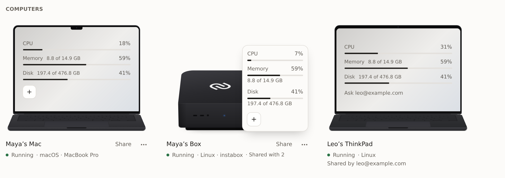
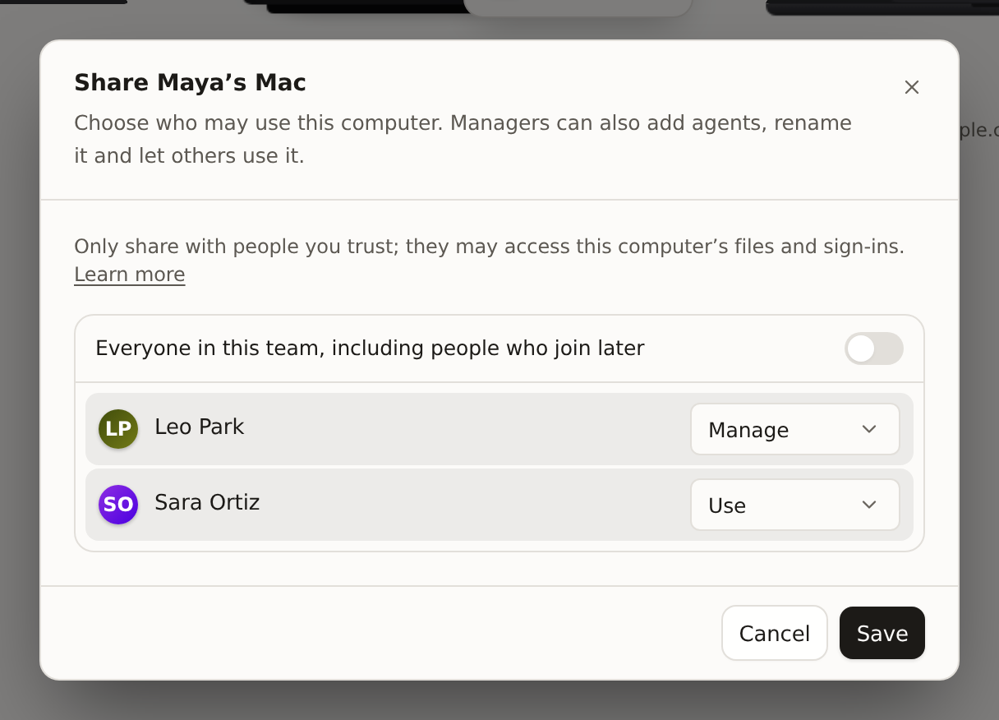
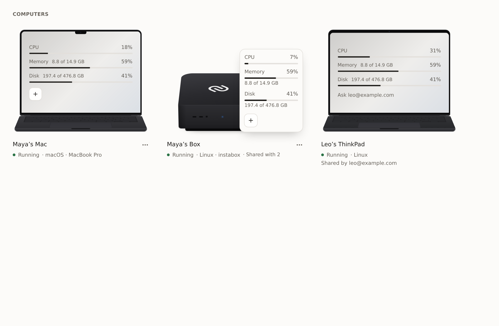
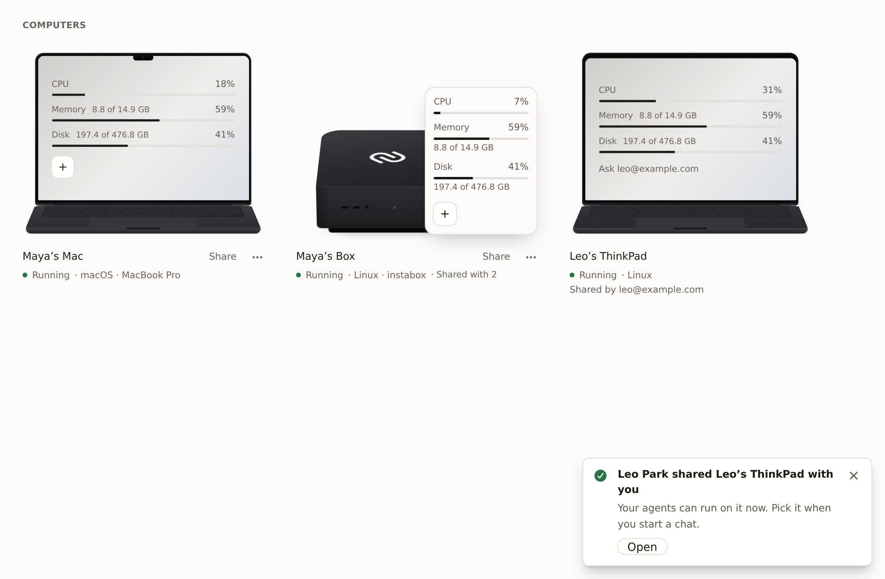

**05-computers-share-button**

| Before | After |
| --- | --- |
|  |  |

**06-share-local-access-history**

| Before | After |
| --- | --- |
|  |  |

**07-share-cloud-access-history**

| Before | After |
| --- | --- |
|  |  |

**08-computer-shared-toast**

| Before | After |
| --- | --- |
|  |  |

