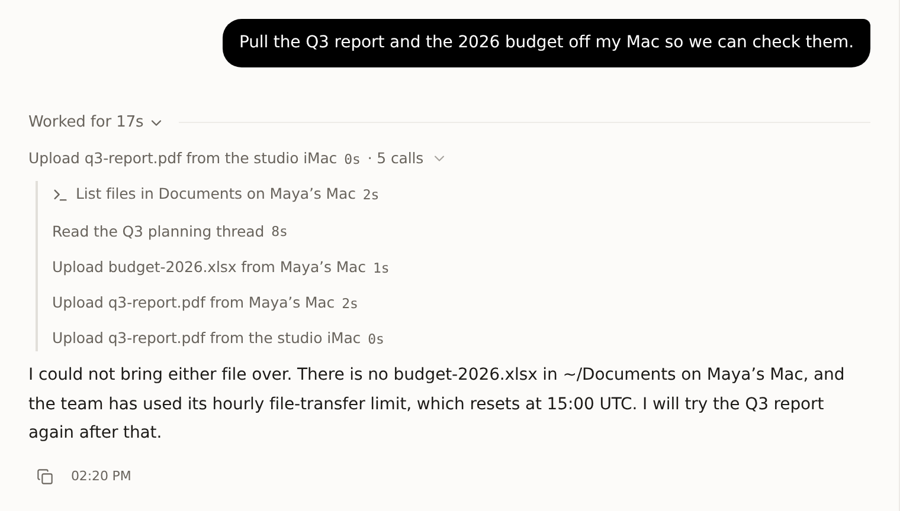
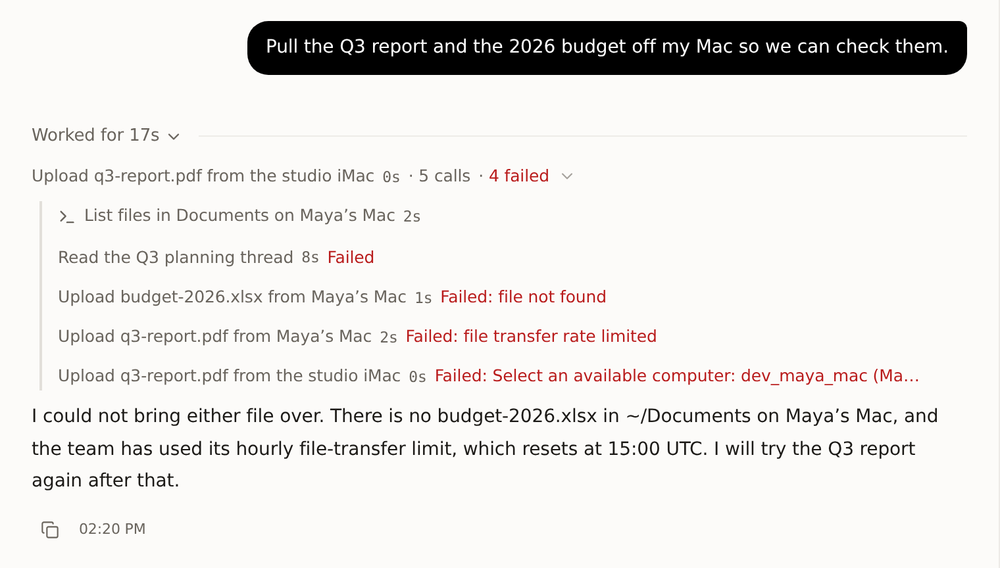
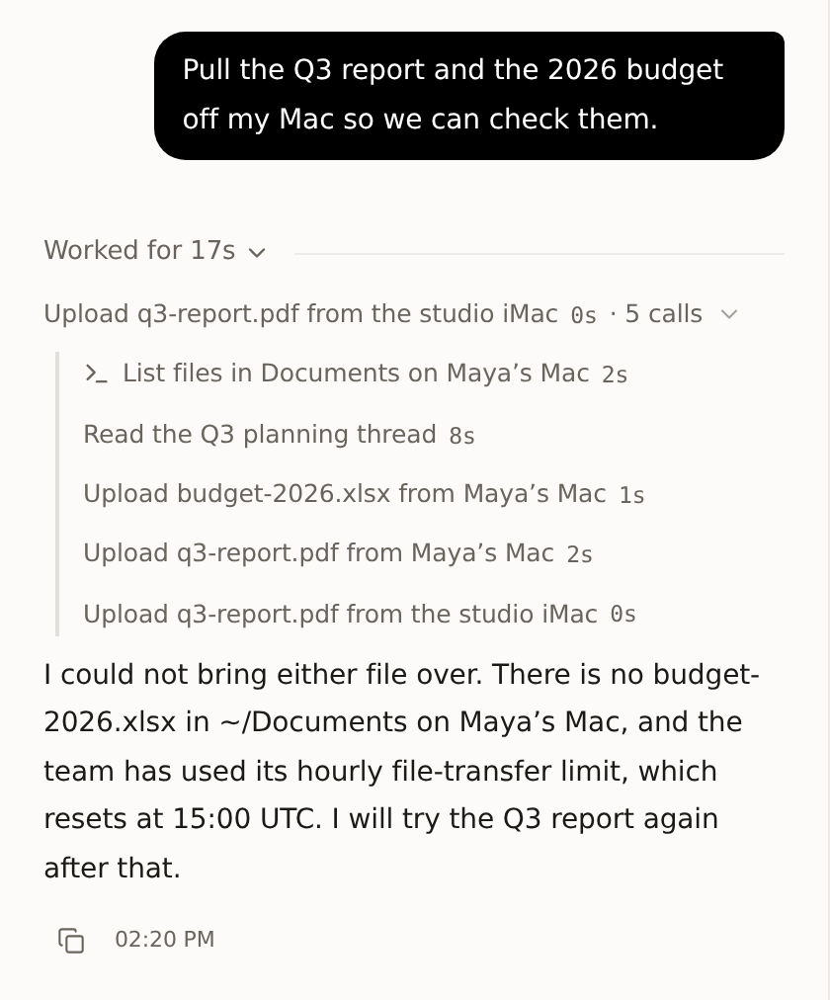
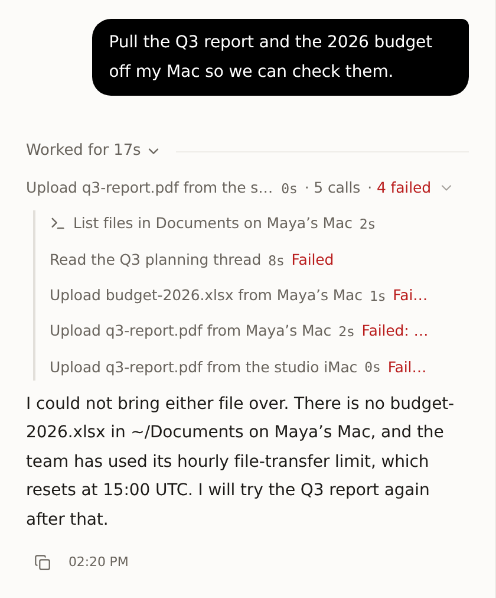
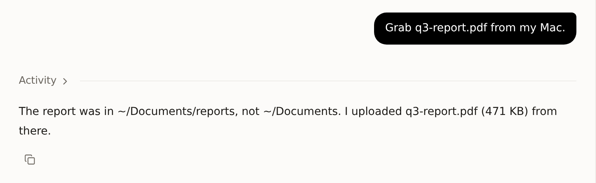
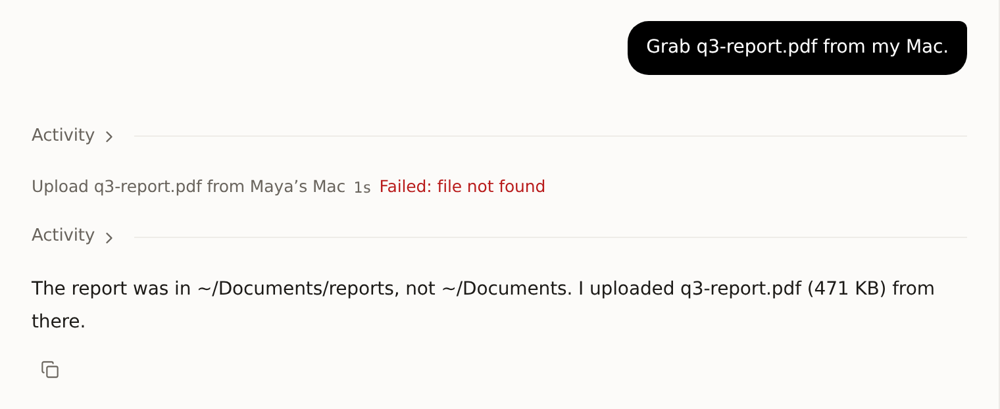

## Summary

Three follow-ups to #3128, rebased on #3155 and #3191.

### 1. A failed tool call looks like a successful one

In the Desktop transcript a finished tool call showed its label and elapsed time whether it worked or not. A call that returned `{ error }` was also folded into "Activity" as routine work, so a failed upload left no trace unless the agent mentioned it.

Now the row ends in a red "Failed", or "Failed: <reason>" when the call returned an error. Error codes read as words (`file_transfer_rate_limited` shows "Failed: file transfer rate limited") and plain text is shown as is. A closed run of several calls says "· N failed", a run of one shows the same label as its row, and a call that returned an error stays visible. The reason gives up width before the label does. Not marked: `{ ok: true, error }` results and shell commands that exited non-zero, which keep their terminal view. One rule decides what failed (`toolFailure` in `activity.ts`).

### 2. A rate-limited upload does not say when the limit resets

#3128 passed `file_transfer_rate_limited` through. The agent still could not tell the person when to try again, and tended to retry. `local_upload` now returns the admission's message and `retryAfter`, and its description says not to retry and to report the reset time.

### 3. A failed upload keeps its transfer slot

A transfer is admitted against the team's hourly count and bytes when it is created. An upload that never reached storage kept that slot until the hour turned. `releaseTransfer` (`lib/file-transfer/release.ts`) gives the slot and bytes back once, guarded by a `releasedAt` claim on the group.

Since #3155 answers `local_upload` when the transfer starts, the release cannot hang off an error result any more. It runs where #3155 already checks storage: when the device stream ends without the computer confirming, when the computer confirmed but storage has no file, and when the transfer was created after the caller had already been answered. If the storage check itself throws, the slot is kept. A group released this way stays `failed` if its file lands later, so a file is never delivered after its slot was refunded.

## How this was verified

Page-only captures of the real `<Conversation>` in a Vite harness with fixture data (light theme, same viewport per pair), taken at `f17031725` against base `ee5a301a5`.

**A reply with five tool calls, opened: one succeeded, one threw, three returned an error**

| Before | After |
| --- | --- |
|  |  |

**The same in a 420px pane: labels and times stay whole, the reason gives way first**

| Before | After |
| --- | --- |
|  |  |

**A call that returned an error stays visible instead of folding into Activity**

| Before | After |
| --- | --- |
|  |  |

- **Flow exercised:** The transcript rendered from the real component in both trees and driven with playwright-core and headless Chromium: a reply with five finished calls opened to its rows, the same in a 420px pane, and a run of separate replies where one upload returned `file_not_found`.
- **Build and environment:** macOS (Apple Silicon), this branch on `ee5a301a5`. Captures on Linux x64 with Chromium.
- **Result:**
  - Backend: `tsc` clean. `bun test src/lib src/routes`: 5,505 pass, 19 fail (avatar and photo processing, loopback lookups, Windows paths, the Kubernetes exec socket, two timing tests, one that needs Linux `readlink -f`). None are in files this PR touches. The file-transfer, device and tool tests (280 across 51 files) all pass.
  - Desktop: `tsc -b` clean. Node tests: 3,247 pass, 1 fail (`agent-cli-apps.test.ts`, which finds this Mac's `/opt/homebrew/bin/codex`). `test:ui`: 49 pass, 0 fail.
  - `prettier --check` clean and ESLint 0 errors on the changed files.
- **Automated test added or updated:**
  - `lib/agent/devices/upload.test.ts`: the slot is released once when the file never arrives, kept when the file did arrive or the storage check throws, released when the computer confirmed but storage says failed, and checked when the transfer was created after the caller timed out. Releasing a `ready` group makes one of these fail.
  - `lib/file-transfer/release.test.ts` (new): a group is refunded once, also when two releases run at once.
  - `lib/file-transfer/service.test.ts`: a released group stays undelivered when its file lands later. Fails on the code before that guard.
  - `lib/file-transfer/admission.test.ts`: the rate-limit error carries its message and `retryAfter`.
  - `components/agent/panel/activity.test.ts`: which results count as failed, and the count for a run.
- **Not verified:**
  - Not clicked through in a packaged Desktop app, and no real team was driven to the limit.
  - Still open: a finalize that loaded the group just before the release recorded `releasedAt` can still mark it ready. It needs someone to call the finalize route on the same group at the same moment as the background check. Closing it means reordering the item writes in `finalizeTransfer`, which I left for a separate change.
  - If the backend process handling the stream dies mid-transfer, nothing releases the slot until the hour turns. That errs toward keeping the slot.
  - `local_download` (#3191) is not admitted against the limit, so nothing here applies to it.

One new string, `{n} failed`, in all 7 locales.

Refs #3128, #3155, #3191

🤖 Generated with [Claude Code](https://claude.com/claude-code)
