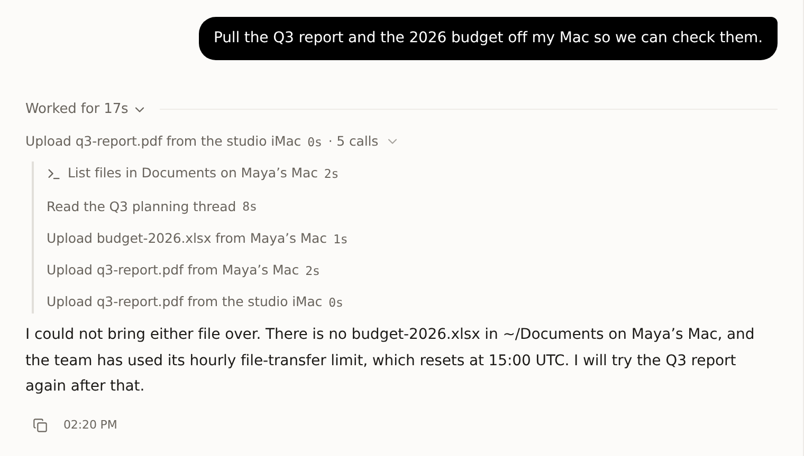
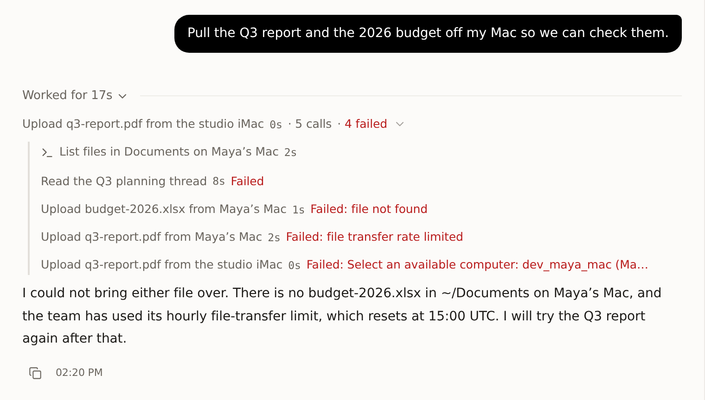
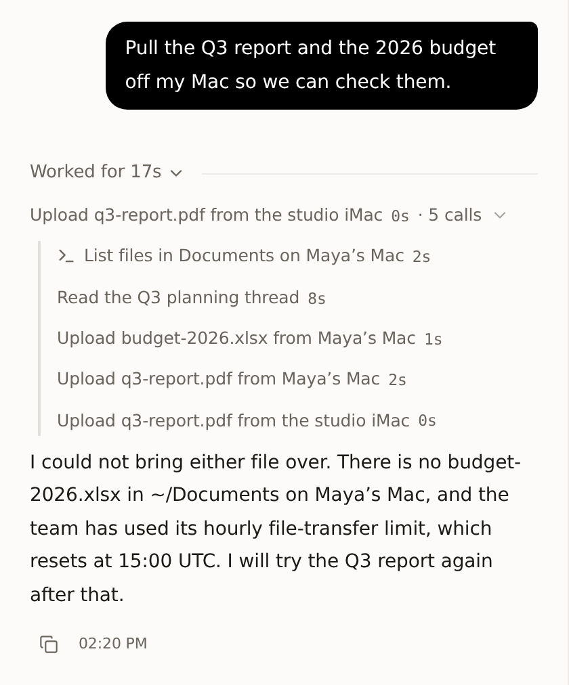
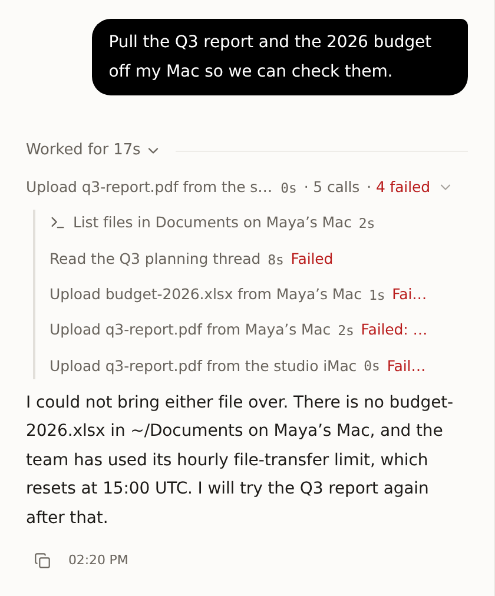
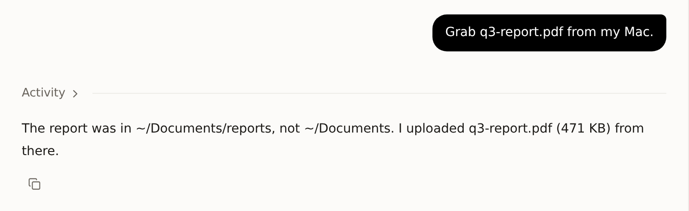
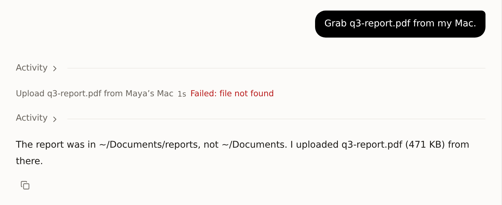

Visuals for f170317254fdefc4306537fbb9f34322776976c0

Captured at `f17031725` against base `ee5a301a5`. Page-only captures of the real transcript with fixture data, light theme, same viewport on both sides. First push, so there is no earlier head to compare against.

**A reply with five tool calls, opened: one succeeded, one threw, three returned an error**

| Before | After |
| --- | --- |
|  |  |

**The same in a 420px pane: labels and times stay whole, the reason gives way first**

| Before | After |
| --- | --- |
|  |  |

**A call that returned an error stays visible instead of folding into Activity**

| Before | After |
| --- | --- |
|  |  |
