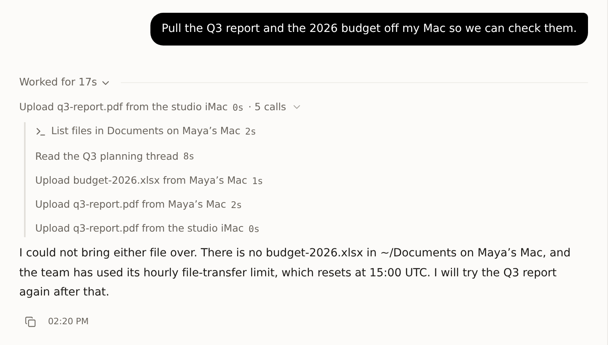
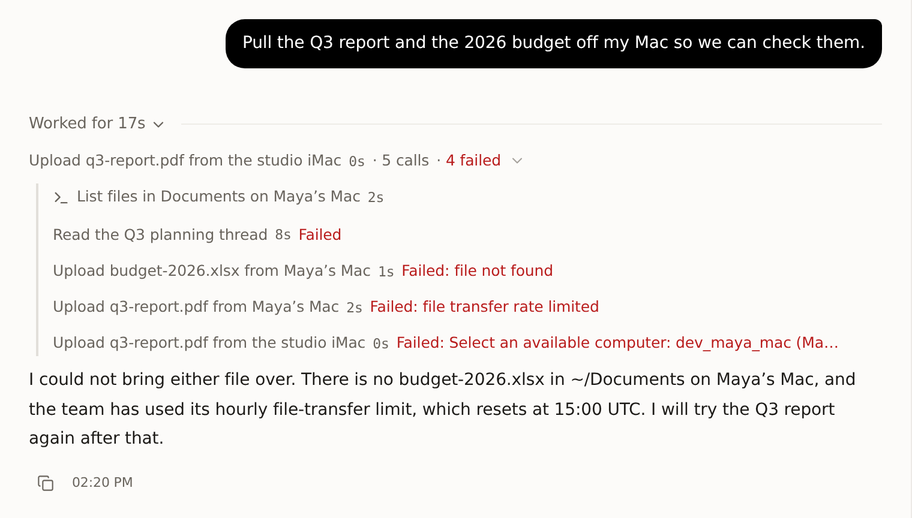
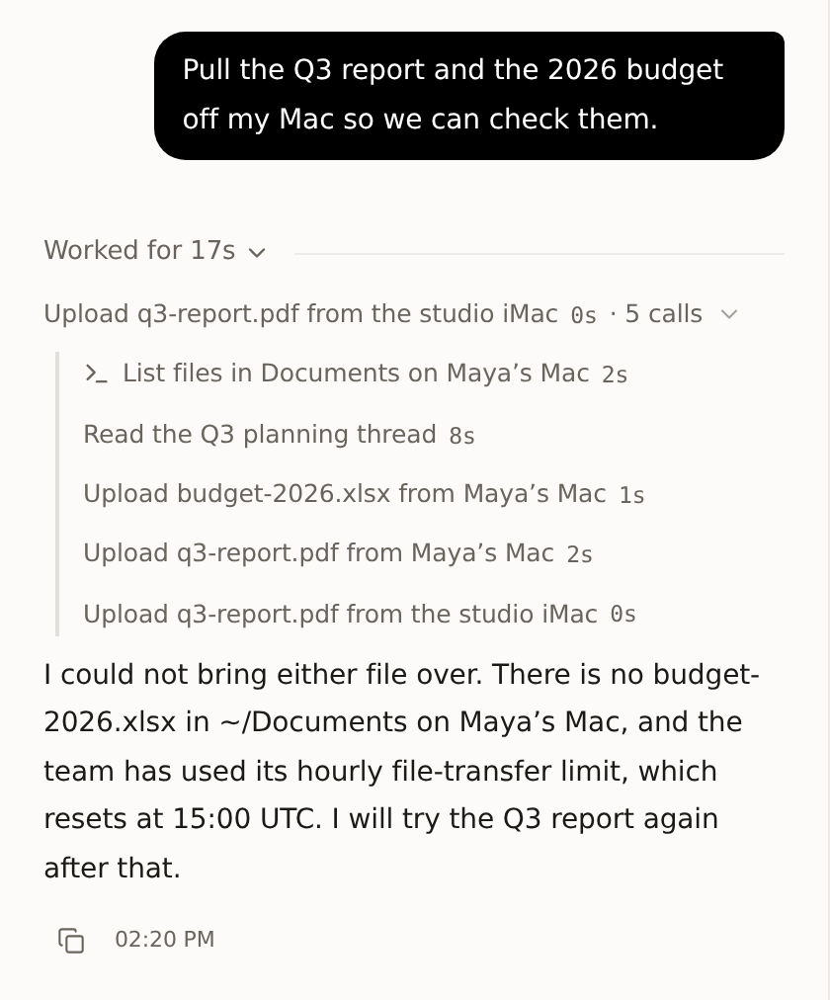
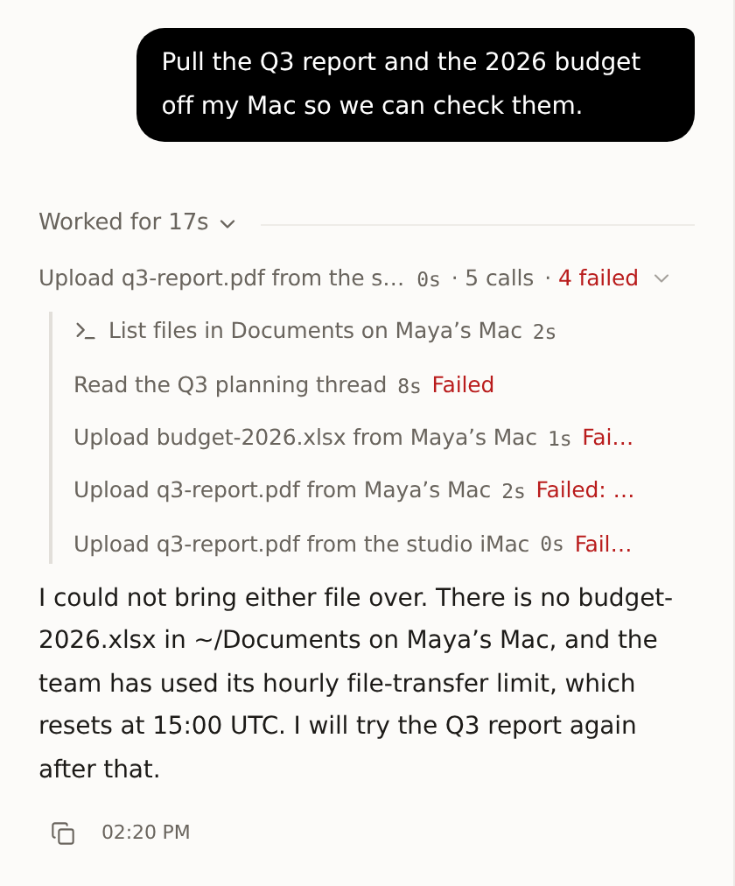
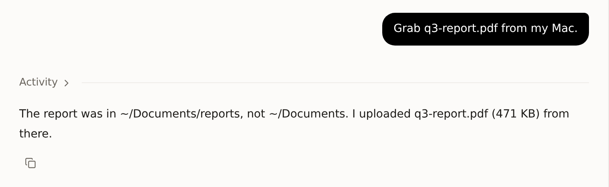
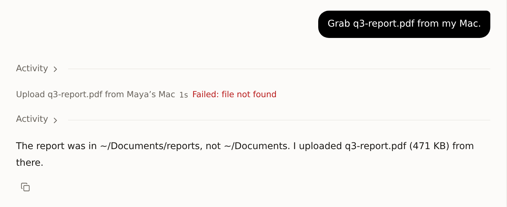

**01-failed-calls**

| Before | After |
| --- | --- |
|  |  |

**02-failed-calls-narrow**

| Before | After |
| --- | --- |
|  |  |

**03-error-result-not-folded**

| Before | After |
| --- | --- |
|  |  |

