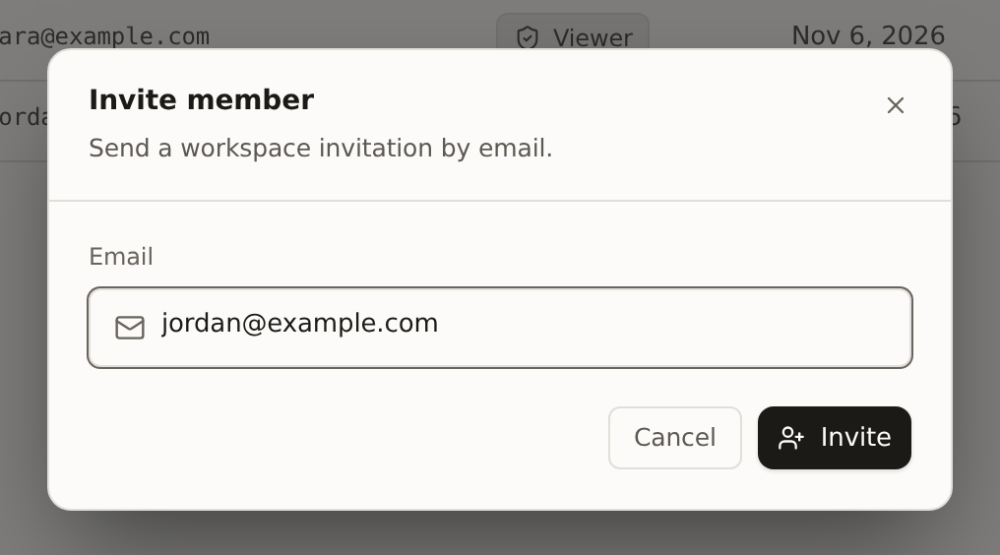
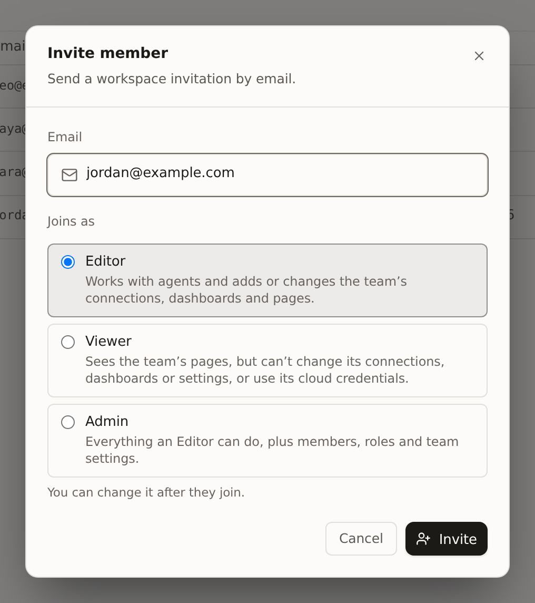
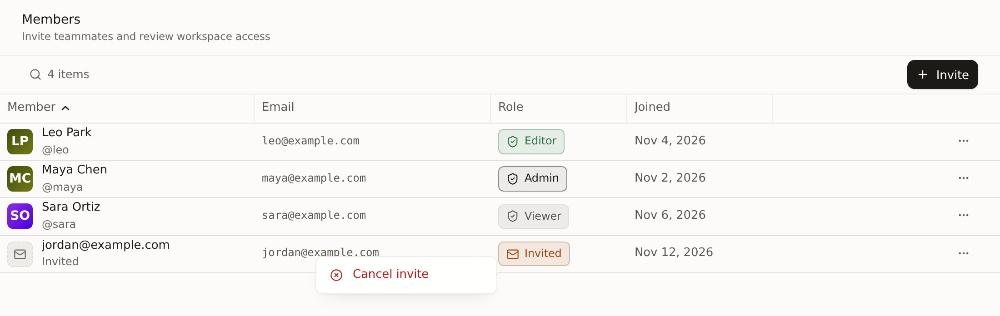
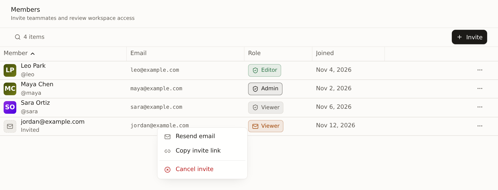

## Summary

Part of #3197 (piece 5 of the split: workspace invitation roles and resend). Fixes #ISSUE.

Today every workspace invitation joins as Editor. Accept hard-codes `addUserToTeam(…, 'EDITOR')` in `routes/invitations.ts`. A pending invite can only be cancelled, and `atlas/teams.ts` `inviteTeamMember` drops the `emailSent` flag the backend already returns. So the Desktop says "Invitation sent" even when no email went out. This PR does the backend rules and the Desktop UI together.

**Backend**
- `POST /teams/:teamId/invitations` takes `role` (`ADMINISTRATOR`, `EDITOR` or `VIEWER`). It defaults to `EDITOR`, so older clients invite as before. The role is stored on `TeamInvitation.role` and returned on every invitation.
- `invitationRole()` (`lib/team-invitations.ts`) gives Editor for invitations made before roles existed.
- On accept, an Admin invitation gives Admin only while its inviter is still an admin of the team (`getTeamMembership`). Otherwise the person joins as Editor, and the accept answer carries the role actually given. Without this rule, an admin about to be demoted or removed could invite a second address as Admin and get back in later. Invitations never expire.
- New `POST /teams/:teamId/invitations/:invitationId/resend`, admin only, registered in `route-access.json`:
  - It claims `lastSentAt` with one `findOneAndUpdate` before it sends, so two clicks (or two replicas) send one email.
  - It refuses with `429 resend_too_soon` inside `INVITATION_RESEND_MS` (5 minutes).
  - It returns 404 for accepted, rejected, unknown or other teams' invitations.
- The 5 minutes count only from an email that actually went out. Create sets `lastSentAt` and unsets it when no email went out. Resend rolls it back to the previous value in that case. So "Resend" works at once after an invite whose email failed.
- `inviteLandingUrl()` is now shared by the email and by `inviteUrl` on the create answer and on the team's invitation list. The list carries it for admins only. The URL holds no token, since invitations are keyed to the invitee's email.
- Model: `TeamInvitation.lastSentAt`, `TeamInvitation.role`.

**Desktop**
- The invite window has a "Joins as" picker: Editor (preselected each time the window opens), Viewer, Admin. Each has a one-line explanation (`memberRows.ts` `roleDetail`), plus "You can change it after they join."
- A pending row's Role pill shows the role it joins as instead of "Invited". The Member column already says "Invited" under the address. A longer "Invited as Viewer" pill overflowed the 150px Role column, so the pill stays as short as a member's.
- The pending row's menu has Resend email, Copy invite link (only when the server sent a link) and Cancel invite.
- "Invited, but no email went out" replaces "Invitation sent" when `emailSent` is false, with next steps. It mentions copying the link only when there is one.
- On an older server that ignores `role`, a picked Viewer or Admin gets a notice: "{email} will join as Editor".
- The invite and resend calls live in the new `electron/atlas/team-invitations.ts`, and their IPC in `channels-team-migration.ts` / `api-team-data.ts`, because `teams.ts`, `channels-team.ts` and `api-team.ts` are at their size limits.
- 16 new strings, in all 7 locales.

**Relation to #3208.** #3208 (copy fixes, still open) and this PR both touch `src/views/members/useMemberActions.tsx`, in different hunks. #3208 owns the longer "Remove from team" confirm text and `confirmLabel: t('Withdraw invite')` on Cancel invite (with `confirmLabel` in `ContextMenu.tsx`). This PR is built on main's version of that file, so Cancel invite confirms as it does today. This PR adds Resend email and Copy invite link above it, plus the invite and resend handlers. Its test asserts neither of #3208's changes.

**Open question for the design check:** the picker's role lines (`memberRows.ts`) say an Editor "Works with agents…". A reviewer noted this may suggest Viewers can't, while the backend does not stop a Viewer from starting or messaging a conversation. The wording is kept as reviewed. Should the Viewer line say what Viewers can do with agents?

## How this was verified

- **Flow exercised:**
  - Backend route tests against the real route handlers with test doubles (`routes/invitations.test.ts`, `routes/teams/invitations.test.ts`, `lib/team-invitations.test.ts`). They cover:
    - role stored and returned, Editor by default, an unknown role refused;
    - accept gives the stored role, and Admin only while the inviter is still an admin (Editor if demoted or gone);
    - resend admin only, once per 5 minutes, 404 on non-pending invitations, a resend that is not held back after an unsent email, and the rollback when no email went out;
    - the link is listed for admins only.
  - Desktop `useMemberActions.test.tsx` (added to `test:ui`). It covers:
    - the unsent-email notice, with or without a link;
    - the older-server role notice;
    - the pending menu (Resend / Copy / Cancel), and that resend calls the API;
    - the role is sent with the invite;
    - the picker renders all three roles with their explanations;
    - the pending pill shows the role.
  - New real-backend e2e scenarios in `scripts/e2e/invitation-scenarios.ts` (`invitationScenarios`). They are registered in `access-scenarios.ts`, so `run.ts` is unchanged.
    - `an invited Editor, Viewer and Admin join with the right role`: the owner invites one new person as each role and one without a role. For each, the create answer carries the role, and both the accept answer and `GET /teams/:id/members/:id` show it. The one without a role joins as Editor.
    - `an Admin invitation whose inviter lost admin joins as Editor`: a second admin (`joinAsAdmin`) invites someone as Admin, the owner demotes that admin to Editor, and the invitee accepts. They join as Editor.
    - `only an admin resends an invitation, at most every 5 minutes after an email went out`. The suite's stack sets up no email, so the scenario checks:
      - create answers `emailSent: false`;
      - the admin gets `inviteUrl` on create and in the list, and an Editor sees the invitation without it;
      - an Editor's resend is refused (403);
      - the admin's resend right after the unsent email goes ahead (200);
      - after the scenario marks an email as sent a minute ago in the database (`lastSentAt`, as a send that worked would), a resend gets `429 resend_too_soon`;
      - marked 6 minutes ago, the resend goes ahead.

      Its two deliberate refusals are declared as that scenario's `expected`, so `backend-log.ts` is unchanged.
  - Component harness captures (real `TeamMembersView` and `InviteMemberModal`, fixture data: Maya Chen's team, pending invite jordan@example.com as Viewer).

    Invite window, before and after:

    | Before | After |
    | --- | --- |
    |  |  |

    Pending invite row, right-clicked, before and after:

    | Before | After |
    | --- | --- |
    |  |  |
- **Build and environment:** Linux container, worktree on upstream main 0fcd14d3. The harness is Vite + headless Chromium, 1100x720 at scale 2, light theme, English, fixture data only.
- **Result:**
  - Backend: `bun test src/lib/team-invitations.test.ts src/routes/invitations.test.ts src/routes/teams/invitations.test.ts src/routes/route-access.test.ts`: 25 pass, 0 fail. `bun run typecheck`: clean. eslint on the changed files: 0 errors.
  - Desktop: `bun test src/views/members/useMemberActions.test.tsx`: 7 pass, 0 fail. `i18n.test.ts` 5 pass, `sourceText.test.ts` 3 pass. `npx tsc -b --noEmit`: clean. eslint on the changed files: 0 errors.
  - Root eslint on `scripts/e2e/invitation-scenarios.ts` and `access-scenarios.ts`: no problems. Prettier 3.9.6 on every changed file: clean. Every changed source file is at or under 300 lines.
  - Fails before the change. With the backend sources put back to main's versions (tests kept), the two route test files gave 13 fail, 1 pass. Examples:
    - `(fail) an Admin invitation from someone no longer an admin, or gone, joins as Editor`
    - `(fail) a resend right after the last email is refused, so nobody is spammed`
    - `(fail) after an invite whose email never went out, Resend sends at once, and only once`
    - `(fail) the list carries the link the email points at, to copy, for admins only`

    With the members view sources put back to main's versions, `useMemberActions.test.tsx` gave 0 pass, 7 fail.
- **Automated test added or updated:** `apps/backend/src/routes/invitations.test.ts` (new), `apps/backend/src/routes/teams/invitations.test.ts` (new), `apps/backend/src/lib/team-invitations.test.ts`, `apps/desktop/src/views/members/useMemberActions.test.tsx` (new, in `test:ui`), `scripts/e2e/invitation-scenarios.ts` (new).
- **Not verified:**
  - The three real-backend e2e scenarios were written but not run. The suite could not run in this container: there was no built openab binary, no mongo or rustfs image, no root `node_modules` with playwright-core, and little disk. I'm relying on the "Desktop against a real backend" job on this PR.
  - No email was actually sent or received. The suite and the unit tests run without an email provider. The "email went out" path is covered by route tests with a stubbed sender and, in e2e, by setting `lastSentAt` in the database.
  - The Desktop IPC path (main process and preload) was not exercised in a running Electron app. The captures are page-only harness renders with a stubbed bridge, not the packaged app.
  - Copying to the clipboard and the toasts (unsent email, older-server notice, resend) were checked only in the unit test, not seen on screen.
  - The older-server notice was not tried against a real older backend.
  - Locales other than English were not looked at on screen.

🤖 Generated with [Claude Code](https://claude.com/claude-code)
