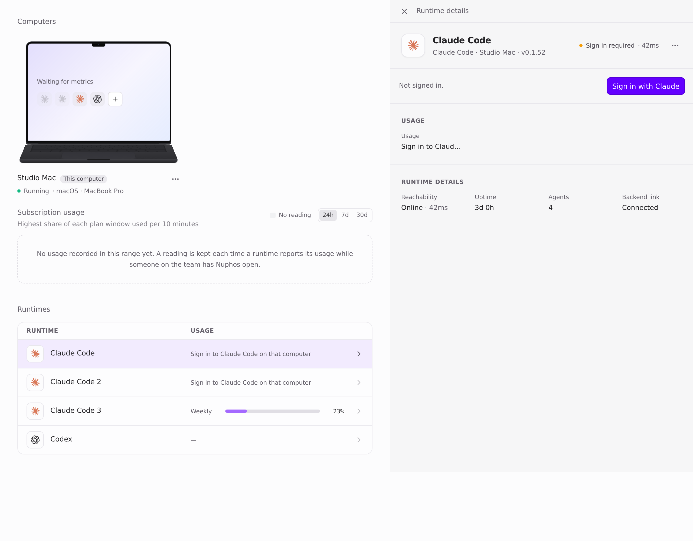
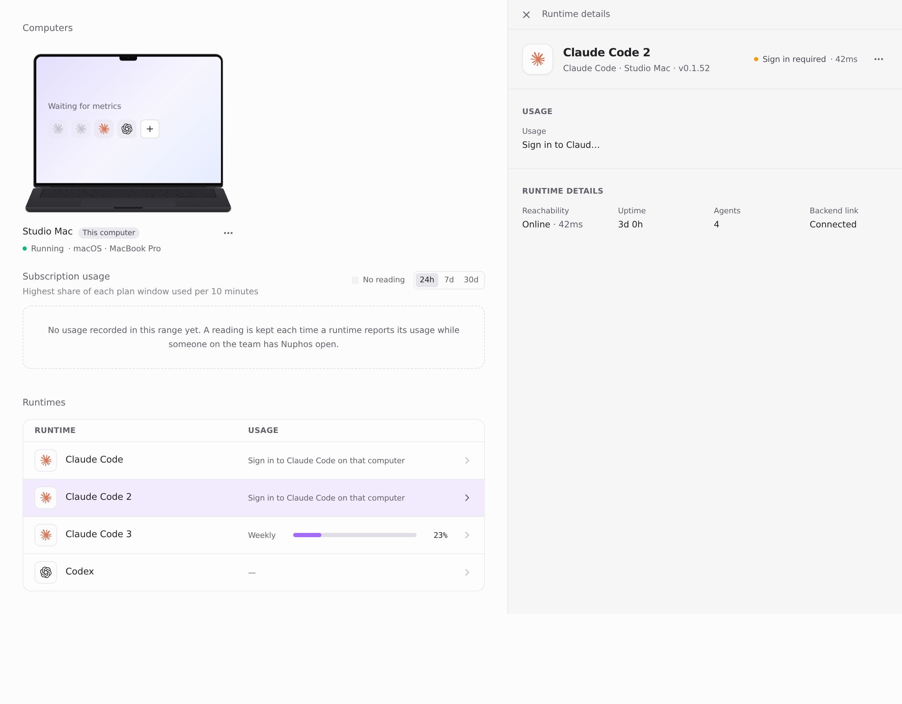
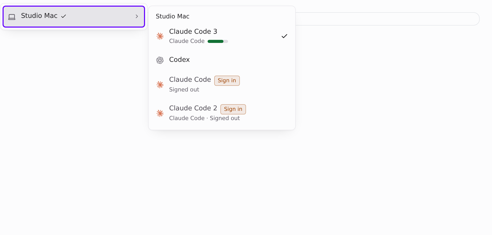
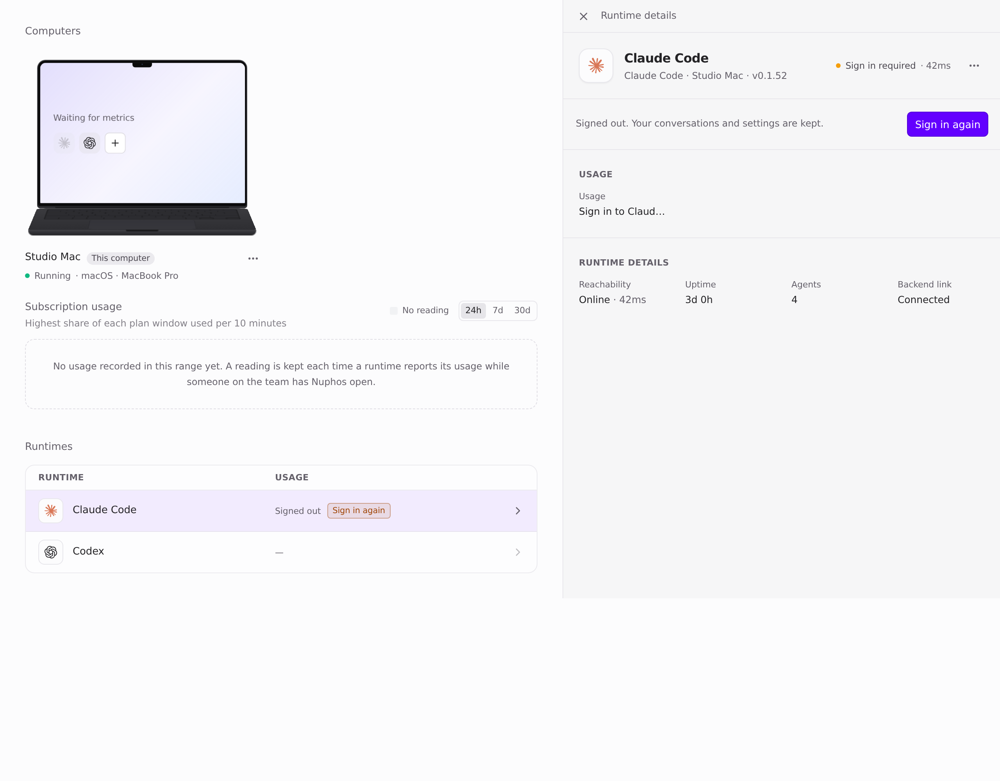
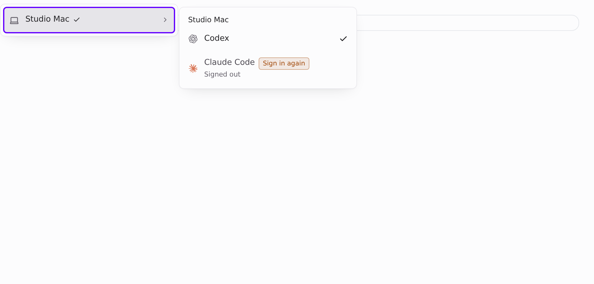
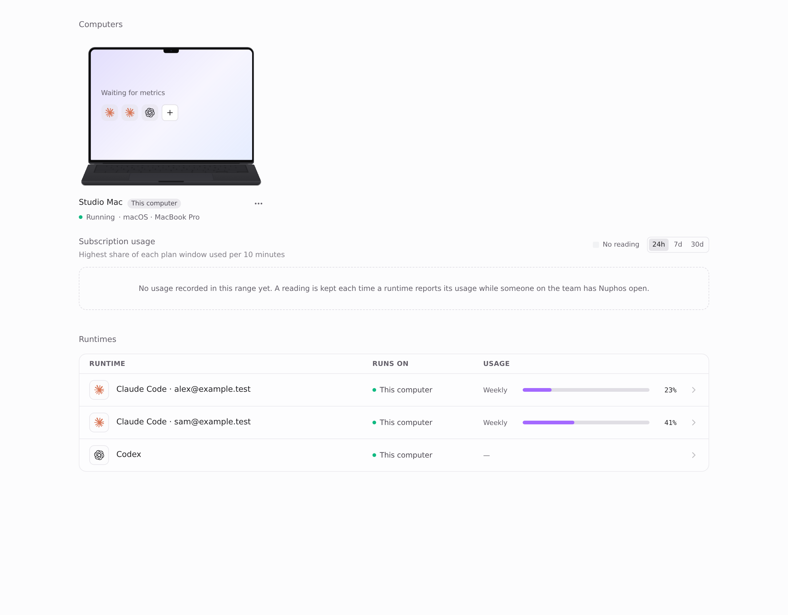
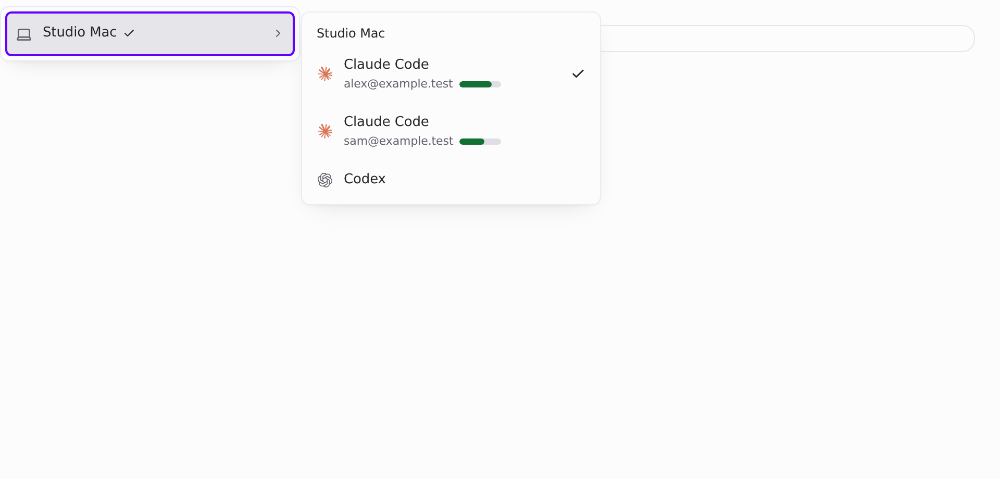
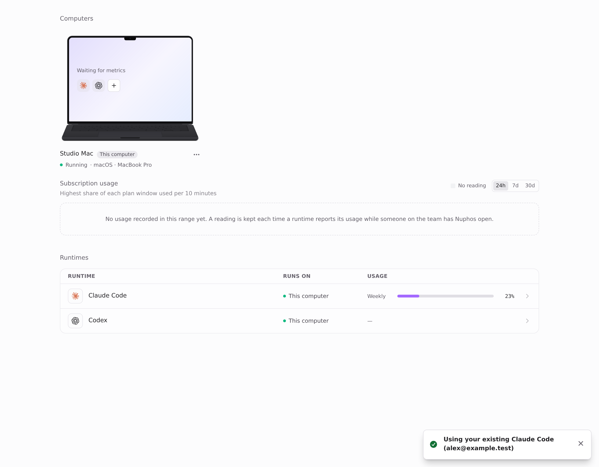
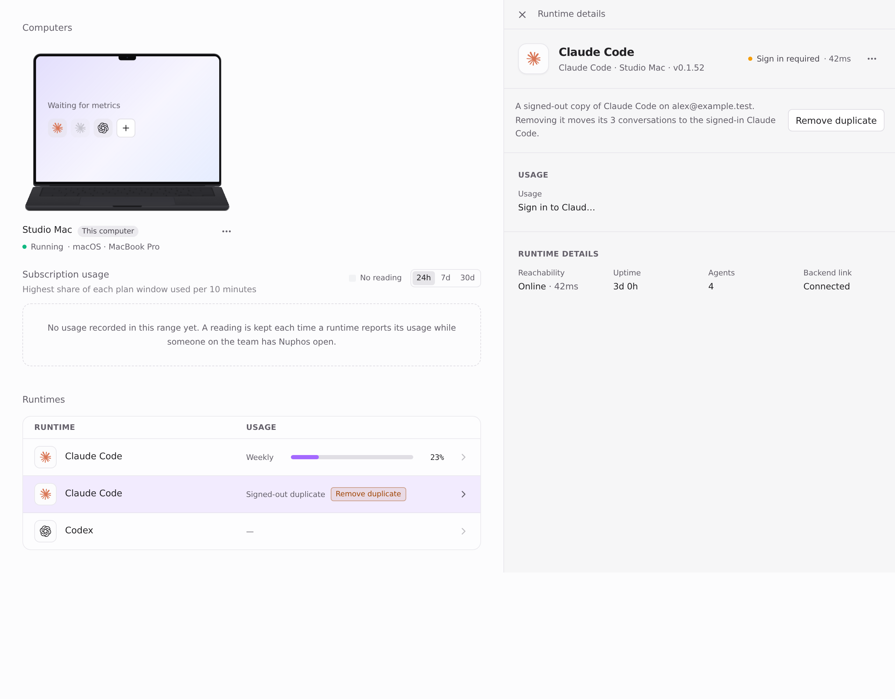
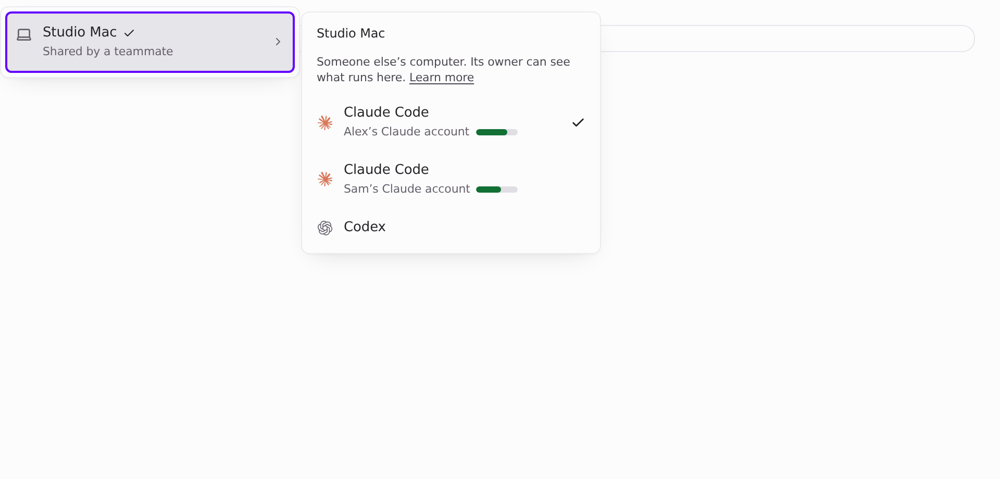

## Before/after visuals (mockup, nothing built)

All captures come from the real Desktop components rendered in a page-only harness at `main` (b2e72322), with fixture data and the light theme. The fixtures are a computer called "Studio Mac" and the people Alex, Sam and Taylor, with `@example.test` emails. The **after** images are a temporary local patch to those components: discarded after capture, never committed.

### Before: one computer, three "Claude Code" runtimes on one account

| Runtimes page (default runtime selected) | Runtimes page ("Claude Code 2" selected) |
| --- | --- |
|  |  |

"Claude Code" and "Claude Code 2" are signed out, and only "Claude Code 3" works. An added runtime such as "Claude Code 2" has **no sign-in button at all** (`thisComputerSignIn` skips `instanceId` runtimes), so adding yet another one looks like the only fix.

| Composer runtime picker |
| --- |
|  |

### After

**1. One runtime per account. Signed out shows "Sign in again" as the primary action.** "Add Claude Code" signs this runtime in again instead of creating "Claude Code 2".

| Runtimes page | Composer picker |
| --- | --- |
|  |  |

**2. The account appears only when a computer has two different accounts.** Owners and managers see the email.

| Runtimes page | Composer picker |
| --- | --- |
|  |  |

**3. A same-account sign-in reuses the existing runtime.** There's no dialog, only this toast.

**4. Existing duplicates get one "Remove duplicate" action.** It moves the duplicate's conversations to the signed-in runtime. Matching works on signed-out copies because `.claude.json` keeps `oauthAccount.emailAddress` after the token wipe (checked on a real computer).

**5. Teammate with `use` (Taylor) on Alex's computer** sees whose account it is, not the email.

