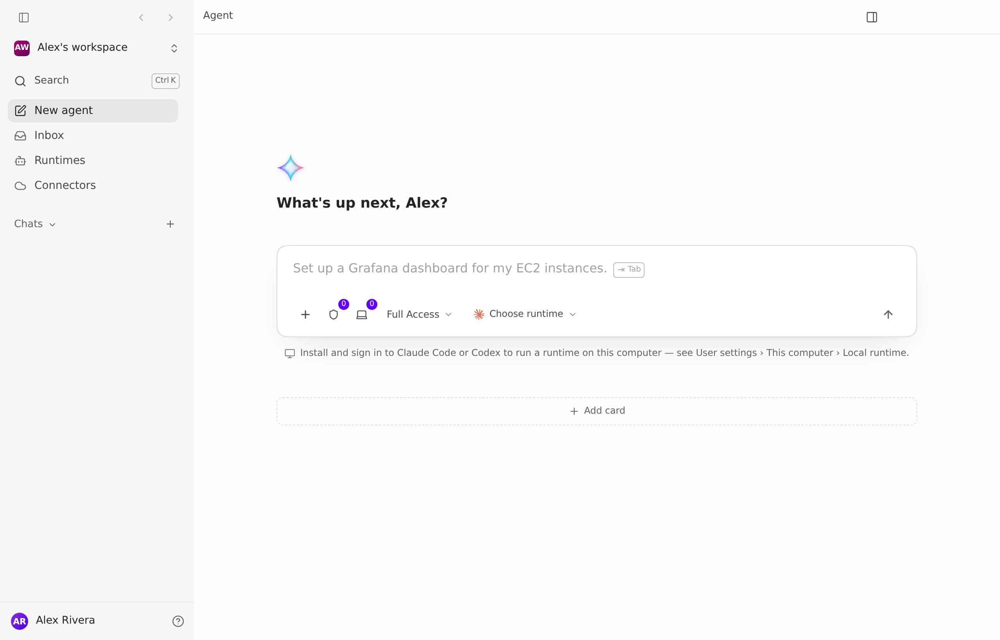
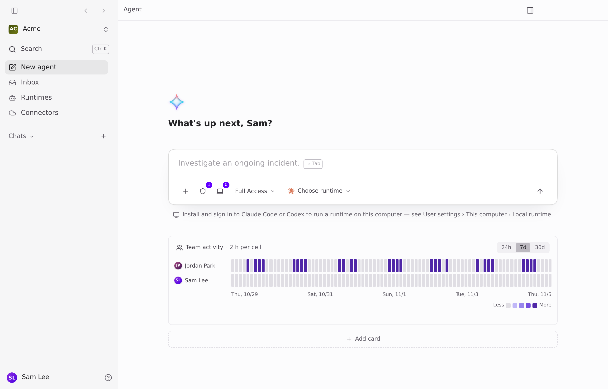
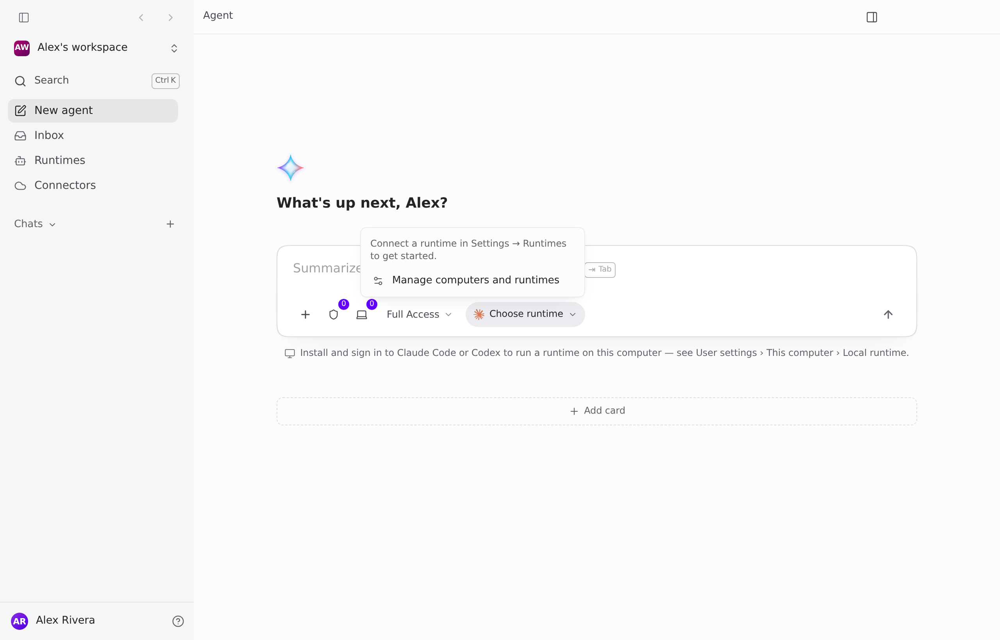
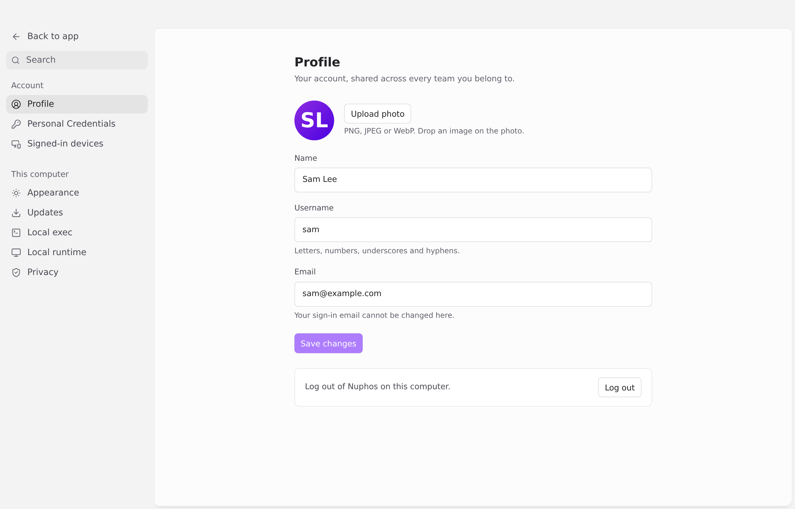
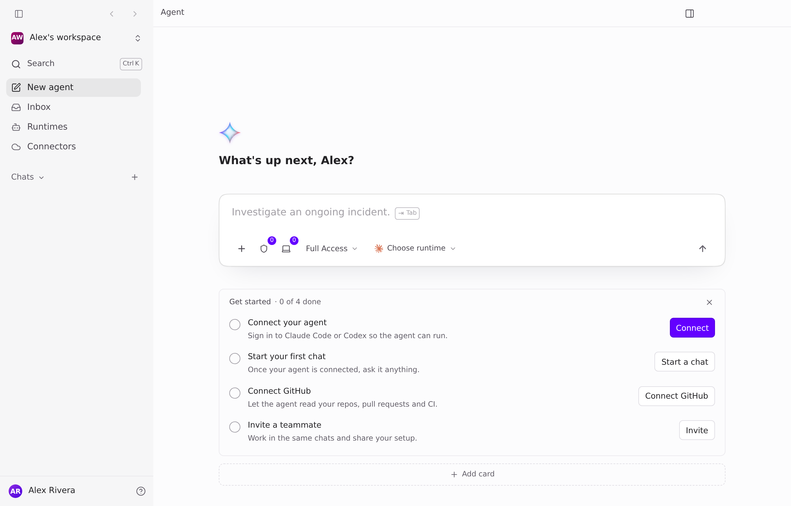
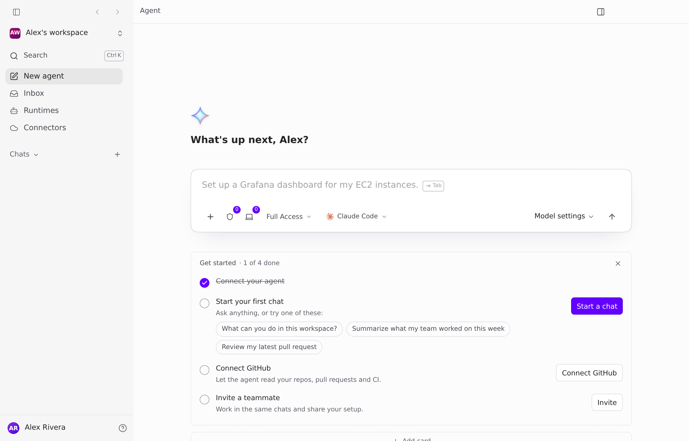
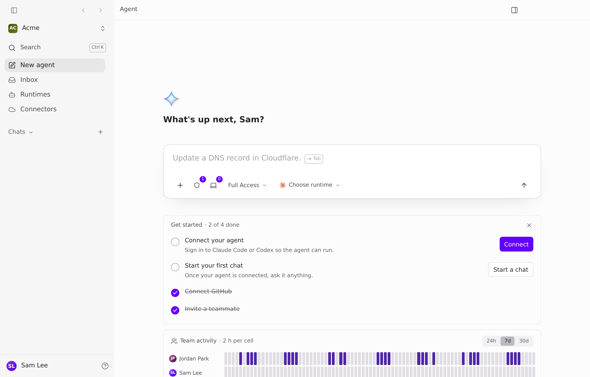

## Desktop: a "Get started" card on the agent home for new members

**Problem.** After signup or after joining from an invite, the agent home shows the greeting, the composer and "Add card". Nothing says what to do first. A new user with no runtime sees a one-line hint ("see User settings › This computer › Local runtime") while the runtime picker says "Connect a runtime in Settings → Runtimes", and Settings itself only has Account and This computer. Captured on main b2e7232 with fixture accounts:

| | Fresh signup | Fresh invitee |
|---|---|---|
| Home today |  |  |
| Runtime picker / Settings |  |  |

**Proposal.** One home card, shown above the other cards, with four steps that tick themselves off from state the app already loads, and that leaves for good once all are done or on ×:

1. **Connect your agent** → opens the existing agent setup (`openAgentSetup`). Done when a runtime is active.
2. **Start your first chat** → focuses the composer. Once an agent is connected it shows 3 example prompts as chips. Done when the member has a conversation.
3. **Connect GitHub** → the existing GitHub connect flow. Done when the team has an installation.
4. **Invite a teammate** → the existing invite modal (admins only). Done when the team has 2+ members.

While the card shows, it replaces the one-line local-runtime hint under the composer. Onboarding stays as it is. No tour, no overlay, no new backend.

| Fresh signup | After connecting an agent | Fresh invitee |
|---|---|---|
|  |  |  |

Mockup only, with fixture data. Copy, placement and whether the invite step belongs here are your call.
