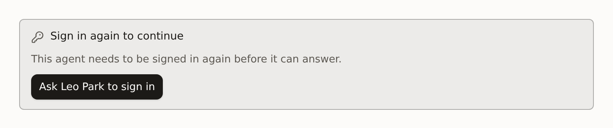
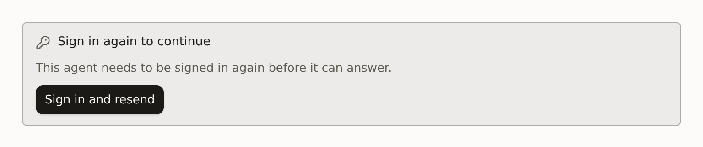

## Summary

Part of #3197 (piece 2 of the split: manager sign-in). Fixes #ISSUE.

Since #2431 the people who manage a computer may sign its agents in, and someone who only uses it may not. The backend enforces that in `requireAgentSignInAccess` (`apps/backend/src/lib/agent/devices/manage-access.ts`), which `runtime-login.ts` calls for every sign-in on a computer's agent. The team route has the same check in `loginRole` (`apps/backend/src/routes/teams/runtime-login.ts`). Two places still worked to the old owner-only rule:

- **Desktop.** `signInRoute` (`components/agent/panel/agentSignInModel.ts`) sent everyone except the owner to "Ask <owner> to sign in". It now takes `manages(deviceId)` and gives a manager the Sign in dialog. The computer comes from the loaded agent, or from the runtime id (`local_<owner>_<device>…`) when no agent is loaded yet. `manages` reads a new shared query, `hooks/useManagedComputers.ts`: one cached `boxListDevices` call (60 s) whose devices with `access` `owner` or `manage` count. The Task sign-in card (`useAgentSignInRoute`) and the agent picker's fixes (`usePickerFixes`, through `agentRowFix`) both use it. If the list hasn't loaded or fails, the app falls back to today's "ask the owner".
- **Backend.** `signInRecipients` (`lib/agent/sign-in-request.ts`) asked only the owner named in the runtime id. It now takes the computer as recorded (`computerSigners` in the new `lib/agent/sign-in-signers.ts`: the real owner through `deviceOwner`, plus `canSignIn` = `allows(deviceAccess(…), 'manage')`, the same rule `requireAgentSignInAccess` checks). It asks everyone who can sign in, owner first, so the card still names the owner. Managers get the push and the Inbox entry (`askedUserIds`). A manager who asks gets `409 can_sign_in` ("You can sign this agent in yourself"). If the computer isn't on record, only the owner is asked, as before.

No new strings.

## How this was verified

- **Flow exercised:**
  - Unit tests on both sides.
  - A new real-backend e2e scenario, `a manager of a teammate's computer signs its agent in; one who only uses it asks` (`scripts/e2e/agent-sign-in-scenarios.ts`, `agentSignInScenarios`, registered at the end of `computerScenarios` in `computer-scenarios.ts`, so `run.ts` is unchanged). The app's own computer stands in for the teammate's. Its owner (the suite's user) shares it with a manager and with an Editor who only uses it. The scenario checks:
    - `GET /agent/devices` lists it as `manage` for the manager and `use` for the other teammate. That is what the Desktop reads to offer the dialog.
    - The manager's `POST …/agent-runtimes/local_<owner>_<device>/login` starts (202). The other teammate's is refused (403). The manager's attempt is then cancelled, since the fixture computer has no real Claude Code to finish it.
    - The other teammate asks to sign in from a conversation on that agent. The conversation is set up in the database because the suite's fixture agent is not this computer's own agent. The stored ask goes to `[owner, manager]`.
    - The manager asking from the same conversation gets `409 can_sign_in`.
    - The share is removed afterwards.

    The two deliberate refusals (the 403 sign-in and the `can_sign_in` ask) are declared as that scenario's own `expected` failures, so `backend-log.ts` is unchanged.
  - Component harness capture (real `AgentSetupRequiredCard`, fixture data; Maya Chen manages Leo Park's ThinkPad, whose Claude Code needs signing in). Before: "Ask Leo Park to sign in". After: "Sign in and resend".

    Before: 
    After: 
- **Build and environment:** Linux container, worktree on upstream main 0fcd14d3. The harness is Vite + headless Chromium, 1100x720 at scale 2, light theme.
- **Result:**
  - Backend: `bun test src/lib/agent/sign-in-request.test.ts src/lib/agent/sign-in-signers.test.ts` 25 pass, 0 fail.
  - Desktop: `agentSignInModel.test.ts` 13 pass. `agentRowFix.test.ts` 8 pass. `lib/query/team.test.ts` 4 pass. `lib/query/runtime.test.ts` 2 pass. `agentBannerCopy.test.ts` 6 pass. `i18n.test.ts` 5 pass. `sourceText.test.ts` 3 pass.
  - Typecheck: backend `bun run typecheck` and Desktop `tsc -b --noEmit` both clean.
  - ESLint: 0 errors on the changed backend, Desktop and `scripts/e2e` files (warnings only, of kinds already in those files). Prettier clean.
- **Automated test added or updated:**
  - `sign-in-request.test.ts`: 4 new tests. Against main's `sign-in-request.ts`, 3 of them fail: "are asked with its owner, owner first", "sign it in themselves rather than asking", and "get the push and the Inbox entry; the ask still names the owner" (19 pass, 3 fail). The fourth checks the owner-only fallback, which main already does.
  - `sign-in-signers.test.ts`: 3 new tests.
  - `agentSignInModel.test.ts`: 2 new tests. Both fail against main's `agentSignInModel.ts`: "a computer's managers sign its agent in; those who only use it ask the owner" and "a manager signs in even before the agent is listed, reading its computer from the id" (11 pass, 2 fail).
  - The e2e scenario above.
- **Not verified:**
  - **The e2e suite was not run locally.** The scenario passed in this PR's "Desktop against a real backend" job on the earlier head (57d743bd). It hasn't run again since the rebase and the rename to `agent-sign-in-scenarios.ts`. This machine has docker and xvfb-run but not the rest of what the suite needs: no `openab` binary (none in `~/.cache/nuphos`, and building one means compiling OpenAB), no root `node_modules` (`playwright-core`), no `mongod`, and the `mongo:8.0.32` and `rustfs/rustfs:1.0.0` images aren't pulled. I didn't install them because disk is tight.
  - The scenario's TypeScript was checked with `tsc` on its own. The only error was the missing `playwright-core` types that `ui.ts` imports.
  - The scenario stops at "the sign-in starts". It doesn't sign a real Claude Code in, because the suite's computer has none.
  - The Desktop dialog for a manager wasn't driven in the real app, because the e2e app is signed in as the computer's owner. The card capture comes from the component harness with stubbed `boxListDevices` and runtime-instance answers.
  - The push to managers wasn't checked on a device. The scenario checks the stored `askedUserIds` that the push and Inbox use.
  - A limit that already applies to the owner: the Inbox lists the ask for a manager only if they can read that conversation.

🤖 Generated with [Claude Code](https://claude.com/claude-code)
