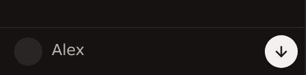
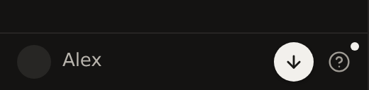
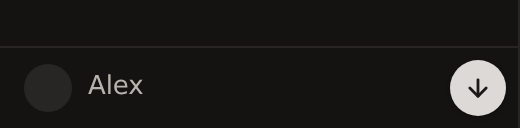
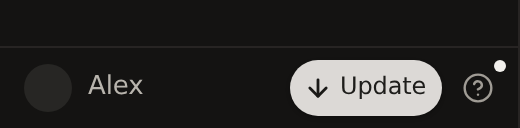
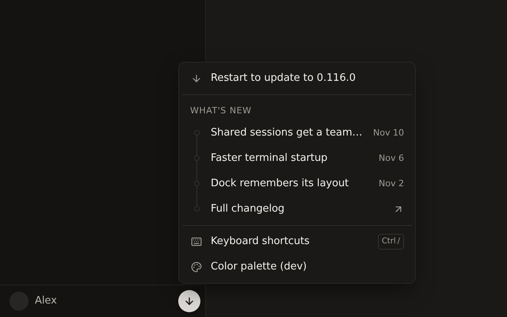
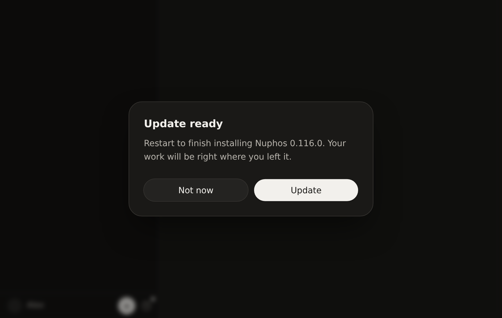
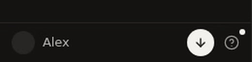
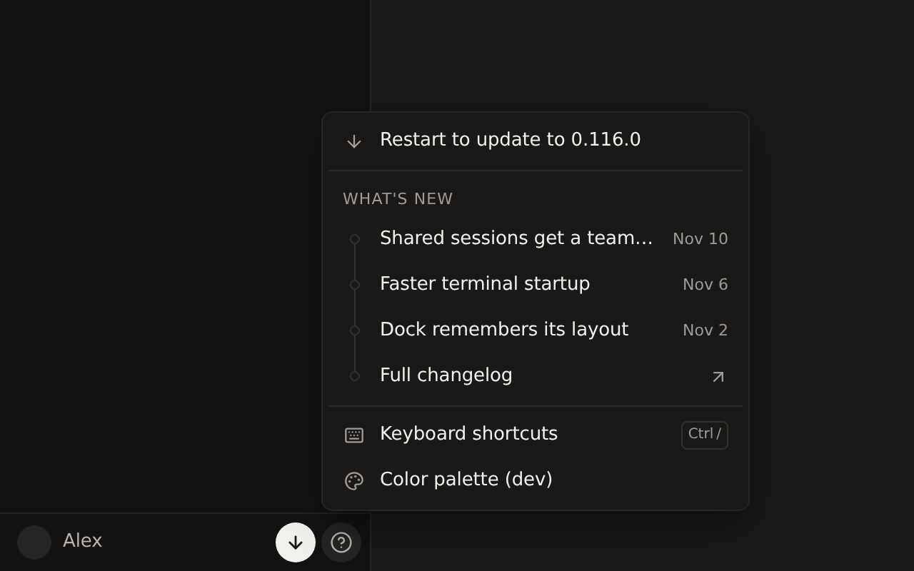

## What

- The round update button in the sidebar footer opens into an **Update** pill on hover (and on keyboard focus). The label width animates with a `grid-template-columns` 0fr→1fr transition, so it fits any language.
- Clicking the pill opens a small **Update ready** dialog instead of restarting right away: "Restart to finish installing Nuphos <version>. Your work will be right where you left it." with **Not now** and **Update**. **Update** runs the existing `updaterInstall` action.
- The **Restart to update to <version>** row in the help menu opens the same dialog, so both entry points share one path.
- The update button now sits beside the help button instead of replacing it, so Help, What's new and Keyboard shortcuts stay reachable while an update is waiting. While the restart downloads a newer release, the pill shows the percent and is disabled.
- `prefers-reduced-motion`: the pill's entry animation and the hover expansion are both off.

Renderer only. No main-process updater or quit changes. No new dependencies. Two new strings are translated in all 7 locales.

## Before / after

| | Before | After |
|---|---|---|
| Idle |  |  |
| Hover |  |  |
| Click |  |  |

Hover animation:

Hover, click, Not now:

Help menu after (row opens the dialog):

Captured from the real `SidebarHelpMenu` in a Vite harness with a stubbed updater (fake version 0.116.0, placeholder user).

## Testing

- `pnpm typecheck`: pass
- `pnpm lint`: 0 errors (no new warnings in the changed files)
- `pnpm test`: 2958 pass. The one failure, `electron/local-terminal.test.ts`, comes from the sandbox: `node-pty` has no linux-x64 native build there. It is unrelated to this change.
- Checked in the harness: the pill and the menu row both open the dialog. **Update** calls `updaterInstall` and closes the dialog. **Not now** and Escape close it. With reduced motion, animation and transition are `none`.
