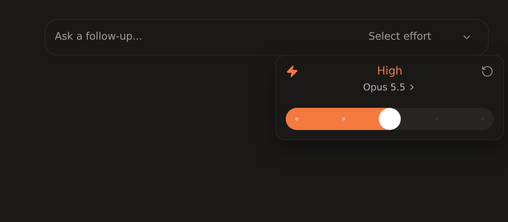
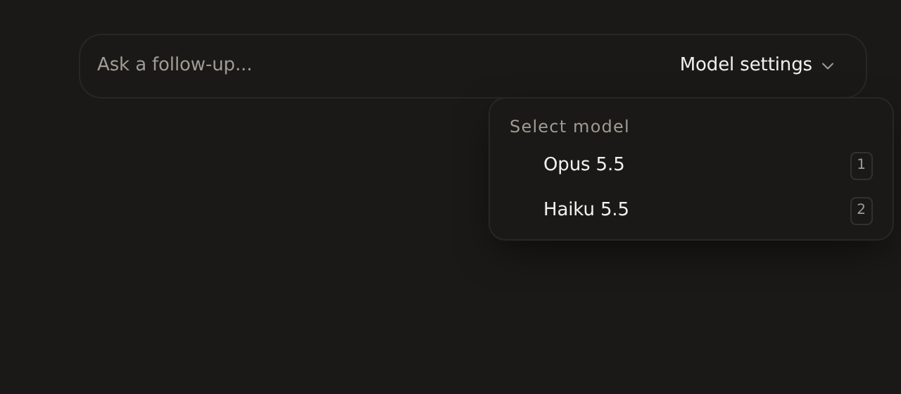
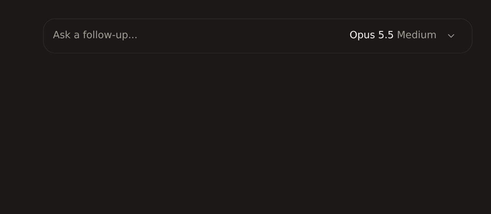

## What was wrong

The model chip on a started chat shows the settings the backend stored when someone picked them. It never learned about changes the runtime made by itself, so it could disagree with what Claude Code ran.

1. **Fast mode stays "on" after Claude Code turns it off.** On an account without extra usage, the first reply comes back at standard speed. Claude Code turns fast mode off and posts "Fast mode turned off: requires extra usage…", but the chip keeps the ⚡ and the toggle stays on.
2. **Chats started on the agent's defaults get no effort control.** Sub-agents and bot chats that never had a pick show "Model settings" with only the model list. There's no effort slider and no fast toggle.

## Reproduced end to end

On a Computer 1 Claude Code runtime, in a throwaway chat, I checked each setting against the runtime's own transcript (`message.model`, `effort`, `usage.speed`):

- Turned fast mode on in the popover and sent a message. The transcript showed `speed: "standard"`, and the CLI's result reported `fast_mode_state: "off"`, `fast_mode_disabled_reason: "extra_usage_disabled"`. The adapter sent `config_option_update` with `fast=off` (seen by driving `claude-agent-acp` directly over ACP). The chip still read "Opus 5.5 High, fast mode on".
- Started a chat with no model or effort pick. Asking for the offered efforts returned none until something was picked.

The model picker, every effort stop on Opus and Haiku, reset, switching model mid-chat, and settings surviving a runtime restart all applied correctly. Only the chip's copy was stale.

## Fix

After each reply, the backend reads the settings from the now-idle session and stores them. The chip reads that copy, so it now shows what the session runs. A session that's busy, gone or replaced keeps the stored settings. A failed read never fails the reply.

Why I didn't remove the stored copy instead: the chip can't ask the session while a reply runs (`-32005`), and #767 made the list independent of that. The copy stays, and the runtime now keeps it current.

Claude Code reports its default model as `default`. The runtime catalog already lists that as the model it stands for, so the chip shows it that way too.

## Before / after

The real `ModelSelector`, rendered with the exact payloads `GET /agent/conversations/:id/model-config` returns before and after the fix.

| | Before | After |
|---|---|---|
| Fast mode after the first reply |  |  |
| Chat started on the agent's defaults |  |  |

## Tests

New file `session-config-record.test.ts`. Its first two cases fail without the fix:
- after a reply the chip shows what the session runs, including fast mode the runtime turned off
- a chat on the agent's defaults gets its effort and fast controls (and its default model by name) after the first reply
- a busy or replaced session leaves the stored settings alone
- a finished Claude Code turn stores its settings before it settles

`bun test src/lib/claude-code-preview/` passes (1058 tests), and `bun run typecheck` is clean.
