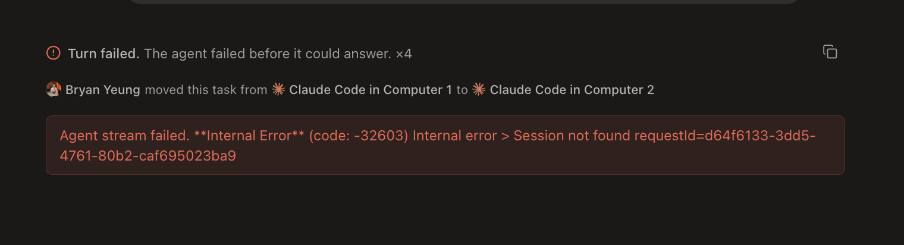
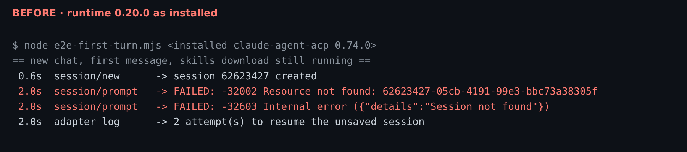
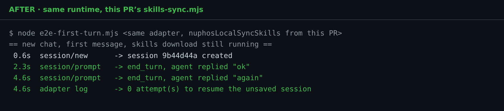
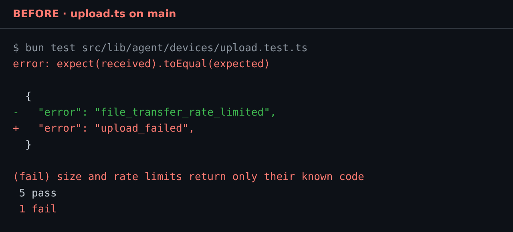
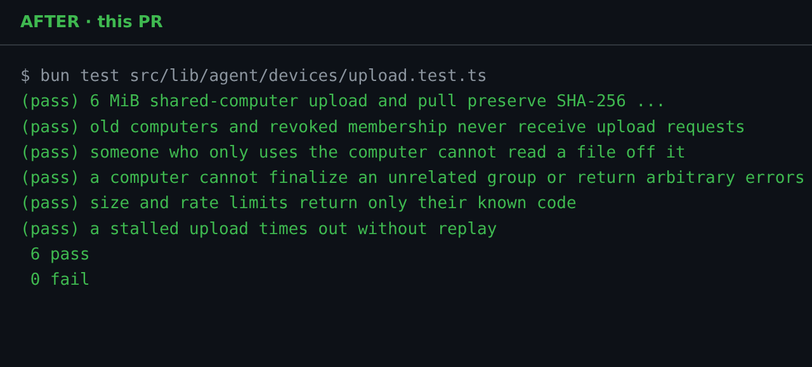

## Summary

Two fixes for errors seen in a long Desktop session on 2026-11-16.

### 1. A new chat's first message fails on a local Claude Code runtime

On a local (Desktop or CLI) Claude Code runtime, a new conversation's first message sometimes fails with `-32002 Resource not found: <session id>`. Every later message then fails with `-32603 Session not found`. This also kills `create_thread` sub-agents, which are always new conversations. It shows up more often on a busy computer.

**Why.** `nuphosLocalSyncSkills` in `apps/desktop/local-runtime/skills-sync.mjs` installs `nuphosRefreshPersonalSkills`, which runs before every prompt. When the personal skills on disk changed, it called `teardownSession` and then `createSession({ resume })`. The personal-skills download from session open runs in the background, so on a new chat it usually lands during the first prompt. The hook then tore down a session whose conversation Claude Code had never saved. Both resume attempts failed, and the adapter no longer held the session.

The real runtime log on a Linux computer shows the pattern: `session created`, then two `[session/query] resume=<same id>` lines within a second, then `-32002`. The session home's `.skills-revision` was written at that same second.

#2618 removed this rebuild from the runtime image's copy (`apps/runtime/image/runtime-defaults.mjs`). The Desktop patch swaps that function for its own copy, `nuphosLocalSyncSkills`, which still had the rebuild. Local runtimes therefore never got the #2618 fix.

**Fix.** A prompt only syncs the skills on disk, the same as #2618. The running session picks a change up through its file watcher, which is why the personal tree is already replaced in place. A new process reads the skills on start. The change tracking (`installed()`, `before`, the return value) only existed to decide on a rebuild, so it is removed too. The trade-off is the one #2612 accepted: a personal skill that changes mid-conversation may not be visible until the watcher fires.

### 2. `local_upload` says `upload_failed` when the team hits the hourly transfer limit

`admitFileTransfer` throws `file_transfer_rate_limited` once a team uses its 60 transfers, or 5 GiB, in a UTC hour. `dispatchLocalUpload` passed through only four transfer codes and turned every other code into `upload_failed`. Agents saw no reason and kept retrying until the hour turned. In the session above, every agent's uploads failed for about two hours while sub-agents uploaded screenshots for pixel checks. The code is now passed through. It is a fixed string, so nothing signed can leak.

## How this was verified

| What the user saw (Desktop, before) |
| --- |
|  |

**First message of a new chat, end to end through the real adapter**

| Before | After |
| --- | --- |
|  |  |

**`local_upload` when the transfer budget is spent**

| Before | After |
| --- | --- |
|  |  |

- **Flow exercised:** A new chat's first and second messages, driven over ACP stdio against the real `claude-agent-acp` 0.74.0 adapter from an installed local runtime (nuphos CLI 0.20.0, Linux), with a real signed-in Claude Code and Haiku. A local stand-in for the skills endpoint served the bundles and delayed the session-open personal download by 4 s, as a busy computer does. The per-turn credential came through `OPENAB_CREDENTIALS_DIR`, as OpenAB sets it. "Before" used the adapter as installed. "After" used a copy of the same adapter with `nuphosLocalSyncSkills.toString()` from this branch swapped in for main's, which the installed bundle carries verbatim.
- **Build and environment:** Installed runtime 0.20.0 on Linux x64 for the end-to-end run. The tests ran on macOS on this branch, rebased on `7ca2a0c59`.
- **Result:** Before, the first message failed with `-32002 Resource not found` and the second with `Session not found`, after 2 resume attempts. This matches the Desktop error in the first image. After, both messages answered (`end_turn`), with 0 resume attempts.
- **Automated test added or updated:**
  - `apps/desktop/local-runtime/skills-sync.test.mjs`: the personal-skills test now asserts that a prompt never calls `teardownSession` or `createSession`, while the skills on disk still follow the turn's credential. It fails against main, where it expects a rebuild, and passes here (9/9).
  - `apps/backend/src/lib/agent/devices/upload.test.ts`: the size-limit test now also covers `file_transfer_rate_limited`. It fails against main (`upload_failed`) and passes here (6/6).
  - `prettier --check` is clean on the 4 changed files.
- **Not verified:**
  - I did not rebuild or install a packaged Desktop app with this change.
  - The end-to-end script needs a signed-in Claude Code, so it is not in CI. The unit test above is the regression guard.
  - ESLint did not load its config in my temporary worktree, so CI is the lint check.
  - I did not exercise a real team hitting the limit. The two-hour upload outage matching the limit is inferred from the code and timing, not read from the counters.

Refs #2612, #3016, #2618

🤖 Generated with [Claude Code](https://claude.com/claude-code)
