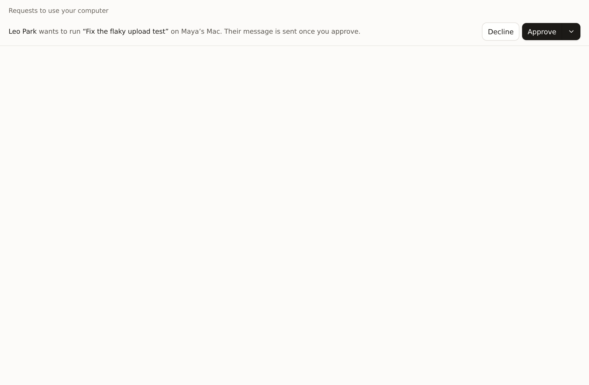
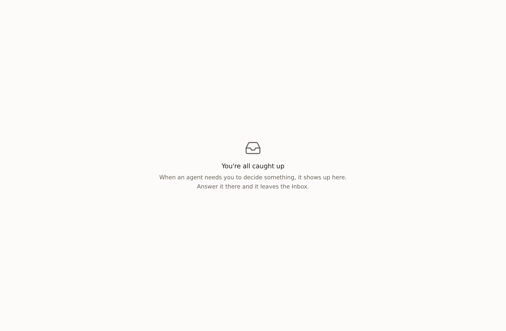

## Summary

Part of #3197 (piece 3 of the split order there). Pure removal of client UI for computer-use approvals, which nothing creates any more.

Why it is dead: #1391 (8abba9053, "one access model for computers") deleted `apps/backend/src/lib/agent/devices/local-share.ts`, the only caller of `requestShareApproval` and the only place that threw `local_share_approval_required`. On main today `requestShareApproval` (`local-share-store.ts`) has no caller, and that error code is only compared against (`queued-turn.ts`, `session-queue-share-approval.ts`), never thrown outside tests. So the list routes can only return records stored before #1391.

Removed:

- **Desktop:** the "Requests to use your computer" Inbox section, its count in the Inbox badge and its OS notification. `InboxView.tsx`, `use-inbox-badge.ts`, and the deleted `views/inbox/` files `ShareApprovalRequests.tsx`, `ShareApproveButton.tsx`, `shareApprovalNotice.ts` (+ its test), `shareApprovalNotification.ts`, `useShareApprovals.ts`. The 10 strings only they used are removed from all 7 locales.
- **iOS:** `Models/ShareApproval.swift`, `tests/ShareApprovalTests.swift` (and its line in `tests/run.sh`), `NuphosAPI.ownShareApproval`, `ChatSession.shareApproval` / `refreshShareApproval`, the waiting strip in `ConversationView.swift`, and the matching line in `tests/RuntimeObservationTests.swift`. The queued-send task still reloads runtimes.
- **Android:** `session/ShareApproval.kt` and its test, `NuphosApi.ownShareApproval`, `ChatSession`'s `readShareApproval` / `shareApproval` / `watchShareApproval`, and the strip in `ConversationScreen.kt`.

Kept, as #1391 planned for step 3 of #1328: all backend approval and trust routes and stores (released builds still call them), the Desktop chat panel's wait UI (`useShareApprovalWait`, `queuedShareApproval`, `ReadOnlyNotice`, `RuntimeSelector`) and the electron IPC and notify code behind it.

Left for a follow-up: after this removal these Desktop pieces have no caller: `localShareApprovals`, `localShareDecide`, `localShareNotify` (preload, `device-api.ts`, `window-device.ts`), `notifyShareApproval` (`electron/agent/notify.ts`, reached only through the `localShareNotify` IPC) and `queryKeys.shareApprovals`. They are left in place so this PR stays a removal of visible UI only; they go with step 3.

Same change as in #3197; no wording or behaviour differs.

## How this was verified

- **Flow exercised:** the Inbox page (`InboxView`) rendered with fixture data, nothing to answer, and the approvals IPC answering one old-style request (Leo Park asks to run "Fix the flaky upload test" on Maya's Mac). Before: the section with Decline / Approve. After: the section is gone and the page reads "You're all caught up". This is a component harness (Vite, headless Chromium, light theme, 1100x720 at 2x), not the packaged app; it renders only the Inbox page, not the sidebar badge or the OS notification.

  | Before | After |
  | --- | --- |
  |  |  |

- **Build and environment:** Linux container, branch on main 9b58fc7f.
- **Result:**
  - Nothing imports what is deleted: `git grep` for `ShareApprovalRequests`, `ShareApproveButton`, `shareApprovalNotice`, `shareApprovalNotification`, `useShareApprovals`, `useShareApprovalNotifications` over the repo, and for `ShareApproval`, `ShareApprovalStrip`, `ownShareApproval`, `refreshShareApproval`, `readShareApproval`, `watchShareApproval`, `shareApproval`, `ShareApprovalTests` over `apps/ios` and `apps/android`: no matches. No `.pbxproj` references the deleted Swift files.
  - Desktop: `i18n.test.ts`, `sourceText.test.ts` and the `views/inbox/*.test.ts` files: 25 pass, 0 fail. `task-row-continuity.test.tsx` (mocks `use-inbox-badge`): 1 pass. `tsc -b --noEmit`: exit 0. `eslint` on `InboxView.tsx` and `use-inbox-badge.ts`: no problems. `prettier --check` on those and the 7 locales: clean.
  - e2e: no scenario in `scripts/e2e` touches the removed section; the two Inbox scenarios in `run.ts` answer question cards only. No iOS UI test or Android device test references the strip or the approval routes.
- **Automated test added or updated:** none added (removal). `shareApprovalNotice.test.ts`, `ShareApprovalTests.swift` and `ShareApprovalTest.kt` are deleted with the code they tested.
- **Not verified:**
  - iOS and Android were not compiled or tested here (no Xcode or JDK in this environment). This PR's CI builds both; the same iOS and Android change passed "iOS (simulator build)", "Android (tests, lint, APK build)" and "Android (device tests on an emulator)" on #3197. The only files in `apps/ios` / `apps/android` that differ from #3197 are upstream changes since (UI tests, version), which this PR does not touch.
  - The Inbox badge and the OS notification were not exercised in a running app.
  - The real-backend e2e suite was not run here; it does not cover this UI.

Fixes #ISSUE. Refs #1328

🤖 Generated with [Claude Code](https://claude.com/claude-code)
