**03-remove-member-confirm**

| Before | After |
| --- | --- |
| 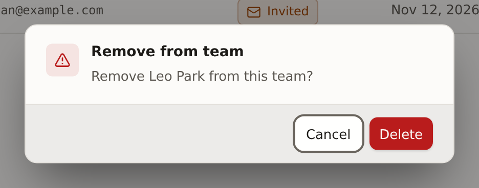 | 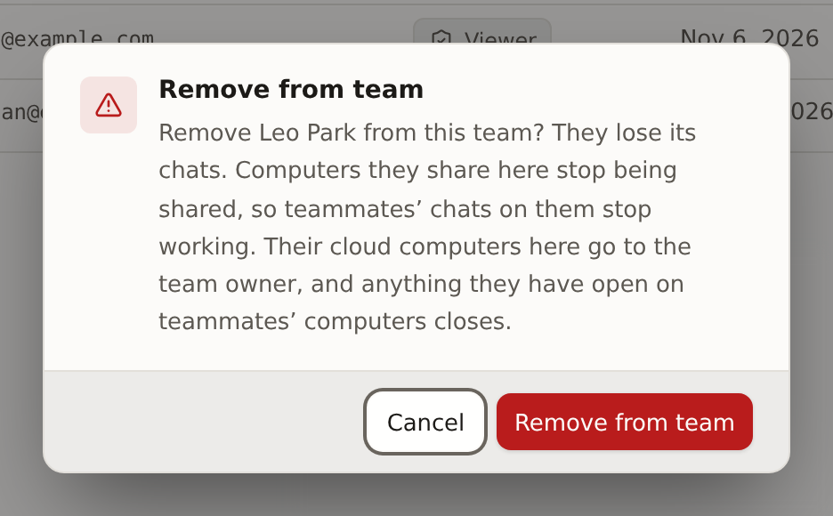 |

**04-cancel-invite-confirm**

| Before | After |
| --- | --- |
| 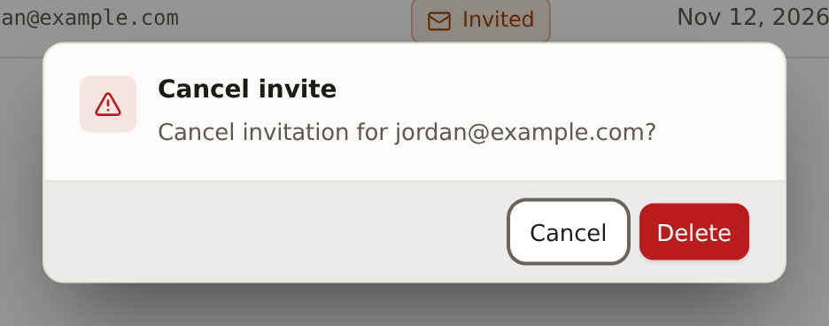 | 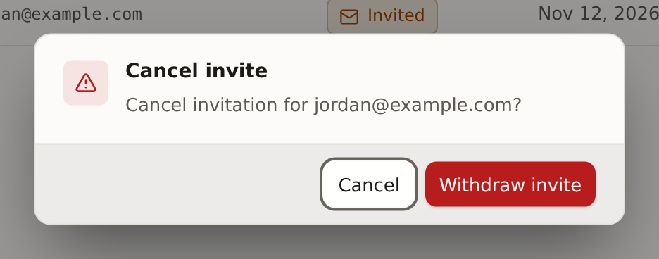 |

**10-local-runtime-copy**

| Before | After |
| --- | --- |
| 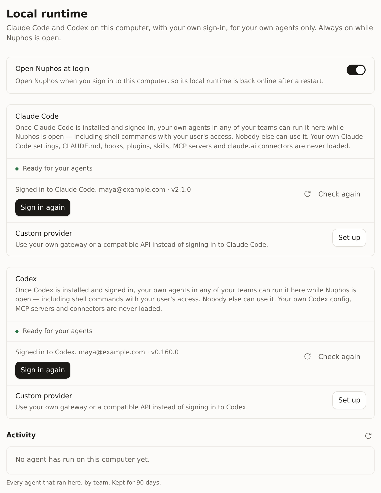 | 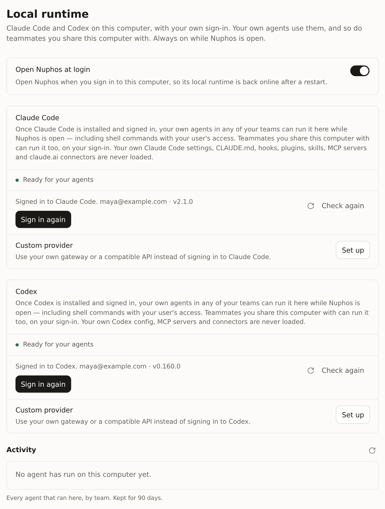 |

**11-local-exec-copy**

| Before | After |
| --- | --- |
| 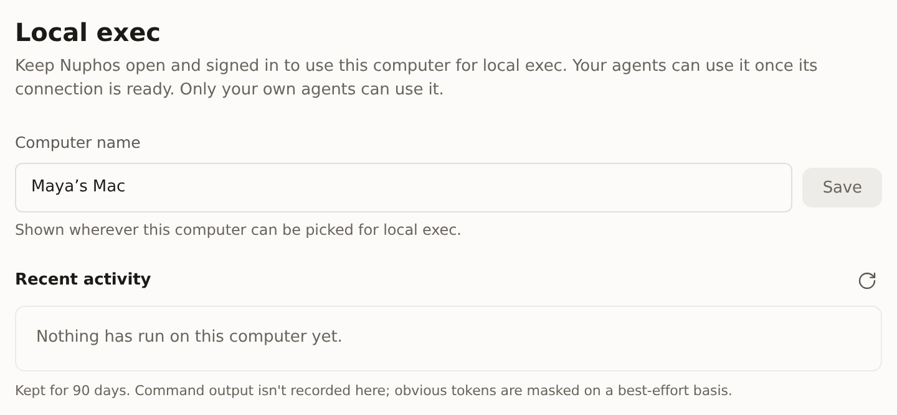 | 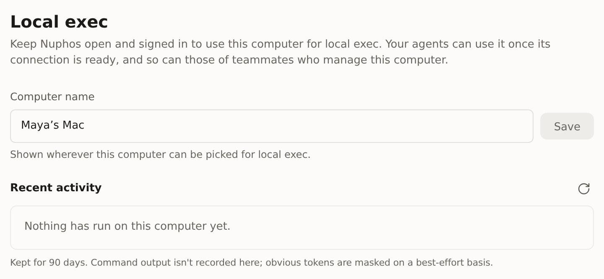 |

**12-leave-workspace-confirm**

| Before | After |
| --- | --- |
| 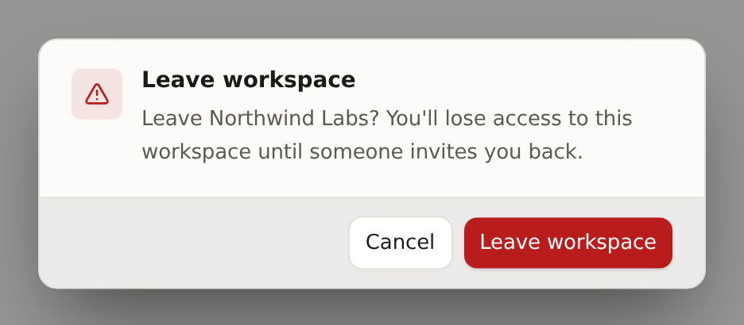 | 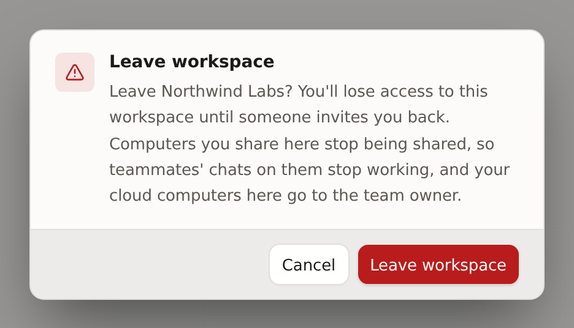 |

**14-agent-gone-banner**

| Before | After |
| --- | --- |
| 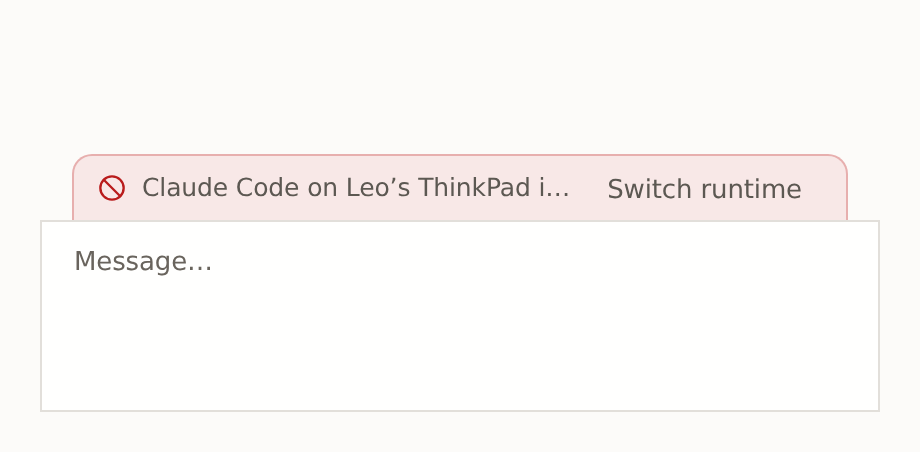 | 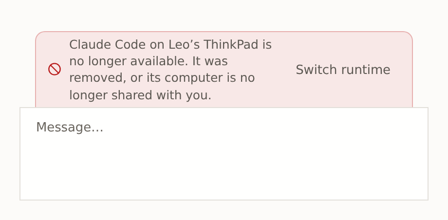 |

