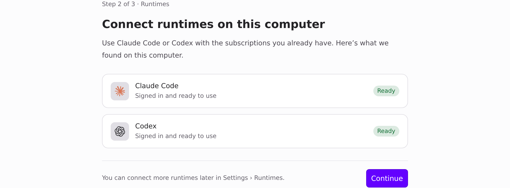
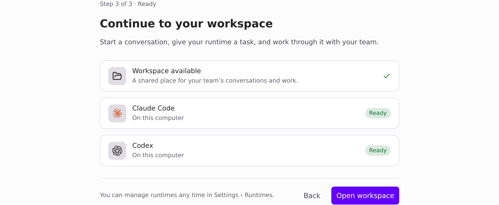

Visuals for HEADSHA

Light theme. Page-only Playwright captures of the real Desktop onboarding components (`LocalAgentsStep`, `SetupComplete`), fixture data only (a computer with Claude Code and Codex signed in, `window.api` stubbed). Before is main 0384809b, after is this branch.

### Onboarding, runtimes step

| Before (main) | After |
| --- | --- |
|  |  |

### Onboarding, last screen

| Before (main) | After |
| --- | --- |
|  |  |
