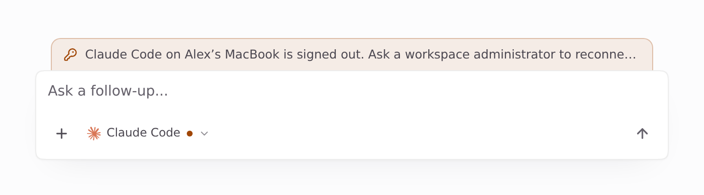
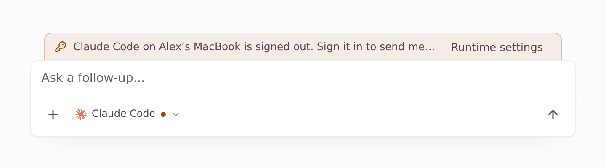
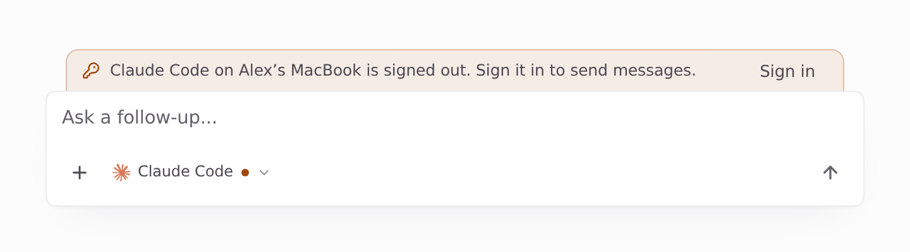
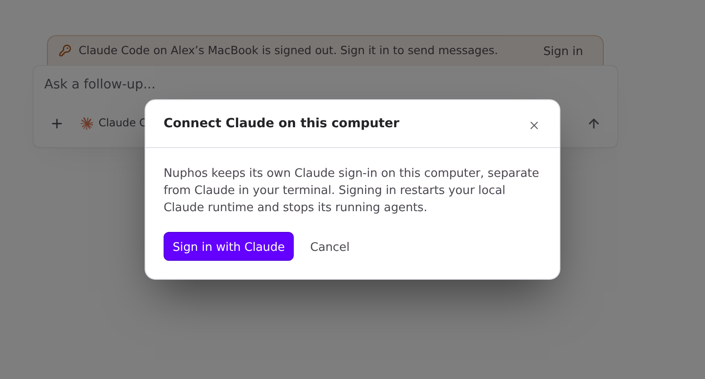
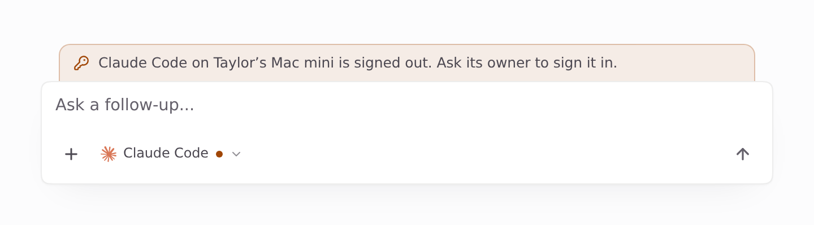
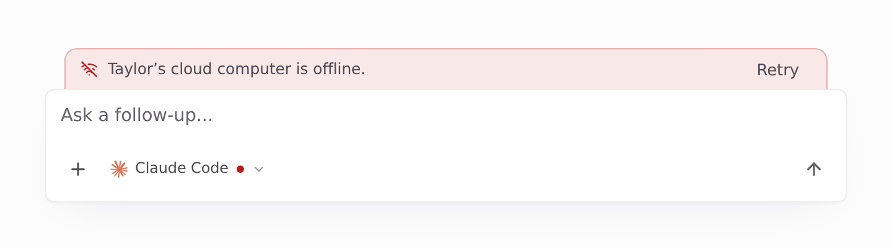

Visuals for abfa7ab74638272cde347e49774e2e2629d6527a

Light theme. Page-only Playwright captures of the real Desktop `Composer` (Chromium, 2x). Fixture data only: viewer Alex Rivera (member) on "Alex’s MacBook", the computer this window runs on; teammate Taylor Kim. No backend: `window.api` returns the fixtures. Before is main 2e20d34f, after is this branch.

### This computer's Claude Code, signed out, viewed by a member

| Before (main) | After |
| --- | --- |
|  |  |

### Same, viewed by an admin

| Before (main): "Runtime settings" | After: Sign in |
| --- | --- |
|  |  |

### After: Sign in opens this computer's Claude sign-in

### Unchanged (after)

| Teammate's computer signed out | Teammate's paused cloud computer |
| --- | --- |
|  |  |
