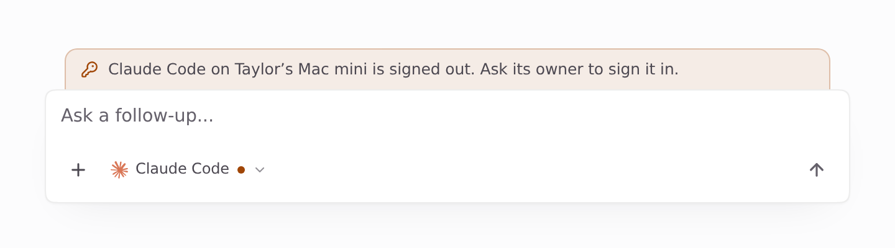
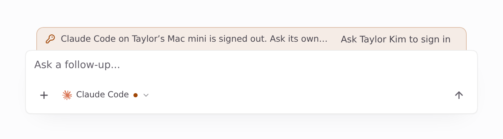
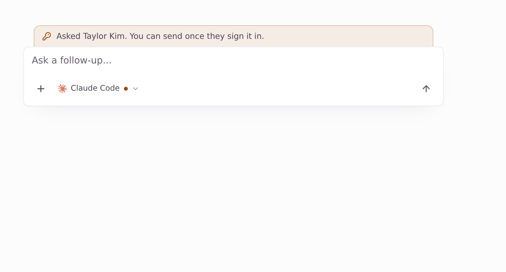
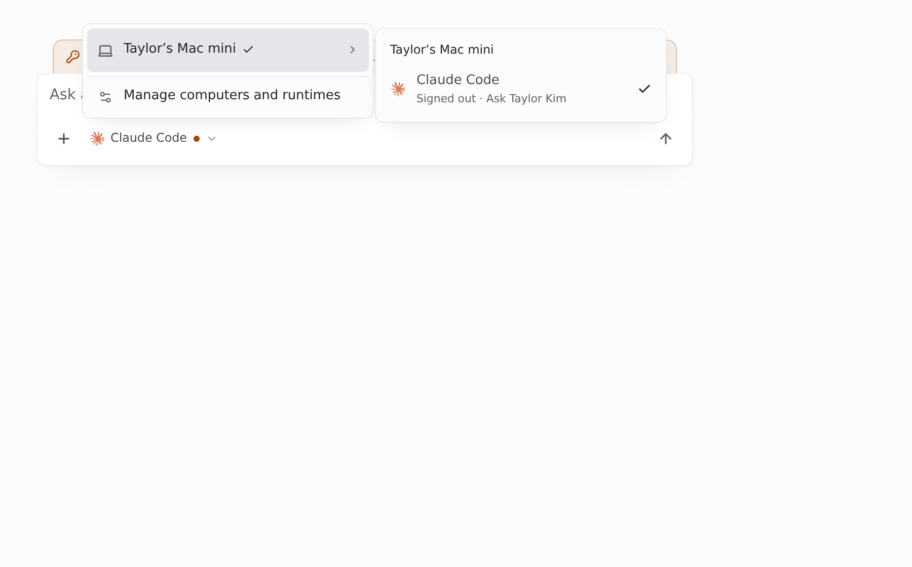
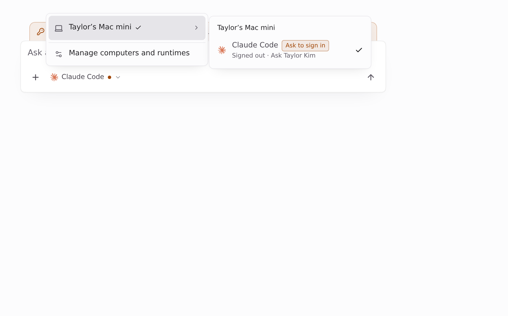
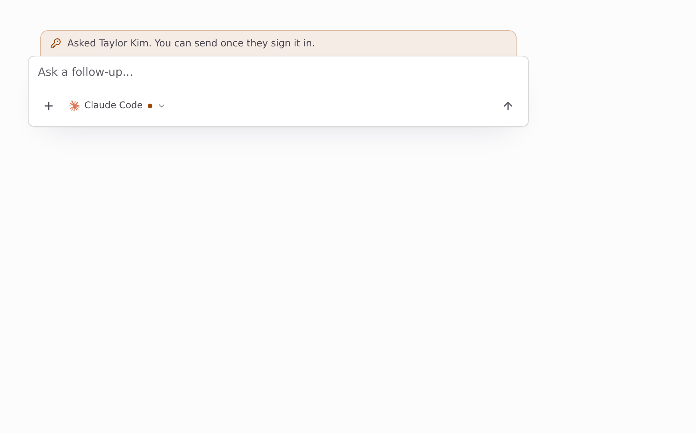

Visuals for HEADSHA

Light theme. Page-only Playwright captures of the real Desktop `Composer` and runtime picker. Fixture data only: viewer Alex Rivera, a conversation on teammate Taylor Kim's "Taylor’s Mac mini", whose Claude Code is signed out. `window.api` is stubbed and `runtimeSignInAsk` answers `{ askedName: 'Taylor Kim' }`. Before is main 0384809b, after is this branch.

### Banner

| Before (main): no button | After: Ask | After: asked |
| --- | --- | --- |
|  |  |  |

### Picker

| Before (main): clicking the row does nothing | After: Ask to sign in |
| --- | --- |
|  |  |

After clicking the row, the request goes out, the menu closes and the banner shows the ask:

