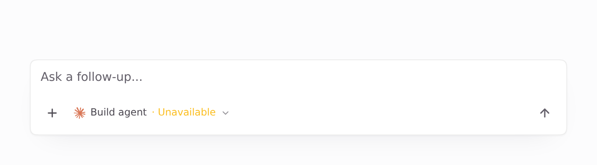
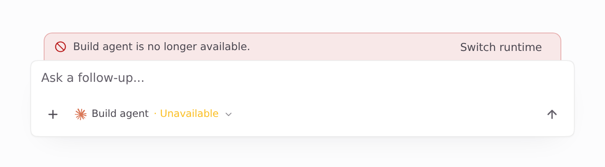
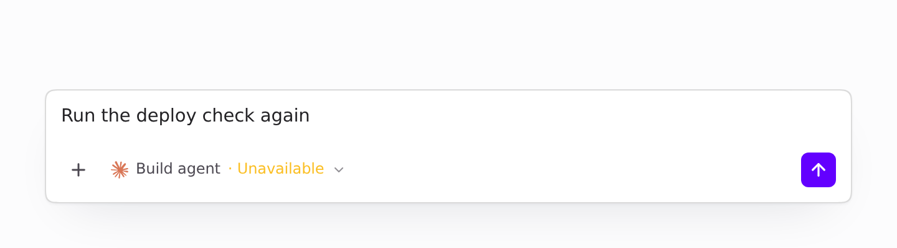
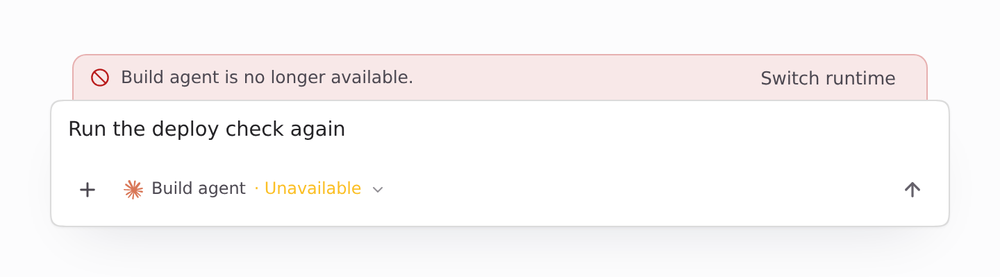
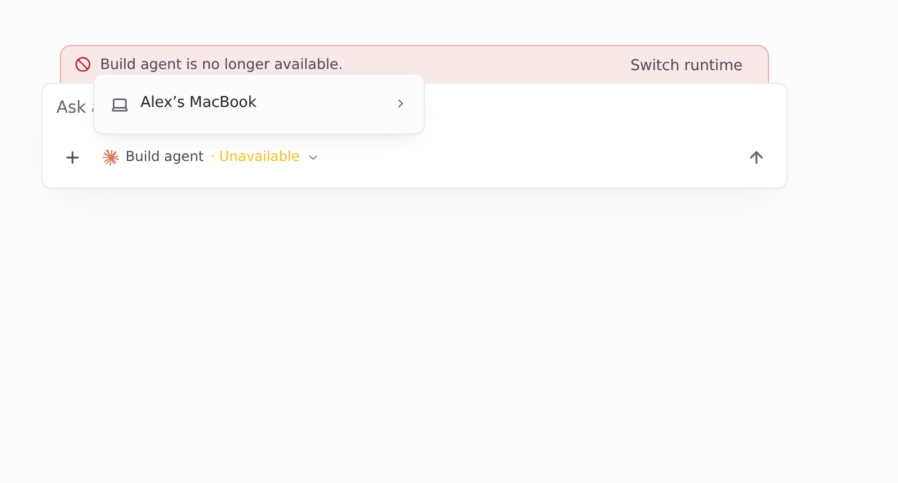

Visuals for HEADSHA

The full set again after rebasing onto main c1661955 (#1589 and #1594 merged). Range-diff:

```
RANGEDIFF
```

The only conflict was in `Composer.tsx`: #1589 replaced `runtimeSendBlocked` with `runtimeSendBlock` (from `runtimeSendRefusal`). This PR's `switchAgent` line now sits beside #1589's `sendBlocked`, and both blocks still apply. `ReadOnlyNotice.tsx` and `runtimeControlSignOut.ts` merged without changes: the `gone` branch stays ahead of `reachabilityCopy`, alongside #1585's `BannerFixes`. Nothing visible changed. Everything below was re-captured at this head.

Light theme. Page-only Playwright captures of the real Desktop `Composer`. Fixture data only: conversation `s-1` on "Build agent", which is no longer in the runtime list (`unavailable: true`). `window.api` is stubbed. Before is main c1661955, after is this branch.

| Before (main): no banner | After |
| --- | --- |
|  |  |

### With a message typed

| Before (main): Send enabled, so the message hits runtime_not_found | After: Send disabled |
| --- | --- |
|  |  |

### After: Switch runtime opens the picker


