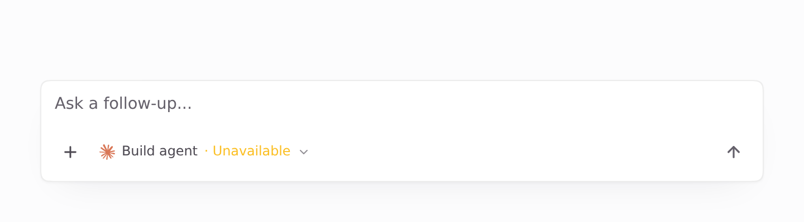
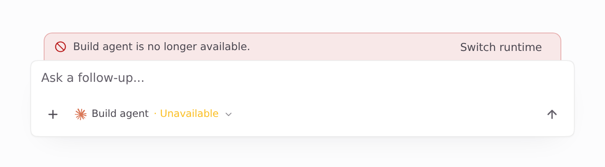
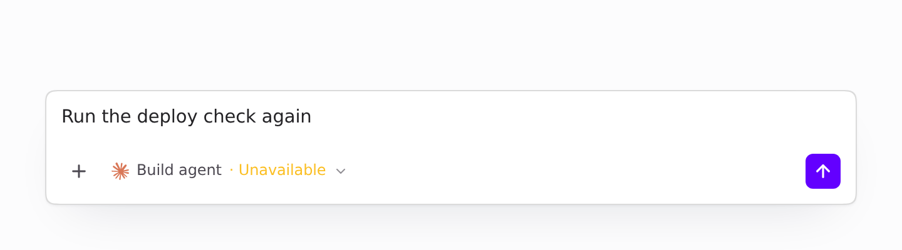
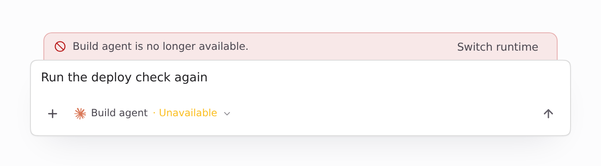
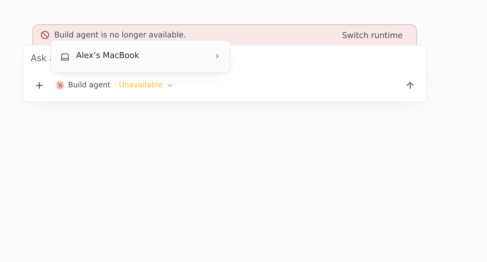

Visuals for HEADSHA

Light theme. Page-only Playwright captures of the real Desktop `Composer`. Fixture data only: conversation `s-1` on "Build agent", which is no longer in the runtime list (`unavailable: true`). `window.api` is stubbed. Before is main 011a9f19, after is this branch.

| Before (main): no banner | After |
| --- | --- |
|  |  |

### With a message typed

| Before (main): Send enabled, so the message hits runtime_not_found | After: Send disabled |
| --- | --- |
|  |  |

### After: Switch runtime opens the picker

