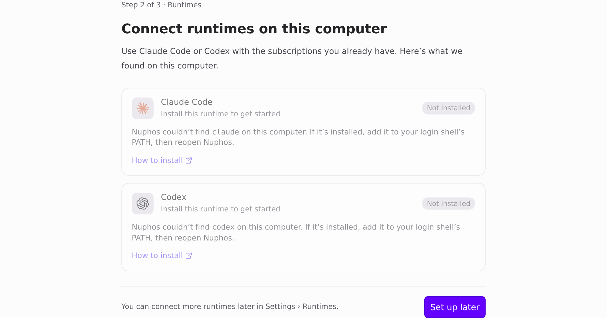
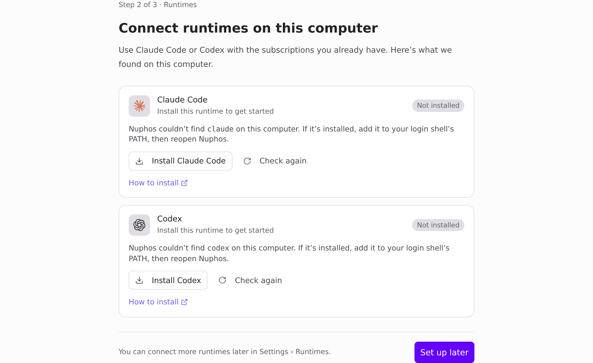
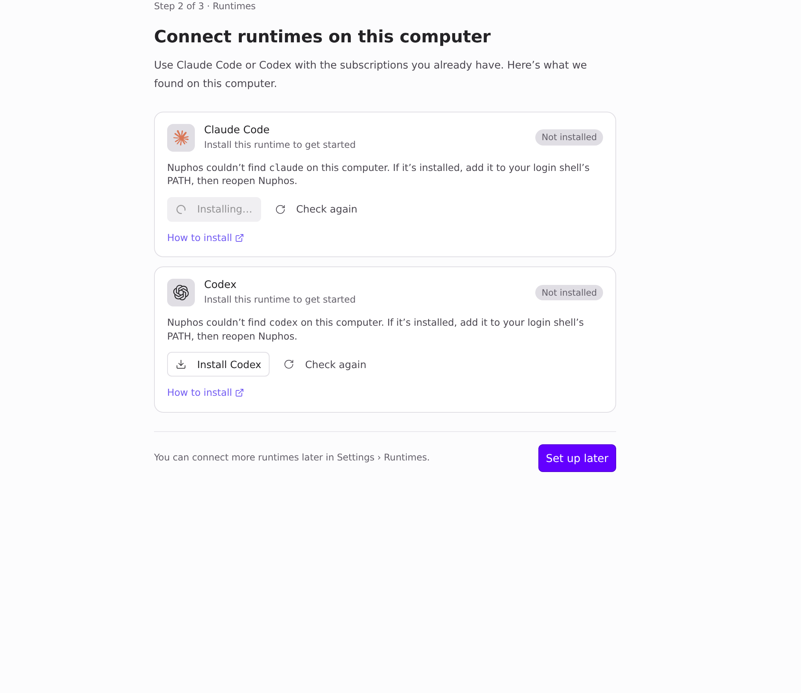

Visuals for HEADSHA

Light theme. Page-only Playwright captures of the real onboarding step `LocalAgentsStep`. Fixture state: neither `claude` nor `codex` is installed; `window.api` is stubbed. Before is main 011a9f19, after is this branch. (The footer still says "Settings › Runtimes" here; #1584 fixes that copy.)

| Before (main): no button | After: Install + Check again |
| --- | --- |
|  |  |

### After: installing

