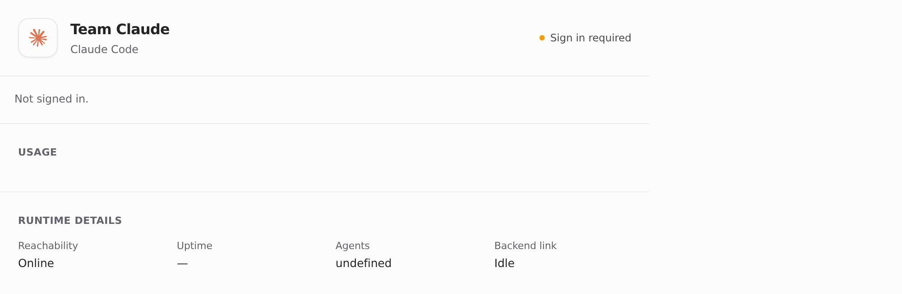
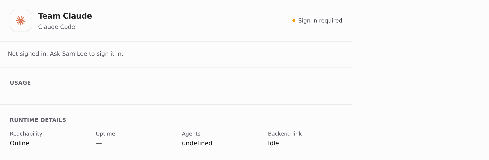
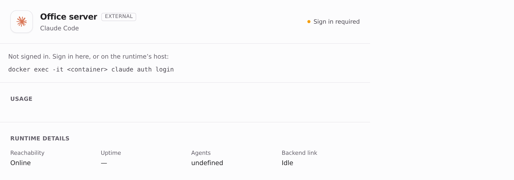
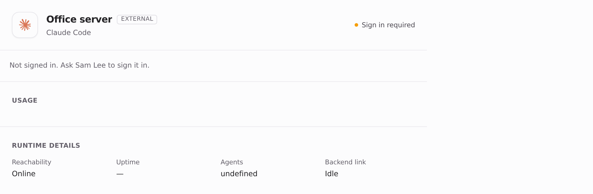
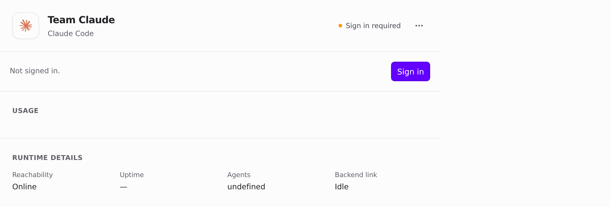

Visuals for HEADSHA

Light theme. Page-only Playwright captures of the real Desktop `RuntimeInstanceCard`. Fixture data only: member Alex Rivera is the viewer, Sam Lee is the team's administrator, and the runtime status reports `authenticated: false`. `window.api` is stubbed. Before is main 011a9f19, after is this branch.

### Cloud runtime, viewed by a member

| Before (main) | After |
| --- | --- |
|  |  |

### Self-hosted runtime, viewed by a member

| Before (main): "Sign in here" with no button | After |
| --- | --- |
|  |  |

### Admin view (after, unchanged)

