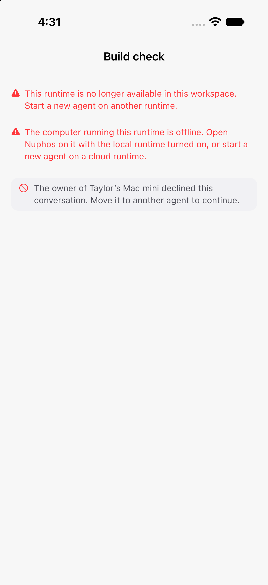
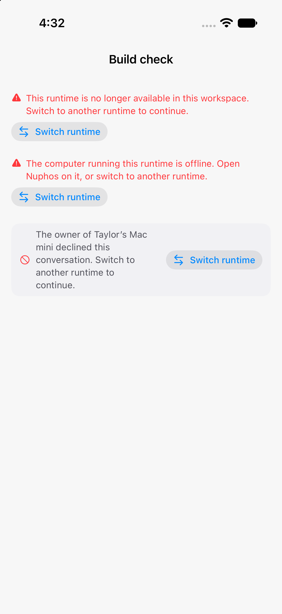
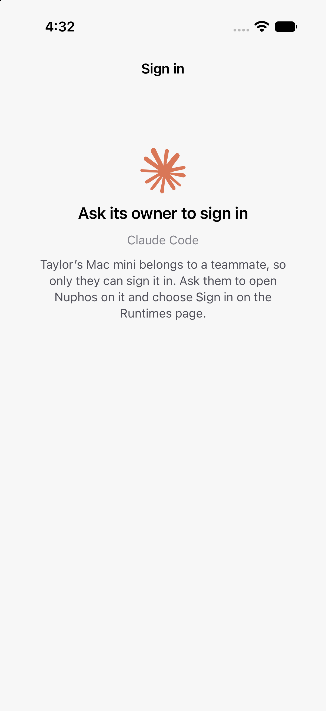
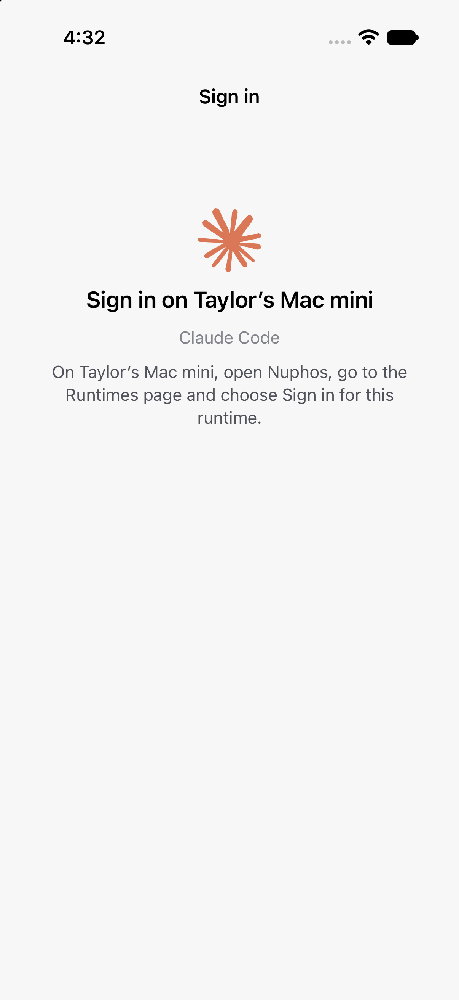

Visuals for HEADSHA

iPhone 17 simulator (iOS 27.2), light mode, `xcrun simctl io screenshot` of the app only. The real `HintRow`, `ShareApprovalStrip` and `AgentSignInInstructions` views are rendered with fixture data (a runtime on "Taylor’s Mac mini") by a temporary capture screen that isn't part of this PR. Before is main 9d75be97, after is this branch.

### Runtime errors and owner declined

| Before (main) | After |
| --- | --- |
|  |  |

### Sign-in instructions, teammate's computer

| Before (main): "Sign in on Taylor’s Mac mini … Settings → Runtimes" | After |
| --- | --- |
|  |  |

### Sign-in instructions, your own computer

| Before (main) | After |
| --- | --- |
|  |  |
