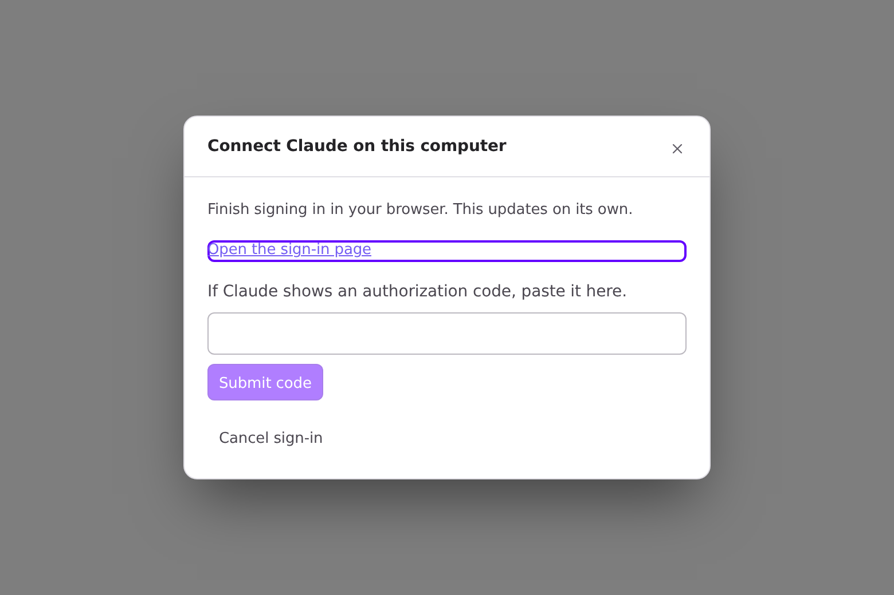
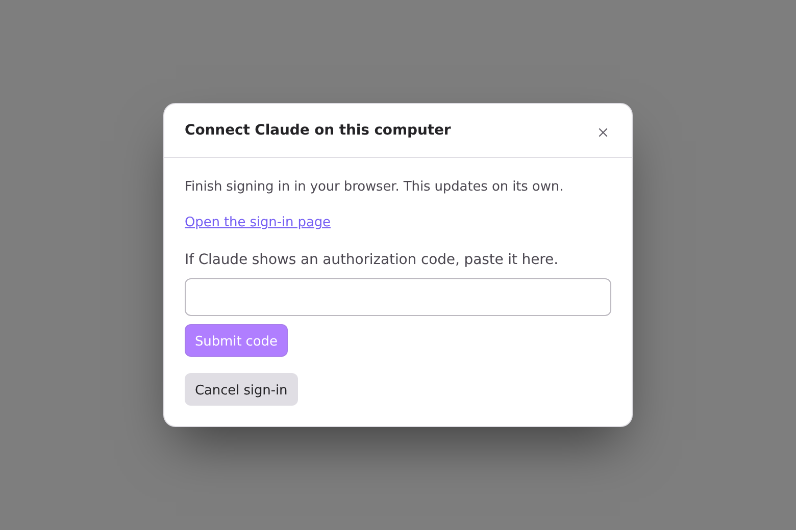
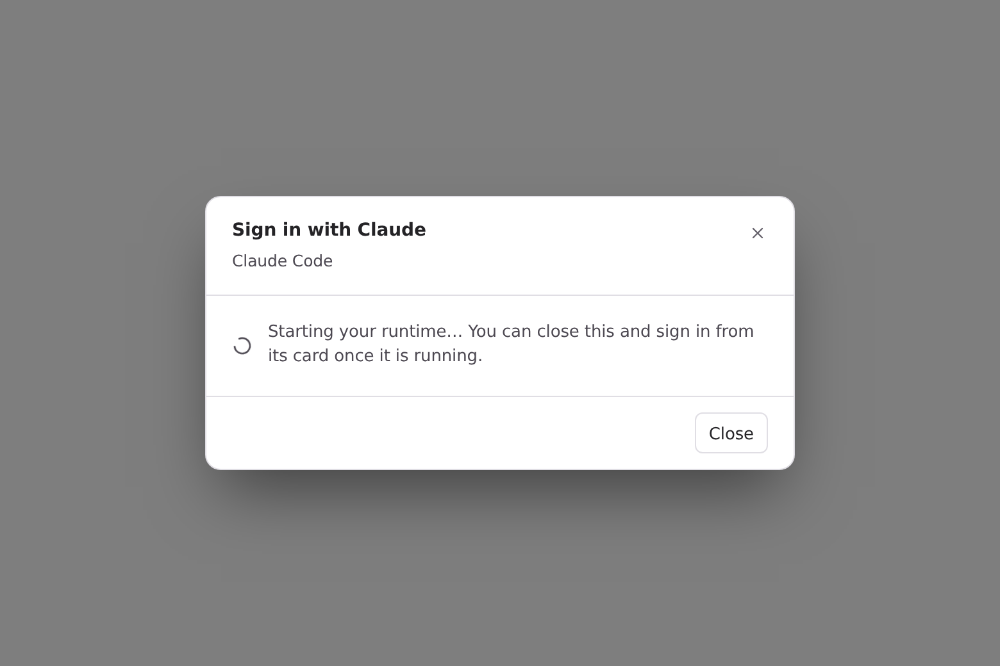
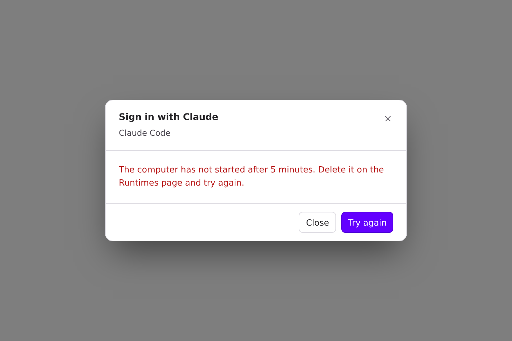
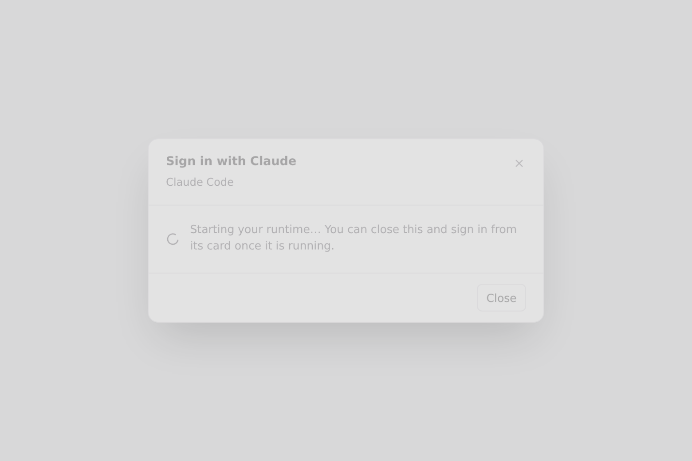
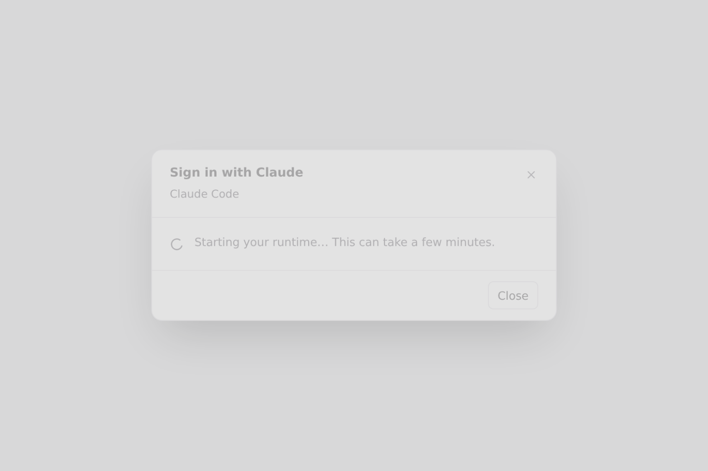

Visuals for HEADSHA

The full set at this head. Light theme, page-only Playwright captures of the real Desktop components, fixture data only, with `window.api` stubbed. Before is main 45122135, after is this branch. **What changed since OLDHEAD:** rebased onto main 45122135, plus a second commit that adds fixes 3 and 4 (the sign-in dialog's cancel, and the endless wait). Fixes 1 and 2 are unchanged and were re-captured at this head.

### 1. Grok Build on this computer, failed turn

| Before (main): no button | After: Sign in and resend |
| --- | --- |
|  |  |

### 2. Outdated runtime, Send reason (measured; the native tooltip doesn't render headless)

| | Send disabled | aria-label | title |
| --- | --- | --- | --- |
| Before (main) | yes | "Send" | none |
| After | yes | "Send (Runtime status unavailable — runtime update required)" | "Runtime status unavailable — runtime update required" |

### 3. Cancel keeps failing (`localRuntimeCancelClaudeLogin` rejects every time)

| Open | Before (main): after 2× Cancel, still open | After: after 2× Cancel, closed |
| --- | --- | --- |
|  |  |  |

### 4. A cloud computer that never comes up (6.5 min on a fake clock)

| Before (main): still spinning, promises a card sign-in | After: timeout reason + Try again |
| --- | --- |
|  |  |

Spinner copy at the start:

| Before (main) | After |
| --- | --- |
|  |  |
