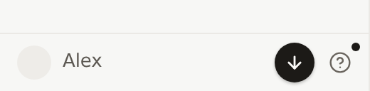
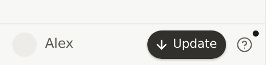
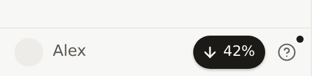
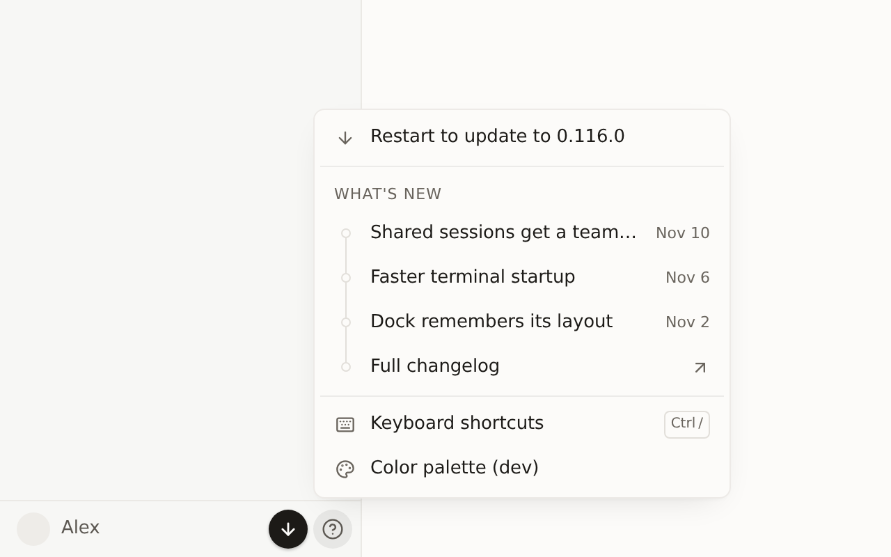
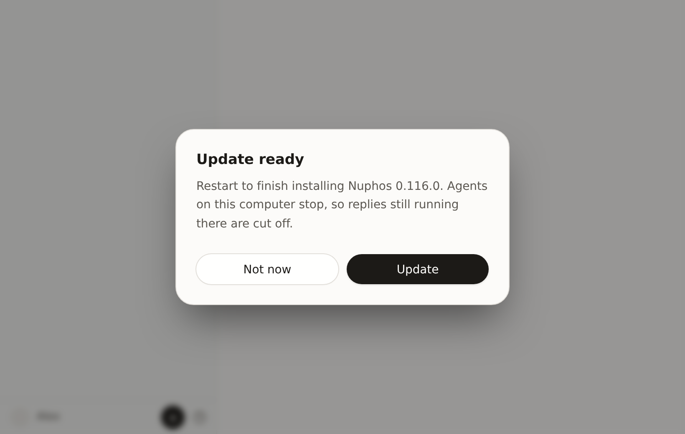
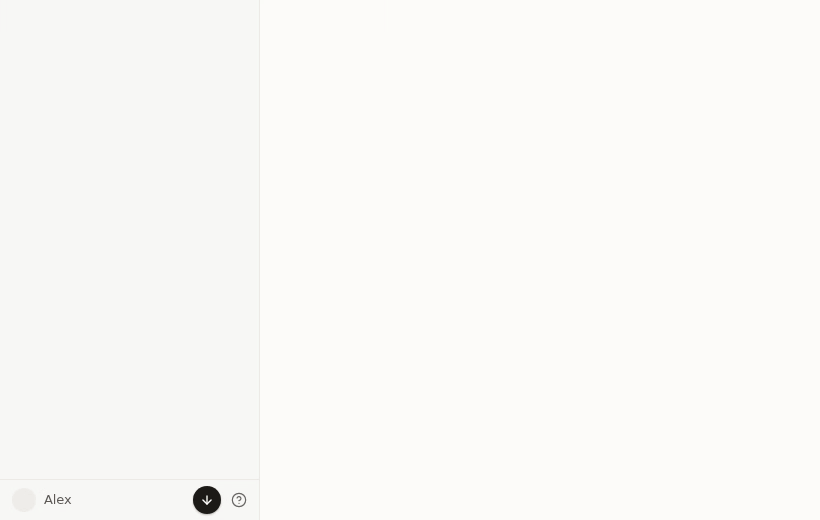

394395b690a379686bd47e4b15df43e0e1b4da83

Light theme, captured from this head: the real `SidebarHelpMenu` and `UpdateDialog` in a Vite harness with a stubbed updater (fake version 0.116.0, placeholder user "Alex"). Images are pinned to commit `2b4ea89f` on `jeun27/nuphos`.

| State | Capture |
|---|---|
| Idle (update ready) |  |
| Hover pill |  |
| Downloading after **Update** (disabled, shows percent) |  |

Help menu, **Restart to update to 0.116.0** row (opens the same dialog):

Dialog:

Hover → click → dialog:

