Visuals for 492df9823c9db4238eb311d7655d2476674a2a4b

Before: main (states 1, 2, 5, 6 at b2e7232; states 7 and 10 at 584e7b9). After: this PR's diff (states 1, 2, 5, 6 captured before the pick-order commit, which doesn't change them; the rest at 492df98's code). Fixture accounts, light theme, no backend.

| State | Before | After |
|---|---|---|
| 1. Fresh signup, no agent | 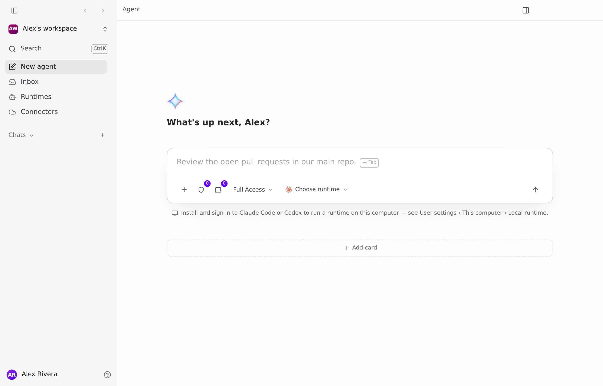 | 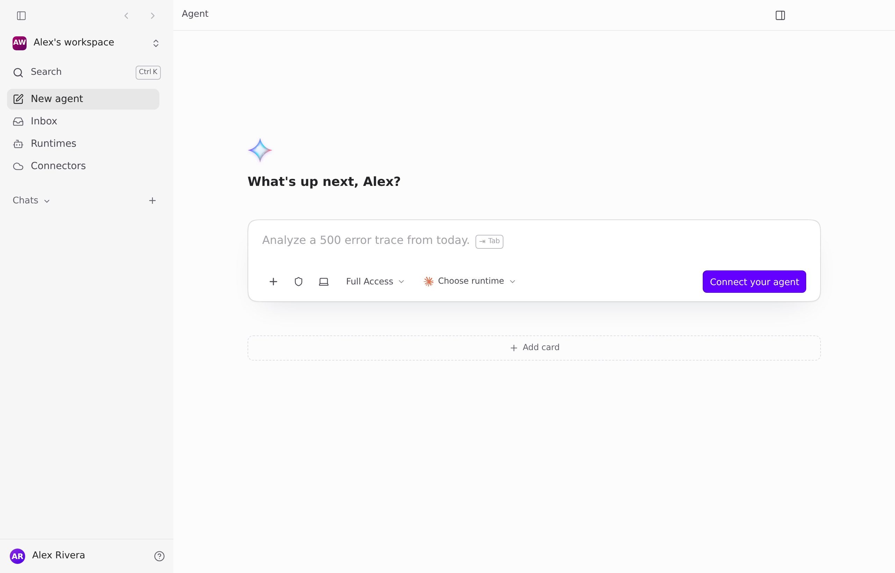 |
| 2. Typed, pressed Enter | 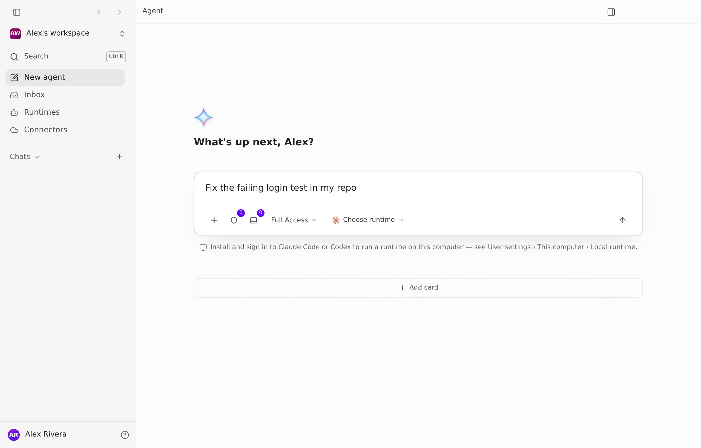 |  |
| 3. Clicked Connect your agent (existing setup) | n/a | 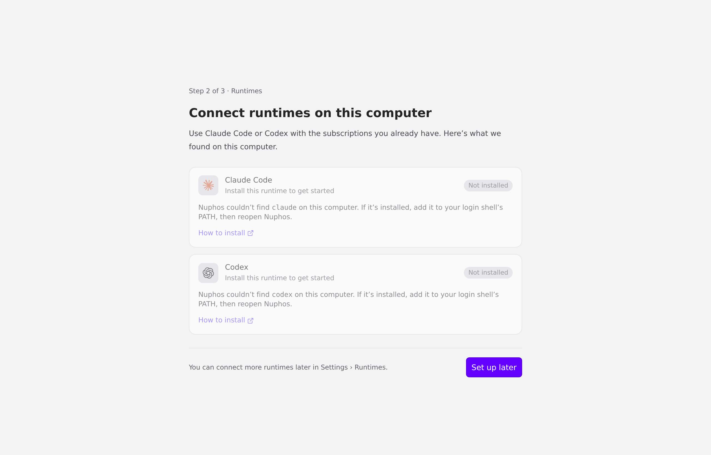 |
| 4. Back from setup: draft kept | n/a | 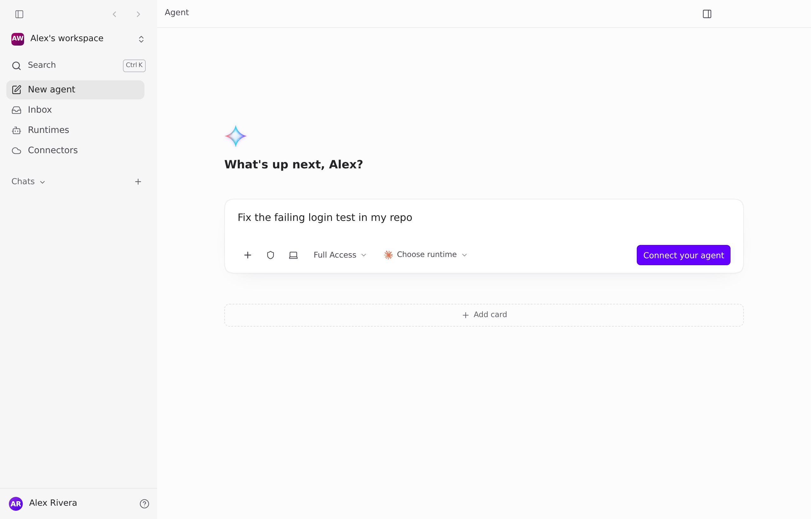 |
| 5. Agent connected, admin, no GitHub | 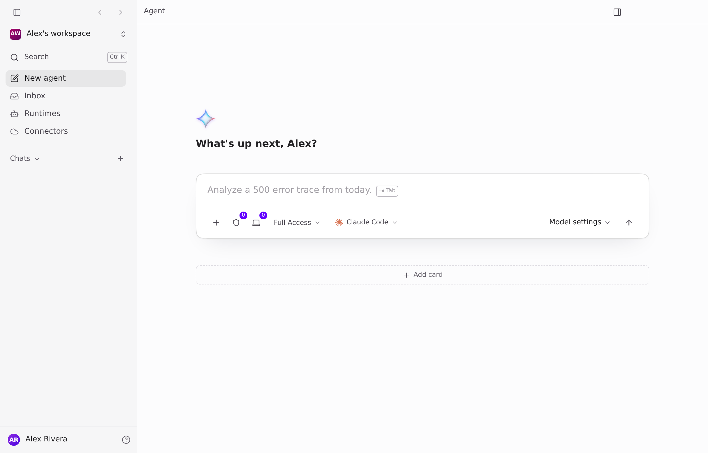 | 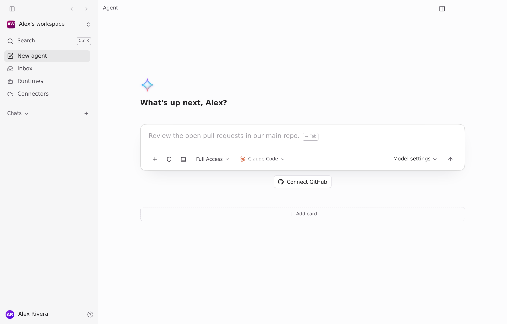 |
| 6. Invited editor, no agent | 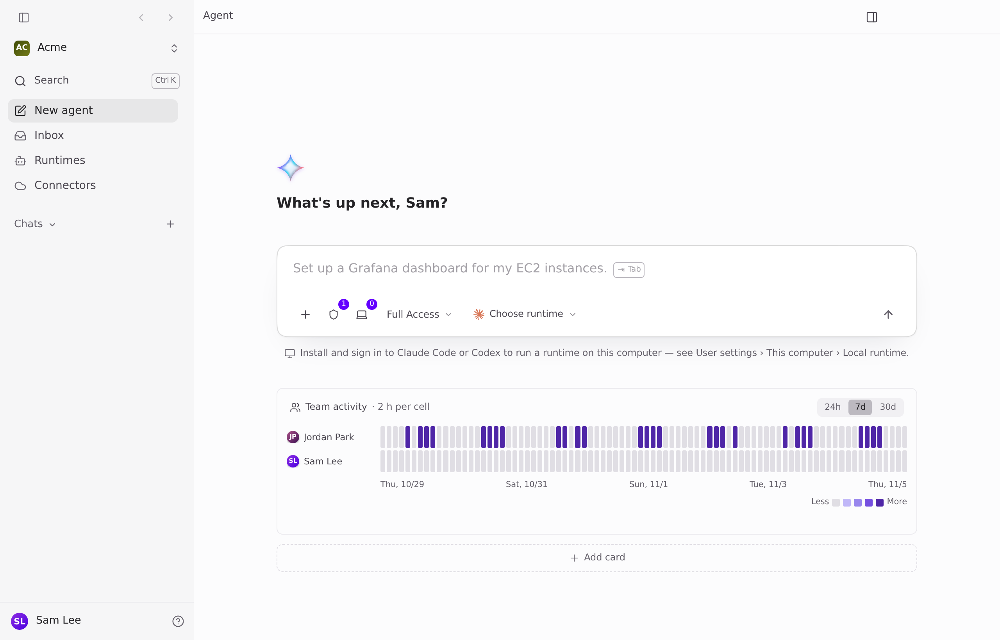 | 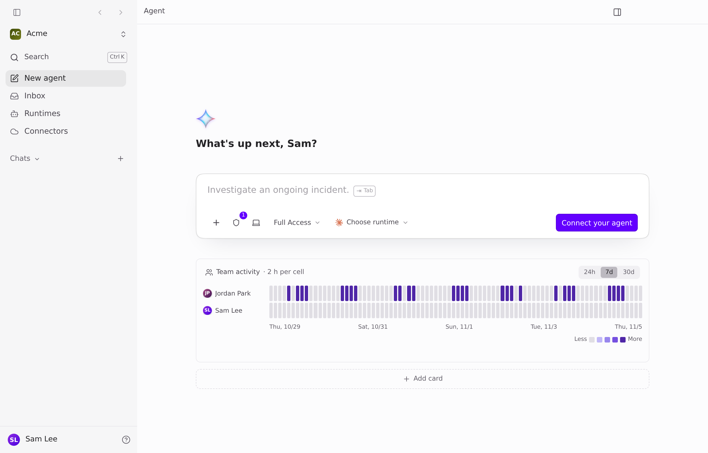 |
| 7. Only agent signed out | 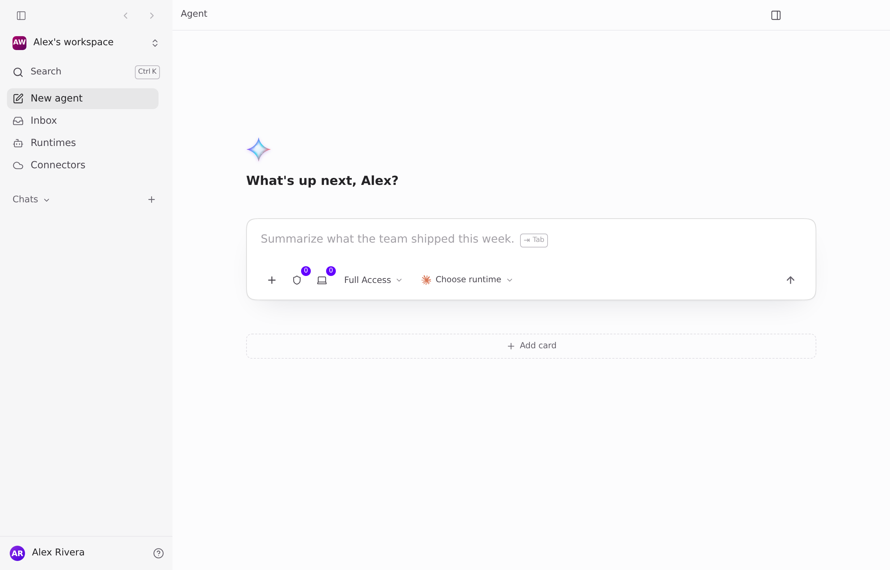 |  |
| 8. Setup: Claude Code signs in | n/a | 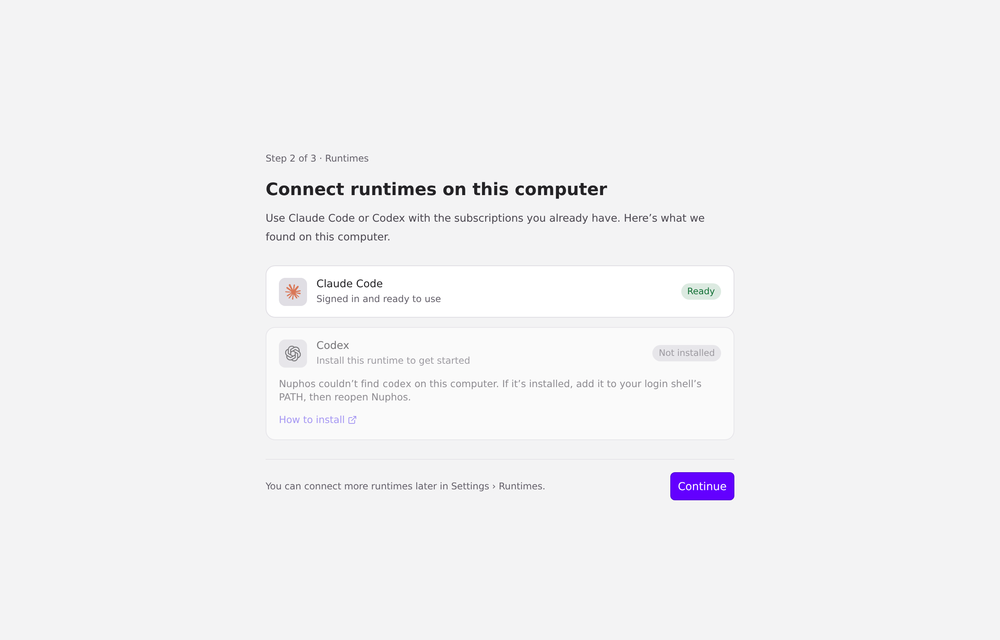 |
| 9. Setup done: Claude Code auto-selected, draft kept, Send on | n/a | 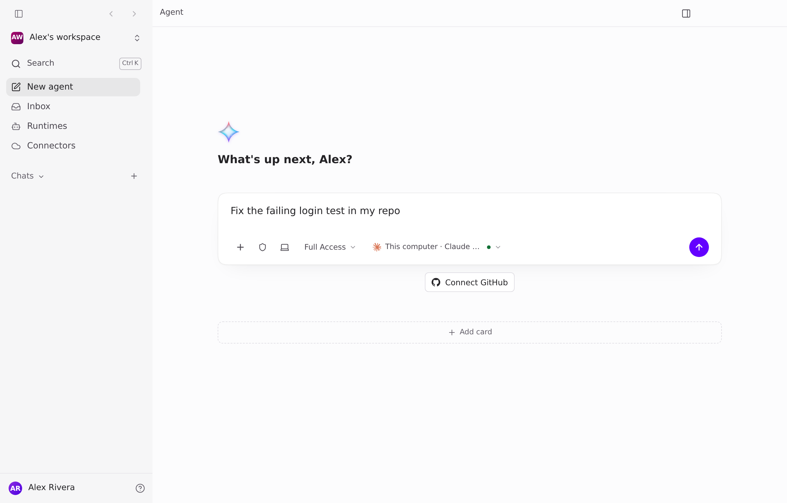 |
| 10. Claude Code here, OpenCode on another computer | 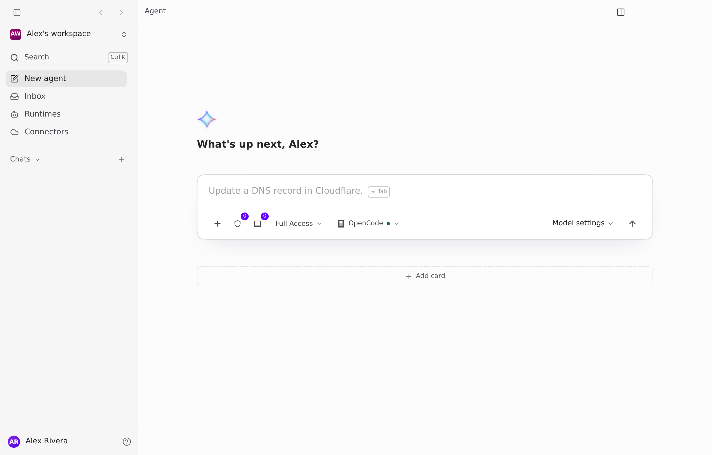 | 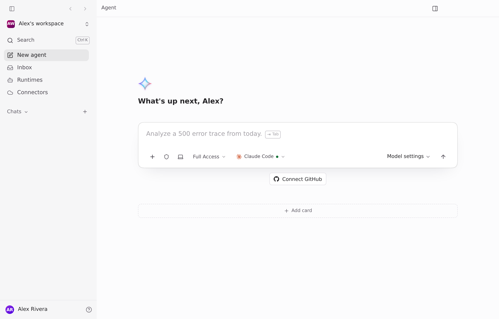 |

Notes: the "0" badges on the credential and computer buttons (states 1, 2, 5, before) are gone after. In 6, the "1" badge stays because the team has a GitHub credential to pick.
