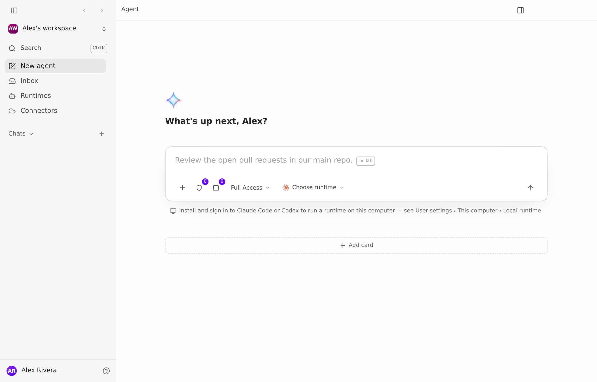
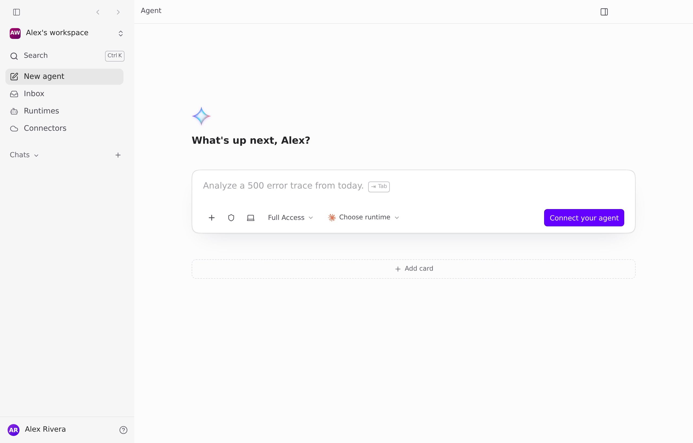
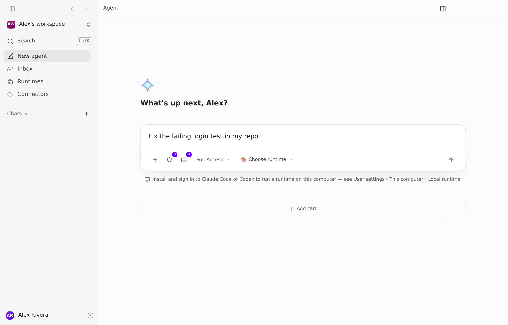
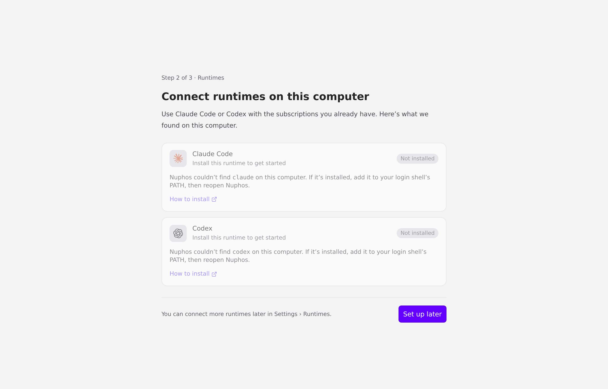
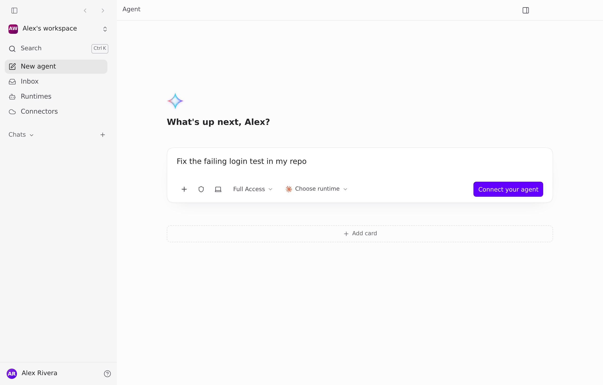
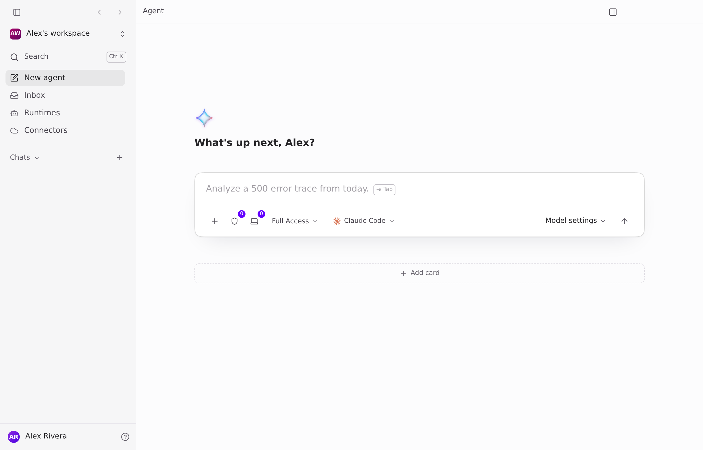
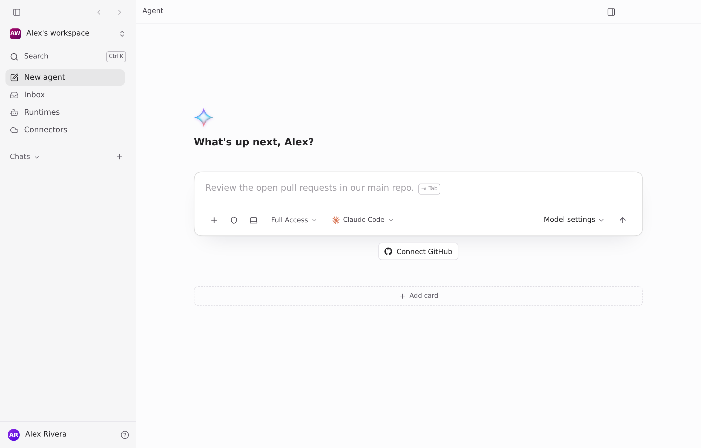
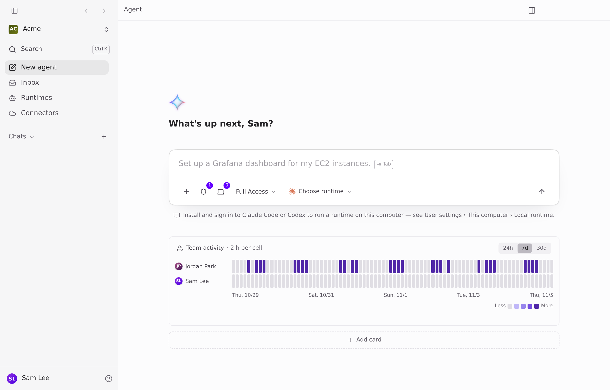
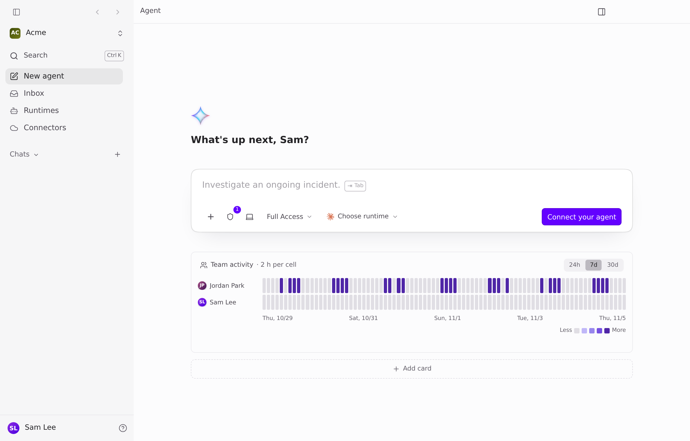

Visuals for 86cbd5e691c21d9dd7cea68af99abafea7c56ef8

Before: main at b2e7232. After: b2e7232 with this PR's diff applied. Head e1efea2 is the same diff on main 584e7b97, which applied cleanly. Page-only captures of the real Desktop renderer with fixture accounts (Alex: new workspace admin; Sam: invited editor to a team with GitHub). Light theme, no backend. Range-diff since e1efea2: one new commit, 86cbd5e, drops ComposerSendControls' unused `streaming` prop (Desktop lint `max-lines` on Composer.tsx). No rendered change, so the captures below are the same full set.

| State | Before | After |
|---|---|---|
| 1. Fresh signup, no agent |  |  |
| 2. Typed, pressed Enter |  |  |
| 3. Clicked Connect your agent (existing setup) | n/a |  |
| 4. Back from setup: draft kept | n/a |  |
| 5. Agent connected, admin, no GitHub |  |  |
| 6. Invited editor, no agent |  |  |

Notes: the "0" badges on the credential and computer buttons (states 1, 2, 5, before) are gone after. In 6, the "1" badge stays because the team has a GitHub credential to pick.
